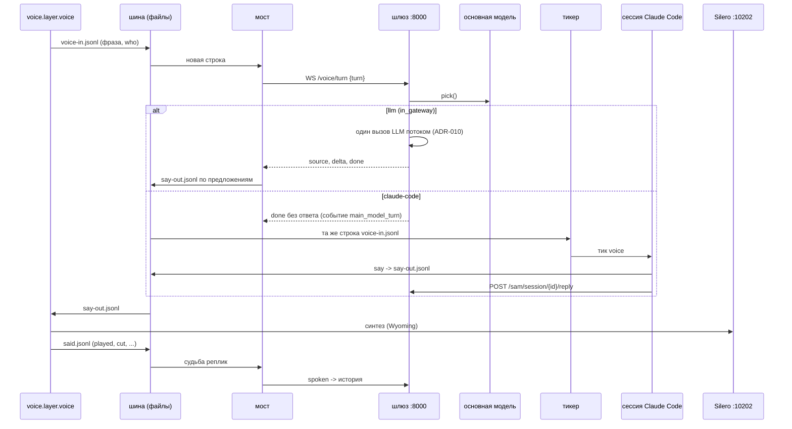
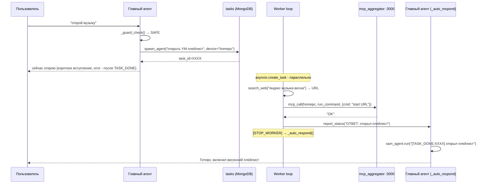
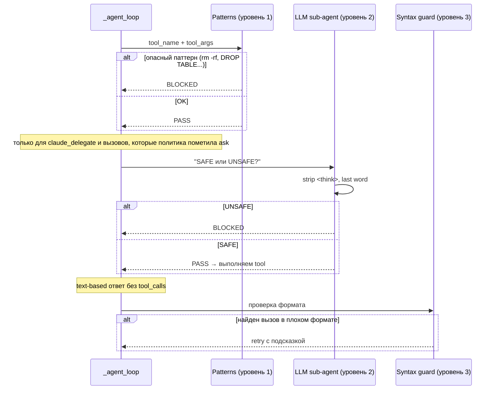

# SAM

SAM (Smart Ambient Mate) - домашняя ИИ-система. Она слышит дом и говорит голосом, помнит людей и договорённости,
замечает сбои и сама их чинит, берётся за дела через агентов, запускает код в песочнице и собирает приложения.

Что есть:

- голосовой ход: слух, опознание говорящего, быстрая модель отвечает сразу, основная дополняет и поправляет;
- память о людях и фактах (MongoDB и Qdrant), сжатие истории с архивом;
- агенты: основная модель разговаривает, дела отдаёт воркерам с правами и бюджетом шагов;
- песочница: контейнер на каждый запуск, сеть только по запросу;
- живые приложения: SAM делает страницу или сервис по просьбе и правит их по ходу разговора;
- монитор: лента событий, настройки, характер, состав дома;
- радар присутствия по Wi-Fi и своя инициатива по расписанию (workflow в папке `workflows/`);
- любой поставщик LLM: Gemini, DashScope, Z.ai, Anthropic, OpenRouter, Polza, локальная LM Studio, Claude Code.

Работает на Windows и Linux.

## Быстрый старт

Нужны Python 3.12, Docker и ключ одного поставщика LLM (или локальная LM Studio).

```bash
git clone https://github.com/sawking-tech/sam-public.git && cd sam-public
cp .env.example .env                       # LLM_SOURCE и ключ поставщика
python3 -m venv .venv && . .venv/bin/activate
pip install -r gateway/requirements.txt
./start_sam.sh                             # Windows: .\start_sam.ps1 -NoLead
```

Монитор: <http://127.0.0.1:8000/monitor>. Настройка на этом закончена. Серверы MCP `fetch` и `time` работают через
[uv](https://docs.astral.sh/uv/); без него они пропускаются.

Кто живёт дома, SAM спросит сама в первом разговоре и запишет. Можно заполнить анкету: вкладка «Дом» в мониторе, имя,
роль и пара слов о каждом человеке и питомце, сколько бы их ни было. Свои правила для SAM - текстом в `data/SAM.md`.
Голос (`pip install -r voice/requirements.txt`) и радар ставятся отдельно, по разделам ниже.

Данные SAM лежат вне git: `.env`, папка `data/`, тома Docker.

## Общая схема

Сверено с кодом 10 окт: точки входа `gateway/main.py`, `gateway/main_model.py`, `voice/layer/*.py`,
`start_sam.ps1`, `scripts/sam_lead.ps1`. Блоки и их справка - раздел «Среда SAM» и `docs/features/stand.md`.

```
Микрофон -> voice.layer.voice (слух, AEC, Whisper, опознание; узел звука TCP :10210)
              │ voice-in.jsonl                                   шина data/voice/bus (файлы)
              ├──> voice.layer.bridge ──WS /voice/turn──> Шлюз :8000 (FastAPI, gateway/main.py)
              └──> voice.layer.ticker ──тики stdout──> сессия Claude Code (Monitor)

Монитор /monitor ──WS /ws/monitor (чат, inject)──> Шлюз
Шлюз: любой вход -> основная модель (gateway/main_model.py, SAM_MAIN_MODELS)
   ├── llm         voice_turn / runner -> agent_loop -> tools ─┬─ remember / list_memories -> MongoDB :27017, Qdrant :6333
   │                                                           └─ spawn_agent -> воркер (фон) ─┬─ search_web
   │                                                                                           ├─ mcp_call -> MCP :3000/mcp
   │                                                                                           └─ claude_delegate -> Claude Code CLI
   ├── claude-code голос: шлюз модель не зовёт, сессия слышит тикером; факты памяти -> тик rag
   │               чат, inject, вопрос и итог агента -> lead-in.jsonl -> тик chat (+ facts) -> сессия
   └── noop        ход принят, ответа нет

Сессия Claude Code ─┬─ say -> say-out.jsonl + POST /sam/session/{id}/reply (монитор, история)
                    ├─ say --text-only -> POST /sam/session/{id}/note (монитор и история, без звука)
                    ├─ POST /sam/agents, POST /sam/inject -> агенты SAM в шлюзе
                    └─ MCP стенда :3000/mcp (подключён один раз, ADR-019)
Ответ шлюза -> мост -> say-out.jsonl -> voice.layer.voice (озвучка) -> Silero :10202 -> колонки
                       said.jsonl (судьба реплик) -> мост -> spoken -> история шлюза (ADR-013)
MCP :3000 = mcp/mcp_aggregator.py, серверы из mcp/configs/local.json: playwright, control, radar, skills, windows,
            filesystem, fetch, git, time
```


## Sequence Diagrams

### 1. Голосовой ход (end-to-end)



### 2. spawn_agent → Worker → Voice response



### 3. Guard check




## Принцип работы

**Оркестратор и воркеры** (ADR-005): главный агент на разговор отвечает сам, действие на устройстве или поиск отдаёт `spawn_agent` (старое имя `create_task` осталось алиасом). Правило «всё через задачу» отменено в SAM-35 (15e2fb9).

Воркер запускается через `asyncio.create_task` без предварительного планирования: задача описывается строкой `description`, воркер сам решает, как её выполнить. Завершённый воркер остаётся idle-сессией и оживает по `send_to_agent` (SAM-38).

**report_status → TASK_DONE поток:**
1. Воркер вызывает `report_status("ОТВЕТ: текст")`
2. `_impl_report_status` пишет ответ через `set_last_answer` (`gateway/worker.py`) и возвращает `"[STOP_WORKER]"`
3. `run_agent_loop` видит `[STOP_WORKER]` → выходит из loop, возвращает захваченный ответ
4. `run_worker_task` (`gateway/worker.py`) отдаёт итог `deps.auto_respond`: маршрутизатор `done_router`
   (`gateway/tools/agents.py`) несёт его основной модели вне шлюза или агенту-создателю, иначе зовёт
   `_auto_respond(short_id, result, parent_session, llm_config)`
5. `_auto_respond` делает `sam_agent.run("[TASK_DONE:XXXX] ...", _system_call=True)` - fire-and-forget
6. Главный агент получает TASK_DONE, перефразирует живым языком и отвечает речью

**background-first:** максимум работы в фоне, минимум касаний браузера.
`search_web` → URL → `mcp_call(run_command/browser_navigate)` - браузер открывается с готовым URL.

**Голосовая система:** звучит весь ответ, кроме мета-блоков в парных тегах `<имя>...</имя>` (раздел «Речь»).

**Сессионная история:** сохраняется между перезапусками gateway; очистка при старте - только с `RESET_HISTORY_ON_START=true` (`gateway/agent.py:108`).
RAG-память (`_memories`, каталог) сохраняется всегда.

**Поиск по памяти (SAM-102):** гибридный, `RAGStore.search` в `gateway/rag.py`. Две ветки: вектор (эмбеддер `paraphrase-multilingual-MiniLM-L12-v2`, Qdrant, порог 0,5) и слова - BM25 по тексту, summary, вопросам и тегам активных фактов из Mongo (`gateway/lexical.py`: регистр и «ё» нормализуются, окончание отрезается - «партнёр/партнёра/партнёру» дают одну основу). Ветки сливаются Reciprocal Rank Fusion (k=60), при равной сумме выше найденное по словам. Порог режет только вектор: факт со словом запроса находится и при слабом векторе. Запрос из одного слова (имя) вектор почти не различает - замер 10 окт: на «партнёр» «День рождения партнёра» у вектора последний (0,285), а правило про тон первое (0,515); для такого запроса сначала идёт найденное по словам, вектор дополняет. Эмбеддер - свой долгоживущий процесс (SAM-172, `gateway/embedder_service.py`, `:10204`, `SAM_EMBEDDER_URL`; `start_sam.ps1` поднимает его вкладкой рядом с Silero): модель грузится раз на стенд, рестарт шлюза её не трогает - первый поиск после рестарта 0,32 с против 28,8 с холодной загрузки (замер 12 окт). Процесса нет - шлюз грузит модель сам фоном на старте; пока она грузится, поиск идёт одними словами и загрузку не ждёт. Все async-вызовы поиска - в потоке (`asyncio.to_thread`). Проверка дубля у автозаписи фактов ищет только по вектору (`lexical_branch=False`): её порог - косинус.

| Переменная | По умолчанию | Что |
|---|---|---|
| `SAM_RAG_LEXICAL` | 1 | 0 - поиск только по вектору, как до SAM-102 |
| `SAM_RAG_RRF_K` | 60 | k слияния RRF (Cormack et al. 2009) |
| `SAM_RAG_SHORT_QUERY_TOKENS` | 1 | запрос из стольких слов и короче - поиск по имени, вектор после слов |
| `SAM_RAG_BM25_K1`, `SAM_RAG_BM25_B` | 1.2, 0.75 | параметры BM25, общепринятые, на памяти SAM не подбирались |
| `SAM_RAG_LEXICAL_SCAN` | 5000 | сколько фактов читает лексическая ветка за поиск; 10 окт в памяти 4 факта |


## LLM стратегии (prompt_format)

Разные модели используют разные форматы tool calls. `llm_router.py` определяет `prompt_format` по имени модели:

### harmony - gpt-oss-20b (OpenAI Harmony)

Модель пишет tool calls специальными токенами:
```
<|channel|>commentary to=functions.TOOL_NAME <|constrain|>json<|message|>{"arg": "val"}<|call|>
```
Финальный голосовой ответ:
```
<|channel|>final <|constrain|>voice<|message|>Текст для TTS
```
- Stop tokens: `<|call|>`, `<|return|>`
- System prompt автоматически дополняется инструкцией по каналам

### qwen / standard - Qwen3, другие модели

Модель пишет tool calls через теги:
```
<tool_call>{"name": "TOOL_NAME", "arguments": {"arg": "val"}}</tool_call>
```

Также поддерживается `[tool_name("arg")]` формат (Qwen иногда использует его вместо нативного API).

### Нейтральное хранение в MongoDB

Tool calls сохраняются нейтрально (не зависит от модели):
```json
{"role": "tool_call", "tool_name": "create_task", "tool_args": {"description": "..."}}
```

При построении истории для LLM форматируется под текущую модель (`prompt_format`).

### Детектор формата (llm_router.py)

```python
if "gpt-oss" in model_id or "harmony" in model_id:
    prompt_format = "harmony"
elif "glm" in model_id or "chatglm" in model_id:
    prompt_format = "glm"
elif "gemma" in model_id:
    prompt_format = "gemma"
elif "qwen" in model_id:
    prompt_format = "qwen"
else:
    prompt_format = "standard"
```

Отдельной обработки у `glm` и `gemma` нет: в цикле агента они идут как `standard`.

**Рекомендация:** использовать qwen3.5-9b или qwen2.5-14b. gpt-oss-20b ненадёжен (Harmony формат нестабилен).


## Файлы проекта

| Файл | Описание |
|------|----------|
| `gateway/main.py` | FastAPI роутер - только маршрутизация |
| `gateway/agent.py` | Регистрация tools и их обёртки, сборка зависимостей, создание задач (2586 строк); цикл - `agent_loop.py`, ход - `runner.py`, воркер - `worker.py`, guard - `guard.py` |
| `gateway/agent_budget.py` | Шаги агентов: пул на дерево задач, квота обращений по каналам |
| `gateway/push_queue.py`, `gateway/push_dispatch.py` | Очередь push: вход workflow к основной модели пачками (ADR-020) |
| `gateway/event_bus.py` | EventBus: broadcast WS + persist MongoDB + inject queue |
| `gateway/llm_router.py` | LLM выбор по типу задачи + prompt_format детект |
| `gateway/catalog.py` | MongoDB CRUD: устройства / люди / питомцы |
| `gateway/tasks.py` | MongoDB task schema, CRUD, TTL-индекс, cancel |
| `gateway/rag.py` | Память: Mongo - факты, Qdrant - векторное оглавление, гибридный поиск (SAM-102) |
| `gateway/lexical.py` | Лексическая ветка поиска по памяти: основы слов, BM25, слияние RRF (SAM-102) |
| `gateway/static/monitor.html` | WebSocket монитор событий: разметка, стили и один модуль `monitor/main.js` |
| `gateway/static/monitor/` | Модули монитора (SAM-230): `events.js` - разбор событий и снимка, `feed.js`, `sections.js`, `calls.js`, `live-rows.js` - лента, `blocks/` - блок записи по типу (данные -> HTML, тест в `tests/js/monitor`), `main.js` - корень сборки |
| `mcp/mcp_aggregator.py` | Агрегатор: несколько MCP серверов → один порт |
| `mcp/windows_control_server.py` | Windows: run_command, powershell, show_notification, get_windows, get_audio_state, screenshot |
| `mcp/client_agent.py` | Регистрация + heartbeat на клиентском ПК |
| `mcp/configs/local.json` | Конфиг MCP серверов устройства |
| `mcp/radar_server.py` | Переходник MCP к ручкам радара (`radar_where`...) для моделей без `app_call`: Cortex, сессия только с MCP стенда |
| `radar/` | Радар присутствия отдельным приложением (SAM-198): сервис `presence_service.py`, страница и three.js в `radar/static/`, каркас страницы - из `gateway/static/shell/` |
| `radar/presence_sam_api.py` | Ручки радара для SAM: шесть маршрутов `/sam/tools/*` с меткой `x-sam-tool`, вызов - `app_call(radar, where, {person})` |
| `radar/presence_answers.py` | Ответы радара словами: разбор момента, строка истории, мебель комнаты, разметка, «со слов» |
| `gateway/app_tools.py` | Ручки приложения для SAM: методы OpenAPI с меткой и поле `tools` манифеста, сборка вызова `app_call` |
| `tests/` | pytest: 1987 тестов, по умолчанию идут 1980 (маркеры `integration` и `quality` исключены в `pytest.ini`) |


## Инструменты

Жизнь задачи воркера и пул шагов - `docs/features/workers.md`; цикл агента и защита от петель -
`docs/features/agent-loop.md`; запись и поиск фактов - `docs/features/memory-search.md`.

### Главный агент (MAIN_TOOL_NAMES)

`search_web` и `claude_delegate` у главного агента нет, они у воркера. Список - `MAIN_TOOL_NAMES` (`gateway/agent.py:1503`).

| Tool | Описание |
|------|----------|
| `remember` | Сохранить факт → Qdrant + MongoDB |
| `update_memory` | Обновить/удалить факт |
| `list_memories` | Поиск по памяти: слова (BM25 по Mongo) и смысл (Qdrant), SAM-102 |
| `forget`, `forget_topic` | Удалить факт или все факты темы |
| `get_devices` | Список онлайн-устройств с presence_score |
| `get_catalog` | Инфо о людях / устройствах / местах |
| `set_household_member` | Занести человека или питомца в состав дома: имя, роль, коротко о нём |
| `wake_device` | Wake-on-LAN |
| `spawn_agent` | Запустить воркера в фоне (алиас `create_task`) |
| `list_agents` | Активные и idle воркеры (алиас `get_tasks`) |
| `send_to_agent` | Инструкция работающему воркеру или оживление idle (алиас `send_to_task`) |
| `cancel_agent` | Отменить воркера (алиас `cancel_task`) |
| `grant_steps` | Выдать агенту ещё шагов по его просьбе (раздел «Guard», шаги агентов) |
| `tune_self`, `get_self_config` | Runtime-настройки SAM |
| `soul_show`, `soul_edit`, `soul_rollback` | Душа SAM - свой характер: показать, заменить раздел, откатить (правка и откат - с ключом команд) |
| `list_capabilities` | Что SAM умеет |
| `load_skill`, `sync_skills` | Тело скилла по имени; сверка скиллов с памятью (раздел «Скиллы по запросу») |
| `quiet` | Тихий режим сессии (`gateway/quiet_mode.py`) |
| `set_env`, `get_env`, `list_env` | Ключи и токены в `.env` |
| `switch_main_model` | Без рестарта шлюза: `main` - кто основная (`claude-code` - ведущий, `llm` - модель шлюза; порядок пишется в `SAM_MAIN_MODELS`, SAM-176), `source` - поставщик модели шлюза (`LLM_SOURCE`, `LMSTUDIO_MODEL`, SAM-129); недоступное не ставится; тот же вход - `POST /sam/main-model {main, source, model}` |
| `compress_session` | Явное сжатие истории |
| `restart_component` | Перезапустить компонент стенда без вопроса (SAM-195), если его health check не ok (`force` - без проверки, после правки кода): `gateway` (после ответа, надзиратель поднимает), `mcp`, `voice`, `bridge`, `tts`, `embedder`, `client`, `cosy`, `radar`, `cortex`; команда - `SAM_RESTART_CMD_<ИМЯ>`, на Windows по умолчанию ключ `start_sam.ps1` (`gateway/restart.py`) |

### Воркер (WORKER_TOOL_NAMES)

| Tool | Описание |
|------|----------|
| `list_memories` | Проверить что знаем о теме |
| `search_web` | HTTP поиск (Invidious → Google CSE → DuckDuckGo) |
| `mcp_call` | Вызвать инструмент на удалённом ПК |
| `sandbox_run` | Свой код в изолированном контейнере: файлы, команда, итог; страница или картинка - в мониторе (`docs/features/sandbox.md`) |
| `sandbox_exec` | Кусок кода в тёплом контейнере беседы за миллисекунды: Python с переменными между вызовами, shell, node, DuckDB (`docs/features/sandbox.md`, «Быстрая песочница»); у основного агента и воркеров |
| `app_make`, `app_update`, `app_list`, `app_stop` | Живое приложение: `app_make` всегда делает новое и отвечает slug и адресом `/apps/<slug>` (в каркасе SAM), правка и остановка - по slug или id; закрепление, настройки и каркас - полями `pinned`, `settings`, `shell` (`docs/features/apps.md`) |
| `claude_delegate` | Делегировать задачу агенту кода - Claude Code или OpenCode (код, файлы, git), раздел «Агенты кода» |
| `list_capabilities` | Что SAM умеет |
| `load_skill` | Тело скилла по имени |
| `report_status` | Отправить статус / финальный ответ (`"ОТВЕТ: ..."`) |
| `estimate_steps`, `request_steps`, `grant_steps` | Оценка шагов задачи, просьба о шагах к создателю, выдача шагов своему агенту |
| `ask_creator` | Спросить создателя о контексте: вопрос пишется в задачу (`questions`), виден в мониторе, агенту основной модели вне шлюза приходит во входящие; воркер не ждёт ответа |
| `restart_component` | Перезапустить компонент стенда без вопроса, как у основного агента |


## MongoDB схема

### sessions - история диалога

```json
{"session_id": "homepc", "role": "user",      "content": "текст",              "timestamp": "..."}
{"session_id": "homepc", "role": "assistant",  "content": "...", "timestamp": "..."}
{"session_id": "homepc", "role": "tool_call",  "tool_name": "create_task", "tool_args": {}, "timestamp": "..."}
{"session_id": "homepc", "role": "summary",    "content": "резюме...",     "time_range": "10:00–10:30"}
```

Воркеры пишут в `task:XXXXXX` сессии (отдельно от пользовательской).
История сохраняется между стартами gateway, очищается только с `RESET_HISTORY_ON_START=true`. RAG-память (`_memories`) - персистентна.

### tasks - задачи

```json
{
  "id": "uuid",
  "description": "открыть ЯМ весенний плейлист",
  "device": "homepc",
  "status": "pending|running|done|failed|cancelled",
  "stages": [
    {"name": "plan",    "status": "done"},
    {"name": "execute", "status": "running|done|failed"}
  ],
  "current_stage": 1,
  "expires_at": "...",
  "result": "..."
}
```

TTL: done=24ч, failed/cancelled=2ч, не запустился=15мин (MongoDB TTL-индекс, автоудаление).

В `tasks.py` есть расширенная схема stages с `dod`, `dod_check`, `on_fail`, `max_retries` - задел для будущего. Сейчас задача создаётся без этапов (stages=[]); событие `task_created` (`_launch_worker`) и `stage_update` воркера (`gateway/worker.py`) показывают plan+execute как псевдо-этапы.


## Guard (трёхуровневый)

```
Уровень 0 - политика tools (SAM-79, gateway/tool_policy.py, gateway/tool_policy.json, SAM_TOOL_POLICY):
  правило tool(шаблон) -> allow | ask | deny, побеждает последнее подходящее;
  deny - вызов не исполняется; ask - вызов идёт к LLM-судье уровня 2 у любого tool.
  По умолчанию: mcp_call powershell, run_command, bg_start и open_terminal с командой - ask; set_env - deny,
  кроме PLAYWRIGHT_MCP_EXTENSION_TOKEN; любой tool, в аргументах которого назван privilege.key, - deny (SAM-177).
  Команда только на чтение из read_only_commands (gateway/readonly_command.py, SAM-127) идёт без судьи.

Уровень 1 - паттерны (мгновенно, все tools):
  rm -rf, format c:, del /s /q, chmod 777, curl|bash, /etc/shadow, DROP TABLE,
  > /dev/sda, mkfs, :(){:|:&};:, ...

Уровень 2 - LLM sub-agent (claude_delegate и всё, что политика пометила ask):
  "SAFE или UNSAFE?" → strip <think>, берём последнее слово

Уровень 3 - syntax guard (text-based ответы без tool_calls):
  Проверяет нет ли вызова в неправильном формате → блокирует + retry
```

**Loop guard:** если один и тот же инструмент вызывается 3+ раз подряд - инжектируется подсказка с накопленными результатами. При 5+ вызовах - `tool_choice="none"` (принудительный текстовый ответ).

**Опрос без прогресса (SAM-80):** тот же вызов с тем же результатом `SAM_NO_PROGRESS_LIMIT` раз (3) - событие `no_progress`, модели подсказка, следующий шаг без tools.

**Лимит воркеров (SAM-80):** одновременно не больше `SAM_MAX_WORKERS` (4); лишний `spawn_agent` получает отказ одной строкой. Глубина - 1: у воркера шлюза нет `spawn_agent`; агент Cortex
основной модели создаёт не больше одного агента, тот - ни одного (`SAM_AGENT_MAX_DEPTH`, `SAM_AGENT_MAX_CHILDREN`, по 1;
ADR-022).

**Шаги агентов (ADR-022, «Шаги - пул на дерево»; `gateway/agent_budget.py`):** шаг - одно обращение агента к модели.
Пул задачи - меньшая из двух прикидок: создателя (`steps` у `spawn_agent` и `POST /sam/agents`, по умолчанию
`SAM_AGENT_STEPS`, 30, не больше `SAM_AGENT_STEPS_CAP`, 100) и самого агента (`estimate_steps` в первом ответе).
Ребёнку пул выделяется из остатка родителя. На доле `SAM_AGENT_BUDGET_WARN` (0,8) агент получает подсказку, не хватает -
`request_steps` с причиной, создатель выдаёт `grant_steps` или отказывает; неистраченное закрытой задачи возвращается
родителю. Оборот, в котором агент зовёт только каналы (`ask_creator`, `request_steps`, `estimate_steps`,
`report_status`, `send_to_agent`, `grant_steps`), шага не стоит; таких обращений на задачу не больше
`SAM_AGENT_CHANNEL_CALLS` (10), дальше `ask_creator` и `request_steps` отвечают «решай сам».

**Идемпотентность:** дублирующие tool calls с теми же аргументами в рамках одного loop игнорируются (кроме readonly инструментов: `search_web`, `screenshot`, `get_windows`, `tools/list`, ...).


## Контекстное сжатие

Как работает сжатие - `docs/features/compression.md`, когда запускается - `docs/features/memory-in-pauses.md`.

```
Контекст хода (gateway/runner.py build_messages):
  system prompt + время + факты памяти (поиск на входе) + сводки (role: summary) из MongoDB
  + реплики после сводок дословно + текущая фраза

Сжатие (меняет MongoDB, gateway/compression.py compress_session_history):
  фоном после записи реплики (ниже), явно - compress_session или POST /sam/sessions/{id}/compress
  старое за окном -> сводки role: summary, оригиналы - в архив (ADR-008); окно - дословно
```

`compress_context` в `gateway/agent.py` (факты, сводка из `_sessions_meta`, последние 15 сообщений) больше никем не
вызывается.

**Сжатие в паузах (SAM-62, ADR-015):** сырое окно считается в токенах: последние сообщения в пределах `SAM_COMPRESS_KEEP_TOKENS` (600), не больше 20 и не меньше последнего обмена; сжатие ставится, когда за окном 4 сообщения или `SAM_COMPRESS_CHUNK_TOKENS` (250) токенов. Токены - по символам, `SAM_CHARS_PER_TOKEN` (3,3, замер на записях разговоров 8 окт). Длинные реплики уходят в сводку раньше, короткие держатся дословно дольше. Сжатие ставит шина после записи реплики в историю (`gateway/compression_watch.py`, SAM-97), а не ход модели шлюза: при основной модели вне шлюза (claude-code) история сжимается так же; сводку пишет основная модель роутера. Фоновое сжатие ждёт ворот простоя (`gateway/idle_gate.py`): текстовый и голосовой ход закрывают их на всё время хода и ещё `SAM_IDLE_S` (30 с) после; дольше `SAM_COMPRESS_IDLE_MAX_S` (300 с) не ждёт. Несжатое в базе на потолке `SAM_COMPRESS_CEILING` (28 сообщений) или `SAM_COMPRESS_CEILING_TOKENS` (окно плюс кусок, 2100 токенов) сжимается сразу. Проход берёт всё, что старше окна, одним снимком и режет на куски до `SAM_COMPRESS_CHUNK_MAX_TOKENS` (1500 токенов, не меньше 4 сообщений) - вызов сводки на кусок; записи во время прохода ждут следующего. После прохода `SAM_COMPRESS_MIN_GAP_S` (60 с) новая запись ниже потолка проход не ставит: в потоке реплик хвост копится до куска, а не сжимается по 1-3 сообщения. В ленте монитора вызовы сводки не идут строками `llm_request`: одна строка хода сжатия (`compression_progress`) обновляется на месте и закрывается `context_compressed`. Состояние - раздел `compression` в `/health` и шапка монитора, сигнал - строка `compress:<сессия> stalled` в `scripts/stand_watch.py`. Отмена посреди сжатия и очередь в Mongo - ещё не сделаны.

**Тело скилла в истории:** итог `load_skill` (список - `SAM_LINGER_TOOLS`) пишется в историю целиком с пометкой `linger` и остаётся в контексте хода, пока после него меньше `SAM_SKILL_LINGER_TURNS` (6) реплик человека; потом убирается целиком, нужно снова - модель зовёт `load_skill`. Сжатие тело не пересказывает: в сводку идёт метка «прочитан load_skill: первая строка». Прочие итоги инструментов в историю по-прежнему не пишутся.

**Автозапись фактов (SAM-63, ADR-015):** перед тем как сжатие уберёт кусок истории, один вызов LLM извлекает из него устойчивые факты (`gateway/memory_extract.py`, промпт `gateway/prompts/extract.py`); каждый только добавляется через `RAGStore.remember` с меткой `auto` и источником `auto:<сессия> <отрезок времени>`, близкий к уже записанному (`SAM_MEMORY_DUP_SCORE`, 0,85) не пишется. Сбой извлечения не останавливает сжатие - событие `memory_autowrite_error`. Выключено по умолчанию (`SAM_MEMORY_AUTOWRITE=0`): промпт вживую не проверен.

**Ночная консолидация (SAM-22, ADR-015):** `gateway/dream.py` раз в 10 минут проверяет ночное окно (`SAM_DREAM_FROM_H`-`SAM_DREAM_TO_H`, 3-6), интервал с прошлого запуска (`SAM_DREAM_INTERVAL_H`, 20 ч) и ворота простоя; запуск один на все процессы - блокировка в Mongo (`_dream`). Шаги: отчёт `maintenance_check`, при `SAM_DREAM_APPLY=1` - чистка мёртвых векторов `prune_dead_facets` (только индекс, Mongo не трогается). Итог - событие `dream` в мониторе. Включается `SAM_DREAM=1`; слияние повторов и забывание фактов - следующий шаг.

**Детектор разрыва сессии:** если с последнего сообщения прошло >30 мин - добавляет в system prompt `⚠️ НОВАЯ СЕССИЯ: прошло Xч Yмин`.


## LLM Router

Виды задач, цепочки и отказы поставщиков - `docs/features/llm-router.md`.

```
default (главный агент):
  1. LM Studio (localhost:1234) - модель с tool support (🔨 в UI); размер в имени меньше 4B - пропуск (MIN_PARAMS_BILLION)
  2. Gemini Flash
  3. Qwen DashScope

planning (задачи / структурированный JSON):
  1. Claude Haiku (Anthropic API)
  2. Gemini Flash
  3. LM Studio
  4. Claude Code CLI (последний: тратит Pro лимиты)
  5. Qwen DashScope
```

### Главный ход через ACP-агента

Устройство клиента ACP, Cortex и агентов Cortex - `docs/features/agents.md`.

`SAM_AGENT_BACKEND=acp` отдаёт главный ход внешнему агенту по протоколу ACP (Hermes Agent, OpenCode): текстовый
ход просит у роутера задачу `turn`, голосовой - `fast`; при выключенной быстрой модели обе идут в поставщика `acp`.
Служебные вызовы (сжатие, судьи, извлечение фактов) идут прежним роутером. Без флага или без `SAM_ACP_COMMAND`
поведение прежнее.

Ход собирает шлюз, как для любой модели: история, память, скиллы, правило тайн. Поставщик `acp`
(`gateway/acp/provider.py`) склеивает сообщения в один текст и отдаёт его агенту в новой сессии с MCP стенда
(`SAM_ACP_MCP_URL`, по умолчанию `http://localhost:3000/mcp`). Ответ возвращается потоком чанков в формате OpenAI.
Инструменты агент вызывает сам через MCP, поэтому цикл шлюза кончается на первом шаге. Запрос разрешения агента
решает судья вызова инструмента на модели роутера, разрешение выдаётся только разовое. Файлы и терминал клиента
агенту закрыты. Если агент не поднялся или умер, вызов падает как 503: поставщик уходит в паузу, ход берёт
следующая модель роутера, а следующий ход поднимает агента заново.

| Переменная | Что |
|---|---|
| `SAM_AGENT_BACKEND` | `sam` (по умолчанию) или `acp` |
| `SAM_ACP_COMMAND`, `SAM_ACP_ARGS` | команда агента, например `hermes-acp.exe` из venv Hermes |
| `SAM_ACP_CWD` | рабочая папка сессии, по умолчанию `data/acp` (не корень репозитория: агенты читают AGENTS.md из неё) |
| `SAM_ACP_NAME` | ярлык модели в мониторе и счёте токенов |
| `SAM_ACP_MCP_URL`, `SAM_ACP_MCP_NAME` | MCP стенда в сессии агента; пусто - без MCP |
| `SAM_ACP_START_TIMEOUT_S` | срок запуска и инициализации агента, 60 с |
| `SAM_ACP_ENV` | имена переменных, которые агент получает (через запятую); остальное окружение ему не передаётся |
| `SAM_ACP_HOME_TEMPLATE`, `SAM_ACP_HOME`, `SAM_ACP_HOME_VAR` | шаблон домашней папки агента, куда его копировать перед запуском (по умолчанию `data/acp/home`) и имя переменной с путём для агента |

Hermes в прокси-режиме: venv клона не старше 7 окт (`uv sync --extra acp --extra mcp`), `SAM_ACP_COMMAND` на его
`hermes-acp.exe`, `SAM_ACP_HOME_TEMPLATE=gateway/acp/hermes` (config.yaml, SOUL.md), `SAM_ACP_HOME_VAR=HERMES_HOME`,
`SAM_ACP_ENV=ZAI_API_KEY,GLM_BASE_URL`. Проверка и замер - `python scripts/acp_probe.py --command ...`,
итоги - ADR-022.

Свой агент Cortex (`cortex/acp/`, модуль `cortex` по `docs/brain-map.md`): `SAM_ACP_COMMAND=python`,
`SAM_ACP_ARGS=-m cortex.acp`, `SAM_ACP_CWD=.` (корень репозитория: Python находит пакет `cortex`), без домашней
папки. Ход ведёт тот же `agent_loop`, что в шлюзе: модель - роутером шлюза по `.env` (Cortex читает его сам,
поставщик `acp` пропускает), инструменты - MCP сессии, вызов из текста разбирает `gateway/tool_text_parse.py` по
ним. Текст ответа идёт клиенту потоком, вызов инструмента - началом и итогом. Инструменты, которые меняют машину
(`SAM_CORTEX_PERMISSION_TOOLS`, по умолчанию shell, запись файлов, код в браузере, git на запись), и помеченные в
MCP `destructiveHint` идут через запрос разрешения, то есть через судью SAM. Реплика в идущий ход -
расширение протокола `_sam/inject` (`session_id`, `text`). Больше `SAM_CORTEX_TOOL_SEARCH_MIN` (20) инструментов в
сессии - модель видит `SAM_CORTEX_CORE_TOOLS` (`load_skill`) и мост `tool_search` со списком имён; найденное
(до `SAM_CORTEX_TOOL_SEARCH_LIMIT`, 5, на запрос), вызванное по имени и названное в итоге вызова приходит со
следующего шага полной схемой. Прочие настройки: `SAM_CORTEX_MAX_TURNS` (20, шагов на ход), `SAM_CORTEX_TASK_TURNS` (10, ходов на задачу), `SAM_CORTEX_LLM_TASK` (`default`), `SAM_CORTEX_LATE_INJECTS`
(3, продолжений хода по репликам, пришедшим во время финального ответа). Проба: `python scripts/acp_probe.py --command python --args "-m cortex.acp"
--cwd . --template - --env LLM_SOURCE,LMSTUDIO_URL,LMSTUDIO_MODEL`.

## LLM Adapter (llm_client.py)

Слой между agent loop и провайдерами. Управляет режимом вызова и парсингом.

### Речь

Звучит весь ответ, модели сказано, что её слышат. Любой парный блок `<имя>...</имя>` не звучит: рассуждение,
вызов tools, молчание `<silent></silent>`, заметка для монитора или workflow. Правило одно для итога хода и
потока моста (`gateway/speech_meta.py`), подробно - `docs/features/speech-text.md`. Режим тега `<voice>` удалён
14 окт: модель с ним путалась и не вызывала tools; `<voice>` старых записей истории звучит текстом.

### Режимы (`LLM_ADAPTER` в .env или `POST /sam/llm/switch`)

| Режим | Описание |
|-------|----------|
| `openai` | Дефолт. Прямой AsyncOpenAI с нативными tools, как у Hermes и openclaw: у всех поставщиков SAM OpenAI-совместимый адрес. Вызовы из текста тоже разбираются (`LLM_TEXT_TOOLS`), syntax guard отключён. |
| `custom` | Тот же AsyncOpenAI плюс syntax guard: ответ без вызова проверяется на неверный синтаксис вызова в тексте. Мета-формат для моделей без протокола tools. |
| `litellm` | Через litellm, если понадобится поставщик без OpenAI-совместимого адреса. Библиотека ставится отдельно (`pip install litellm`), без неё - ошибка поставщика, тихой подмены нет. |
| `auto` | openai → при `parse_fail × 3` на lmstudio/vllm переключается в custom. |

Модели формата `harmony` (gpt-oss) нативные tools не получают ни в одном режиме: вызовы идут их форматом в тексте.

### prompt_format (определяется по имени модели в LM Studio)

| Формат | Модели | Tool call синтаксис |
|--------|--------|---------------------|
| `harmony` | gpt-oss-*, harmony-* | `<\|channel\|>commentary to=functions.NAME <\|constrain\|>json<\|message\|>{...}<\|end\|>` |
| `qwen` | qwen* | `<tool_call>{"name": ..., "arguments": {...}}</tool_call>` |
| `standard` | остальные | нативный OpenAI API tool_calls |

**Syntax guard** вызывается только в `custom` режиме и учитывает `prompt_format` при проверке.

### Сроки ожидания поставщика

| Переменная | По умолчанию | Что ограничивает |
|---|---|---|
| `LLM_CALL_TIMEOUT_S` | 120 | ответ без стрима целиком |
| `LLM_FIRST_TOKEN_TIMEOUT_S` | 60 | стрим: от запроса до первого чанка |
| `LLM_DELTA_TIMEOUT_S` | 30 | стрим: паузу между чанками |

Значения не замерены. Срок считается после захвата семафора `LLM_CONCURRENCY`. Не дождались - поставщик получает
ошибку 504: cooldown как у 5xx и замена по цепочке роутера. Если упавшая попытка уже отдала дельты,
`make_llm_call` зовёт `on_reset`: `agent_loop` шлёт событие `assistant_stream_reset`, монитор стирает показанное
начало, и запасной поставщик стримит ответ с начала.

### Очередь к местам LLM

Мест `LLM_CONCURRENCY` (4). Когда все заняты, освободившееся место получает вызов голосового хода (ADR-010),
затем остальные в порядке прихода: воркеры, сжатие, автозапись, проверка ответа, heartbeat (`gateway/llm_gate.py`).
Резерва мест под голос нет: на одной локальной GPU лишний параллельный вызов замедляет всех.
Свой предел поставщика - `LLM_CONCURRENCY_<ИСТОЧНИК>` (`LLM_CONCURRENCY_ZAI=2`, `LLM_CONCURRENCY_LMSTUDIO=1`): вызов
берёт сначала место поставщика, потом общее; не задан - поставщика ограничивает только общий.


## Голосовой ход /voice/turn

WebSocket `/voice/turn`: фраза -> один вызов LLM потоком -> дельты клиенту. Guard, критика ответа и повторов
нет; модели предлагается только `spawn_agent`, действие уходит воркеру, проверки остаются там. Вызов из ответа,
нативный или текстом, исполняет общий `agent_loop.execute_tool`; контекст собирает общий `runner.build_messages`.
Ход входит через `acquire_and_run` (ADR-007).

| Модуль | Что делает |
|---|---|
| `gateway/voice_turn.py` | логика хода без сокета: история, память со сроком, один вызов, `spawn_agent`, `assistant_reply` в шину |
| `gateway/recall.py` | поиск по памяти на входе до развилки основной модели (SAM-101): факты в контекст хода или в `deliver` модели вне шлюза, опоздавшие - записью `rag` |
| `gateway/voice_socket.py` | протокол сокета: `turn`, `cancel` от клиента; `delta`, `reset`, `done`, `queued`, `cancelled`, `error` клиенту |

| Переменная | По умолчанию | Что |
|---|---|---|
| `VOICE_RAG_TIMEOUT_S` | 1.5 | срок поиска в памяти на входе (голос, чат и inject к модели вне шлюза, `gateway/recall.py`); не успел - ход без памяти, модели вне шлюза факты догоняют тиком `rag`. Не замерен |
| `VOICE_MAX_TOKENS` | 512 | отсечка длины голосового ответа |

В историю голосовой ответ идёт только в той части, что прозвучала (ADR-013, `gateway/spoken_history.py`):
мост присылает `{"type": "spoken", "sentences": [{"text", "status"}]}` по судьбам из `said.jsonl`; played -
целиком, cut - с меткой `[прервано]`, dropped, stale, dup, retracted - нет. Отчёта нет за
`SAM_SPOKEN_REPORT_TIMEOUT_S` (120) - ответ пишется с меткой `[судьба неизвестна]`. Событие шины
`assistant_spoken` пишется в историю как реплика ассистента; `assistant_reply` голосового хода помечен `system`
и идёт только в монитор. Мост ждёт судьбы `SAM_BRIDGE_FATE_TIMEOUT_S` (90).

Своя реплика SAM - итог воркера для голосовой сессии и реплика heartbeat (SAM-85) - идёт тем же учётом:
`{"type": "say", "text", "id"}`, мост отчитывается `{"type": "spoken", "id", "sentences"}`, когда очередь своих
реплик её сыграла (судьба приходит под текстом или путём к её аудио). Не взята в озвучку до срока очереди
(300 с) - stale, в историю не идёт. Gateway ждёт такой отчёт `SAM_SPOKEN_OWN_REPORT_TIMEOUT_S` (420), потом
пишет с меткой `[судьба неизвестна]`. Ход TASK_DONE голосовой сессии свой `assistant_reply` в историю не пишет.

Кому сказана фраза (`docs/features/addressee.md`, `gateway/addressee.py`): до вызова модели код решает ясное - эхо и свой
голос, обрывок неузнанного голоса вне беседы (фон), обращение к коту (не SAM), имя обращением и команда в окне
беседы `SAM_CONVERSATION_WINDOW_S` (SAM). Фон и «не SAM» не вызывают модель и не пишутся в историю, монитор видит
событие `addressee`. Остальное идёт модели с подсказкой, кто сказал и сколько прошло после реплики SAM; пустой
ответ (`<silent></silent>`) - молчание. Мост передаёт `who` из `voice-in.jsonl`. Имена SAM и котов - `SAM_NAMES`,
`SAM_CAT_NAMES`.

Болталка (ADR-014, SAM-56, SAM-166; механика - `docs/features/fast-voice.md`): голосовой ход отвечает быстрой моделью - маршрут роутера `fast`, он
выбирается раньше `LLM_SOURCE`. По умолчанию это локальная `qwen/qwen3-30b-a3b-2507` в LM Studio
(`LLM_FAST_SOURCE=lmstudio`, `LLM_FAST_MODEL`), только если она уже загружена (`lms load qwen/qwen3-30b-a3b-2507`);
не загружена или `LLM_FAST_SOURCE=off` - голос идёт основной. Сводки сжатия пишет та же загруженная qwen
(`SAM_SERVICE_LLM_SOURCE`, SAM-226), рассуждение моделей сведено к минимуму по роли вызова (`gateway/reasoning.py`). Отвечает ли быстрая на фразу, решает workflow
`workflows/fast-voice.yml` (ADR-020, п. 11): точка решения `on.consult: fast_voice`, ворота `fast_voice_ready`
(`gateway/fast_voice_gate.py`) пусты первые `SAM_FAST_COLD_TURNS` (2) голосовых хода сессии после старта шлюза и
на время отката по поправкам, тогда отвечает основная; без файла быстрая отвечает всегда. Точки решения - поле
`workflow_decisions` в `/health`. Ответ быстрой - событие `assistant_reply` с `source:
fast`, фразой и классом ответа (`gateway/reply_class.py`); его проверяют два workflow (`docs/features/workflows.md`):
`fast-review` - шаг `ask` основной модели, одиночный ответ сразу, поток пачкой (`collect`); неверно - инструмент
`amend_reply`: на один ответ к последней фразе - `{"type": "fix"}`, голосовой слой отзывает реплики быстрой (`turns.py`,
retracted) и говорит поправку; звучащая реплика быстрой не обрывается, а затихает к `SAM_FIX_LEVEL` и замолкает в паузе между словами (`SAM_FIX_KEEP_SECS`, `SAM_FIX_FADE_SECS`, SAM-167), поправка идёт следом; на пачку или после новой фразы - своя реплика SAM в паузе, через
`SAM_AMEND_TTL_S` (20 с) без паузы протухает. `fast-action` - быстрая пообещала действие без `spawn_agent`
(класс `action_unbacked`), основная своим ходом запускает его или поправляется. Быстрая и основная - одна модель (после `switch_main_model`) - роутер снимает метку `fast`, отвечает основная, проверки нет (SAM-170).
Граница компетенции (SAM-169, `gateway/phrase_class.py`, `SAM_FAST_BOUNDARY`): на вопрос о факте вне разговора
(погода, курс, «где», «когда», «что такое»; время и дата - в контексте хода) и на просьбу о действии быстрая не
вызывается: код сразу говорит паузу из `SAM_FAST_PAUSE_PHRASES` (каждый раз разную), ответ помечен `handoff`, и
workflow `fast-handoff` своим ходом основной отвечает и делает по существу (память, `spawn_agent`). Своих вызовов у
быстрой нет, кроме `quiet`; список возможностей SAM с числом она видит в системном сообщении. Голосовой промпт
говорит ей, что она и есть SAM: без «я только голос», неуверенность - «посмотрю, что можно сделать».
При ведущем (основная вне шлюза, Claude Code; SAM-173, `SAM_FAST_WITH_LEAD`) быстрая тоже отвечает сразу, ведущий получает фразу тиком и ответ быстрой входом `fast_reply` и делает по существу или поправляет `say --fix`; workflow `fast-review`, `fast-handoff`, `fast-action` при ведущем не запускаются (поле `main` события ответа). Откат быстрого голоса (SAM-168, `gateway/fast_backoff.py`): каждая поправка `amend_reply` в сессии - срок, когда
голосовой ход ведёт основная: `SAM_FAST_BACKOFF_BASE_S` (60 с), умноженный на `SAM_FAST_BACKOFF_FACTOR` (2) за каждую
следующую поправку в окне `SAM_FAST_BACKOFF_WINDOW_S` (5 мин), не больше `SAM_FAST_BACKOFF_MAX_S` (30 мин); событие
`fast_backoff` в мониторе, остаток - `/health` поле `fast_backoff`.
Заметки о разговоре (SAM-131): workflow `dialogue-notes` после фраз голосовой сессии (не чаще 20 с, частые
склеиваются) даёт основной модели свежие реплики и прежние заметки (`dialogue_context`), она обновляет для себя
кратко тему, линию и прогноз и разыгрывает ветки беседы - кто что вероятно скажет и короткий ответ (`update_dialogue_notes`, коллекция `_dialogue_notes`, старше
`SAM_DIALOGUE_NOTES_MAX_AGE_S` - нет). Быстрая получает их в системном сообщении хода как подсказку, отвечает как
считает лучше; `fast-review` - вместе с
разговором.
Голосовой ход берёт свой системный промпт `gateway/prompts/voice.py`: из общего в нём нет списка tools и порядка дел
(разделы TOOLS, DOING, WHEN_WHAT из `SAM.md`). Ответ без вызова tool - обычный ответ, повторного вызова модели нет:
простая реплика стоит один вызов. `noop` остался пустым шагом workflow, основной модели он не даётся. Заметки основной о разговоре идут в него (SAM-131).

Своя инициатива (SAM-49) - лёгкий workflow стенда `workflows/late-night.yml` (SAM-96,
`docs/features/workflows.md`): раз в 15 мин ворота `late_night` (`gateway/heartbeat.py`) проверяют повод без LLM -
с `SAM_LATE_FROM_H` (2) до `SAM_LATE_TO_H` (6), если человек говорил за `SAM_ACTIVE_S` (10 мин). Повод есть - шаг
уходит основной модели входом с источником `workflow:late-night/nudge`; у модели в шлюзе пустой ответ - молчание,
сказанное уходит голосовому слою `{"type": "say"}` в очередь своих реплик (`voice/layer/agenda.py`) и звучит в
паузе. Выключить - `SAM_WORKFLOWS_OFF=late-night` (прежний `SAM_HEARTBEAT=0` тоже выключает).
Тем же планировщиком раз в 30 мин идёт `workflows/memory-review.yml`: основная модель сама просматривает
услышанное и пишет важное в память (SAM-94).

Workflow зовут основную модель через очередь push (`gateway/push_queue.py`, `gateway/push_dispatch.py`, ADR-020,
пп. 1-13): поводы сессии копятся до срока по важности (`SAM_PUSH_MAX_HOLD_S`, 30 с), пачка - до `SAM_PUSH_MAX_ITEMS`
(50) пунктов и `SAM_PUSH_MAX_CHARS` (12 000 знаков), сверх `SAM_PUSH_MAX_PENDING` (400) ждущих неважные сворачиваются
в сводку. Пачки делятся ровно и идут параллельно на `LLM_CONCURRENCY` минус два места (одно - одиночному и срочному,
одно - голосу; `SAM_PUSH_PARALLEL`), замер 12 окт: первый токен голоса p99 0,37 с против 1,8 с при трёх полосах.
Пункты пронумерованы, модель в шлюзе подтверждает их строкой `ОТРАБОТАНО:`, модель вне шлюза - `push_ack`;
неподтверждённое уходит повтором, после `SAM_PUSH_ATTEMPTS` (3) попыток - судьба `error`.

Мост голосового слоя к этому сокету - SAM-09. Задержка от конца фразы до первой дельты на живом gateway не замерена.


## Голосовой слой (voice/layer, ADR-011, SAM-54)

Слух SAM: фраза по паузе, распознавание
кусками, эхоподавление WebRTC, перебивание громкостью только узнанным голосом, стоп-слова, договаривание
до паузы между словами. `start_sam.ps1` поднимает слой; `voice_client.py` - прежний клиент, стенд его не запускает.
Как работает каждая часть - `docs/features/`: `audio-core.md` (эхоподавление, калибровка, устройства), `hearing.md`
(фраза и распознавание), `voice-id.md` (опознание голоса), `barge-in.md` (перебивание), `speech-out.md` (синтез и
очередь реплик).

| Модуль | Что |
|---|---|
| `voice/layer/hearing.py` | микрофон -> фраза -> Whisper -> `voice-in.jsonl`, флаги `hearing`, `barge` |
| `voice/layer/audio_core.py` | микрофон и колонки 48 кГц, AEC, калибровка колонок, `WindDown` |
| `voice/layer/mic_watch.py` | сторож микрофона: когда вход замолчал и когда пробовать открыть его заново |
| `voice/layer/speakers.py` | опознание голоса ECAPA (SAM-30) |
| `voice/layer/bus.py` | имена файлов и флагов шины, JSONL |
| `voice/layer/config.py` | пути из env: `SAM_VOICE_DATA_DIR` (data/voice, вне git), `SAM_VOICE_BUS_DIR`, `SAM_VOICES_DIR`, `SAM_SPEAKER_CALIBRATION`, `SAM_VOICE_TERMS`, `SAM_SELF_PROFILE` |

Озвучка и мост (SAM-09):

| Модуль | Что |
|---|---|
| `voice/layer/say_out.py`, `tts_client.py`, `audio_stream.py`, `turns.py`, `stress.py`, `voice_registry.py`, `voice_bank.py`, `recorder.py` | `say-out.jsonl` -> синтез Wyoming по предложениям -> колонки, судьба реплик в `said.jsonl`, кто звучит |
| `voice/layer/voice.py` | слух и озвучка одним процессом с ядром AEC; узел звука (ADR-017) |
| `voice/layer/vmic.py` | виртуальные входы узла: очищенный звук подписчикам по TCP `:10210` (`SAM_VOICE_HUB_PORT`) |
| `voice/layer/ticker.py`, `say.py` | тики шины сессии Claude Code и её ответ в шину и шлюз (`docs/features/main-model.md`) |
| `voice/layer/speech_text.py` | речь по дельтам без мета-блоков, нарезка на предложения (числа и сокращения не режут) |
| `voice/layer/bridge.py` | `voice-in.jsonl` -> `/voice/turn` -> предложение строкой в `say-out.jsonl`; `reset` от gateway обрывает начатое |

Порядок запуска: gateway, `python -m voice.layer.voice`, `python -m voice.layer.bridge` (`SAM_VOICE_TURN_URL`,
`SAM_VOICE_SESSION`, `SAM_BRIDGE_RECONNECT_S`). Реестр голосов синтеза - `SAM_VOICE_REGISTRY`, по умолчанию
`data/voice/voices/registry.json`, вне git.

Пропал микрофон (9 окт: отвалилась камера C922): блоков с входа нет дольше `VOICE_MIC_STALL_SECS`
(2 с) - строка в лог, событие `lost` в `mic.jsonl` и тик `mic`, недослушанная фраза бросается, флаг
`hearing` снимается; раз в `VOICE_MIC_POLL_SECS` (2 с) ядро ищет то же устройство в списке winmm и
переоткрывает вход и колонки в том же процессе. Старт без микрофона - одна строка `[слух] нет микрофона`
вместо трассировки PortAudio, озвучка работает.

Опознание голоса (SAM-30): профили людей дома и `claude` и калибровка колонок
лежат в `data/voice/voices` (вне git). Порог `VOICE_MIN_SCORE` 0,4 (замер на записях голоса). Замер
порога на записях: `python -m voice.layer.speaker_eval score|report`. Проверка на 37 размеченных фразах от 3 с

Запуск: `python -m voice.layer.hearing [папка-шины] [--no-aec]`; проверка файла:
`python -m voice.layer.hearing --file phrase.wav`. Пороги и их замеры - в описаниях фич выше.

## Среда SAM: основная модель и стенд

Шлюз отдаёт любой вход - голос, чат монитора, inject - основной модели (`gateway/main_model.py`): списку
конкретных моделей по приоритету `SAM_MAIN_MODELS` (по умолчанию `claude-code,llm`) с инертностью - текущая
остаётся, пока доступна. `llm` отвечает вызовом модели в шлюзе; `claude-code` - живая сессия Claude Code, ход ей
приносит тикер из файлов шины; `noop` не отвечает. Claude Code в этой роли - носитель SAM, история и обещания
SAM - её. Механика - `docs/features/main-model.md`.

Справка по каждому блоку стенда - где, зачем, что есть, чем получить то же, если блок упал, - в
`docs/features/stand.md`. Крупно:

| Блок | Где | Кто поднимает |
|---|---|---|
| Слух, озвучка, узел звука | `voice.layer.voice`, виртуальные входы TCP `:10210`, лог `logs/voice.log` | `start_sam.ps1`, скрытый процесс |
| Синтез | Silero Wyoming `:10202` (CosyVoice `:10203`, `-Cosy`), лог `logs/silero.log` | `start_sam.ps1`, скрытый процесс |
| Шина голоса | `data/voice/bus/*.jsonl`, флаги | файлы, процессов нет |
| Мост | `voice.layer.bridge` -> WS `/voice/turn`, лог `logs/bridge.log` | `start_sam.ps1` вне вкладок |
| Шлюз, монитор, агенты | `:8000`, `/monitor`, лог `logs/gateway.log` | `start_sam.ps1`, скрытый процесс |
| Память | MongoDB `:27017`, Qdrant `:6333` | Docker dev-compose |
| MCP стенда | `POST :3000/mcp`, `mcp/configs/local.json`, лог `logs/mcp.log` | `start_sam.ps1`, скрытый процесс |
| Сессия Claude Code | вкладка «SAM: Claude Code» | `scripts/sam_lead.ps1`, если `lead.alive` старше 5 с |
| Живость, тикер | `lead_heartbeat.py`, `voice.layer.ticker` | сама сессия по шагам SessionStart-брифа |
| Надзор | `stand_watch.py`, лог `logs/stand_watch.log` | полный старт `start_sam.ps1` и любой модуль стенда (`gateway/stand_watch_keeper.py`) |
| Workflow стенда | `workflows/*.yml`, планировщик в шлюзе, `docs/features/workflows.md` | шлюз на старте |
| n8n | `:5678` | Docker dev-compose |

Что сессия Claude Code знает о себе на старте - SessionStart-хук `.claude/hooks/lead_brief.py`: назначение SAM,
блоки среды по строке и указатель на `docs/features/`. Модель из shell пользуется стендом через MCP стенда,
подключённый один раз (ADR-019, команда - в `stand.md`); инструментов SAM в MCP стенда нет, ведущему они идут
отдельным MCP-сервером `sam` (SAM-175, раздел «Агенты кода»).

## Секрет команд

Опознание говорящего - не аутентификация: привилегированная команда подтверждается
секретом `SAM_COMMAND_SECRET` из `.env`, он произносится во фразе или пишется в чат монитора. Секрет не идёт дальше
входа: слух (`voice/layer/hearing.py`), чат `/v1/chat/completions` и inject маскируют его (`gateway/secret_mask.py`
`mask`, число любым написанием Whisper - цифрами, с пробелами, словами, с тысячами) и ставят признак
`secret`: список назначений названных ключей. Ключей может быть несколько (SAM-104): каждый - переменная
`SAM_<НАЗНАЧЕНИЕ>_SECRET` в `.env`, маскируются все; привилегированные команды открывает только `command`
(`SAM_COMMAND_SECRET`). Последняя линия - стоки: `EventBus.emit` и `SessionRepo` прогоняют через `scrub` всё, что пишут
в монитор и историю. Монитор не показывает набранный текст сам, а ждёт его с маской от сервера. Число, в котором
секрет только содержится, маскируется, но командой не правит. Назначения доходят до гарда через ContextVar хода
(`gateway/command_auth.py` `secret_scope`: чат - вокруг хода, голос - мост передаёт поле, сокет кладёт в задачу хода).
`guard.guard_privileged` в цикле агента: инструменты из `SAM_PRIVILEGED_TOOLS` (`set_env`, `tune_self`, `forget`,
`forget_topic`, `claude_delegate`, `switch_main_model`) без ключа не выполняются; `mcp_call` судит основная модель (не модель хода),
сбой суда - блок. Отказ возвращается модели строкой «Нужен ключ», она просит назвать его. `claude_delegate` требует
ключ, только когда правит ядро (SAM-194, `gateway/core_paths.py`): ядро - весь репозиторий SAM, кроме папок
`SAM_PERIPHERY_DIRS` (по умолчанию `data/apps`), и папка, которая содержит репозиторий SAM (папка репозиториев).
Папку приложения или другой репозиторий SAM правит без ключа: страховка - откат по истории git этого репозитория,
у приложения - по его собственной (задача apps-git-backup).

## Голосовой клиент (voice_client.py)

```
Микрофон (sounddevice, 16kHz)
    ├── Ring buffer 70 сек (не пишется во время TTS - защита от эха)
    │   ├── noisereduce (stationary, prop_decrease=0.75) - стационарный шум
    │   └── pedalboard chain: HighpassFilter → NoiseGate → Compressor → Limiter
    └── Wake word loop (отдельная asyncio.Task):
          faster-whisper tiny GPU - чанки 1.5 сек, overlap 50%
          слова: "сэм" / "сам" / "sam"
                 ↓ wake detected
          RECORDING: берёт pre-trigger 60 сек из ring + пишет до тишины 1.5 сек
                 ↓
          VAD обрезка (ищет последний непрерывный блок речи)
                 ↓
          _prepare_audio(): gain-нормализация + noisereduce + pedalboard
                 ↓
          WhisperSTT (faster-whisper, локально, GPU)
            модель: bzikst/faster-whisper-large-v3-russian
              - дообучена на 200k+ русских сэмплов, WER 6.39% (vs 9.84% base)
              - vad_filter=True (Silero VAD: тишина → не транскрибируется)
              - condition_on_prev_text=False (нет накопления галлюцинаций)
              - no_speech_threshold=0.6, compression_ratio_threshold=2.0
            альтернатива (быстрее, хуже): WHISPER_MODEL=large-v3-turbo
            альтернатива (меньше VRAM):  WHISPER_MODEL=bzikst/faster-whisper-large-v3-russian-int8
                 ↓ STT текст
          POST /v1/chat/completions → SAM Gateway :8000
                 ↓ ответ (весь звучит, кроме мета-блоков)
          Wyoming Piper :10200 (Docker, ru_RU-irina-medium) → pygame
```

STT работает **локально** (не Docker). Только TTS остаётся в Docker (Piper).

**Почему STT не в Docker (Wyoming Whisper):**
- Wyoming образ принимает только стандартные имена моделей - русскую дообученную модель (`bzikst/faster-whisper-large-v3-russian`) туда не засунуть
- Антигаллюцинационные параметры (`condition_on_prev_text=False`, `vad_filter`, пороги) через Wyoming TCP протокол не пробрасываются - сервер решает сам
- Wyoming Whisper внутри и так запускал faster-whisper на той же GPU, просто через лишний Docker + TCP слой - убрали посредника

**Диаризация (SAM-30, будущее):** `--diarize` флаг → WhisperX + pyannote.
Требует HuggingFace токен (`DIARIZE_TOKEN` в .env) + принятие лицензии pyannote.
Ценность: агент будет знать, кто говорит.


## Прогон и трасса хода

`gateway/evals.py`: случай - фраза и ожидание, которое проверяет код (вызван `spawn_agent` или нет, ответ или
молчание, нет обещания действия без вызова). Набор из истории: `python scripts/eval_voice.py export`
(`data/evals/cases.jsonl`, вне git), прогон: `python scripts/eval_voice.py run` - итог JSON, ходы в историю не
пишутся. Без набора берётся образец `tests/fixtures/voice_eval_cases.py`.

Трасса: внутри `token_usage.trace_turn()` этапы хода пишутся в поле `stages` записи `_token_usage`, мс от начала
хода: `context` (контекст собран), `first_token` (первая дельта). Этапы голосового слоя (первое предложение на
синтез, первый звук) gateway не видит, они в логе слоя.

## Счёт токенов

`gateway/llm_client.make_llm_call` после каждого вызова пишет документ в коллекцию `_token_usage`: сессия, роль, поставщик, модель, `input_tokens` / `output_tokens` / `total_tokens` из `usage` ответа, `latency_ms`. Роль ставит вызывающий код через `token_usage.usage_scope`: ход главного агента - `main`, воркер (`task:XXXX`) - `worker`, guard - `guard`, сжатие - `summarize`; вызов вне разметки пишется как `unknown`. Записи живут `SAM_TOKEN_USAGE_TTL_DAYS` дней (30). Стрим отдаёт usage, только если поставщик прислал его в последнем чанке: запрос включает `LLM_STREAM_INCLUDE_USAGE=1`, по умолчанию выключен, пока поддержку у LM Studio, Gemini и z.ai не проверили вживую; без него стримовый вызов считается в `calls_without_usage`.

## Доступ по ключу

gateway (:8000) и MCP-агрегатор (:3000) слушают 0.0.0.0 и пускают по общему ключу `SAM_API_KEY` из `.env`
(`gateway/access.py`, ASGI-слой на HTTP и WebSocket). Ключ не задан - пускаются только запросы с этой машины
(`SAM_LOCAL_HOSTS`, по умолчанию 127.0.0.1, ::1, localhost), строка в логе на старте. Клиенты шлют заголовок
`X-SAM-Key` (или `Authorization: Bearer`): gateway в агрегатор, `voice_client.py`, `client_agent.py`, `chat.py`,
мост голосового слоя; ключ берут из окружения или из `.env` в корне. Монитор: один раз открыть
`/monitor?key=<ключ>`, дальше cookie. `/health` открыт. Gateway и агрегатор на разных машинах
работают только с заданным ключом.

POST принимается только с `Content-Type: application/json`, иначе 415 (SAM-188): с этой машины ключ не нужен, и
любая страница в браузере простым POST (`text/plain`, форма, без тела, без preflight CORS) звала `run_command`
агрегатора. Заголовок JSON браузер ставит чужой странице только после preflight, а его сервер не разрешает. Прокси
живых приложений `/apps/<id>/` из правила исключён: тело идёт в контейнер приложения. Без ключа Host запроса -
только имя этой машины (её адреса и имя, `localhost`, `host.docker.internal`, добавочные - `SAM_ALLOWED_HOSTS`;
короткое имя сети вроде `gateway` из compose соседний хост может перепривязать через LLMNR), иначе 403: страница чужого имени, перепривязанного на 127.0.0.1 (DNS rebinding), иначе
становилась своей. WebSocket браузер открывает с любой страницы без CORS, поэтому рукопожатие с заголовком
`Origin` пускается только со своей страницы (тот же Host) или из `SAM_ALLOWED_ORIGINS`; клиенты на Python Origin
не шлют. Ручка, которая меняет состояние, - не GET: `GET` зовёт любая страница картинкой.

Ручки, которые создают агентов, выдают права и меняют модель (`POST /sam/agents`, `/sam/agents/{id}/grant`,
`/sam/main-model`, `/sam/llm/switch`), требуют ещё ключ привилегий `X-SAM-Privilege` даже с этой машины
(`gateway/privilege_key.py`, SAM-177): иначе агент с командой оболочки создал бы агента мимо своих прав. Ключ - из
файла `data/secrets/privilege.key` (путь меняет `SAM_PRIVILEGE_FILE`; файла нет - шлюз создаёт его при первом
обращении), в `.env` и окружении его нет; его шлёт MCP sam ведущего, файл в аргументах любого tool запрещает политика
(`gateway/tool_policy.json`).

## REST API

| Метод | Путь | Описание |
|-------|------|----------|
| POST | `/v1/chat/completions` | Главный endpoint (OpenAI-совместимый) |
| POST | `/sam/event` | События от n8n / HA |
| POST | `/sam/client/register` | Регистрация устройства |
| POST | `/sam/client/heartbeat` | Heartbeat (presence_score) |
| POST | `/sam/client/offline` | Устройство ушло офлайн |
| GET  | `/sam/catalog` | Список каталога |
| GET  | `/sam/catalog/devices/online` | Онлайн-устройства |
| GET  | `/sam/sessions` | Сессии с видом (`person`, `agent`, `check`), свежие первыми; `stale`, `protected`, `default` - устройство этой машины |
| DELETE | `/sam/sessions/{id}` | Удалить сессию со всеми следами; голос, эта машина, работающий агент, идущий ход - отказ |
| GET  | `/sam/tasks` | Последние задачи агентов любого статуса (имя, описание, статус, итог), не больше `SAM_MONITOR_TASKS_LIMIT` (30) |
| GET  | `/sam/monitor/history` | Порция истории монитора раньше `before` и `before_id`; `session` - лента одной сессии или агента |
| POST | `/sam/sessions/{id}/compress` | Явное сжатие истории |
| POST | `/sam/tasks/{id}/cancel` | Отмена задачи (поддерживает 8-символьный prefix) |
| POST | `/sam/inject` | Инъекция сообщения в сессию; `task:<id>` - работающему агенту в ход, завершившемуся - воскрешение с историей |
| POST | `/sam/agents` | Агент SAM от основной модели вне шлюза (SAM-91), см. ниже; ключ привилегий |
| POST | `/sam/agents/{id}/grant` | Выдать агенту Cortex инструмент по его запросу; ключ привилегий |
| POST | `/sam/agents/{id}/inbox`, `/ask`, `/status` | Канал агента кода к создателю (раздел «Агенты кода») |
| POST | `/sam/main-model`, `/sam/llm/switch` | Смена основной модели и адаптера LLM; ключ привилегий |
| POST | `/sam/session/{id}/reply`, `/note`, `/command` | Ответ и заметка основной модели вне шлюза, команда монитора |
| POST | `/sam/push/ack` | Подтверждение пунктов push моделью вне шлюза |
| POST | `/sam/stand/watch` | Отчёт надзора стенда: отбивка, смена состояния - событие `stand_change` (SAM-195) |
| POST | `/sam/stand/restart` | Перезапуск компонента стенда `{name}`, без ключа привилегий; у ведущего - `restart_component` MCP `sam` |
| GET  | `/sam/commands`, `/sam/config`, `/sam/memory/search` | Команды для `/` монитора, настройки SAM, поиск по памяти |
| GET  | `/sam/metrics/tokens/sessions/{id}` | Токены сессии по ролям main / worker / guard / summarize (SAM-48) |
| GET  | `/health` | Статус: LLM + онлайн устройства |
| GET  | `/monitor` | Monitor UI |
| *    | `/apps/{slug}/...` | Страница живого приложения с CSP sandbox; `/apps/{id}/...` - 308 на slug |
| WS   | `/ws/monitor` | WebSocket event stream |
| WS   | `/voice/turn` | Голосовой ход (раздел «Голосовой ход») |

Остальные ручки сессии (`/sam/session/{id}/...`: отмена хода и очереди, правка последних реплик) и радара
(`/sam/presence/...`) - в `gateway/main.py` и `radar/presence_api.py`. Ручки радара для SAM - `/sam/tools/*` в
`radar/presence_sam_api.py`: SAM зовёт их `app_call(radar, ...)`, шлюз читает OpenAPI радара и ходит на его адрес с
ключом `SAM_API_KEY`.

### Агенты основной модели

Основная модель вне шлюза (сессия Claude Code) создаёт агента SAM тем же путём, что `spawn_agent`: задача в
MongoDB, событие `task_created`, воркер в фоне.

```
POST /sam/agents {"description": "...", "level": "smart|medium|weak", "tools": ["search_web", ...], "device": "", "name": "",
                  "framework": "sam|cortex", "peers": [], "depth": 0, "steps": 30}
-> {"status": "ok", "task_id": "abcd1234", "session": "task:abcd1234", "level": ..., "tools": [...], "device": ..., "model": ...}
```

- `level` - метка сложности (по умолчанию `medium`); модель - источник роутера из `SAM_AGENT_LLM_SMART|MEDIUM|WEAK`,
  пусто или недоступен - выбор роутера.
- `tools` - права: подмножество инструментов воркера, без поля - все; `ask_creator`, `report_status`,
  `estimate_steps` и `request_steps` есть всегда. Права и метка хранятся в задаче и действуют и после воскрешения.
- `framework` - воркер шлюза или сессия Cortex (по умолчанию `SAM_AGENT_FRAMEWORK`, иначе `sam`); агенту Cortex
  `tools` обязательны, `peers` - кому он может писать, `depth` - поколений детей (до `SAM_AGENT_MAX_DEPTH`).
  `steps` - прикидка шагов (раздел «Guard», шаги агентов).
- Ручка требует ключ привилегий `X-SAM-Privilege` (раздел «Доступ по ключу»).
- Отказ - код HTTP и одна строка в `detail`: 400 запрос, 429 все `SAM_MAX_WORKERS` заняты, 503 нет MongoDB,
  устройства или модели.
- Вопрос агента (`ask_creator`) - во входящие основной модели (`lead-in.jsonl`), тикер приносит его тиком `chat`
  с `source: agent_question`, `session: task:<id>`. Ответ - `POST /sam/inject` в эту сессию. Итог агента приходит
  туда же (`source: agent_done`) с вопросами, которые он задавал.
- События агента в мониторе относятся к сессии `SAM_AGENT_PARENT_SESSION` (по умолчанию `voice`).
- Ядро - `gateway/tools/agents.py` (`create_agent_impl`, `answer_agent_impl`, `ask_creator_impl` с зависимостями
  параметром); эндпоинты - обёртки, зависимости собирает `gateway/agent.py`.


## Кто такая SAM

Системный промпт SAM собран из трёх слоёв, как у Claude Code CLAUDE.md проекта и `~/.claude/CLAUDE.md`. Душа -
характер: кто она (живёт в компьютерах дома, дружит с домашними), характер и принципы (держит позицию, спорит по
делу, не поддакивает), тон. Инструкции - как она делает дела, слышит и говорит, чем пользуется: файл `SAM.md` в
корне репозитория. Личный слой - имена домашних и личные инструкции: `data/SAM.md` вне git. Род речи - по голосу:
настройка `voice_gender` (`female` или `male`, `tune_self`), промпт собирается из шаблона с метками
`{женская|мужская}` (`gateway/prompts/identity.py`). У голоса в реестре синтеза род можно записать полем `gender`.

Какие разделы куда - сборка: модель в шлюзе (`llm`) получает промпт `gateway/prompts/system.py`, голосовой ход -
`gateway/prompts/voice.py`, ведущий - `gateway/prompts/lead.py`. Раздел по имени берётся из души, а если там его
нет - из `SAM.md` (`gateway/prompts/sections.py`); формат обоих текстов - шапка `---` с подстановками и разделы
`## ИМЯ`, комментарии `<!-- -->` в промпт не идут (`gateway/prompts/prompt_md.py`).

Душа - разделы `IDENTITY`, `CHARACTER`, `TONE` в хранилище SAM, коллекции Mongo `_soul`
(`gateway/repos/soul_repo.py`, снимок и кэш - `gateway/prompts/soul.py`, засев, правка и откат -
`gateway/soul_service.py`). У каждого раздела время и автор правки и последние `SAM_SOUL_HISTORY` (20) версий для
отката. Сборка берёт снимок души на каждом ходе и в Mongo из хода не ходит: первый снимок читается на старте шлюза,
запись перечитывает его в своём потоке, и правка доходит до следующего хода без рестарта.

В репозитории лежит заготовка души `gateway/prompts/soul_seed.md` (`SAM_SOUL_SEED`). Засев на старте дописывает
разделы, которых в базе нет. Раздел, который в базе не правили (автор `seed`), идёт за заготовкой: изменился в
заготовке - обновляется новой версией. Правленый не трогается, в лог идёт строка «заготовка раздела X изменилась, в
базе правка человека, не трогаю»; хэш заготовки, с которой засеян раздел, лежит в записи (`seed_hash`). Записи вне
заготовки в душу не входят: неправленые (автор `seed` или перенос из `data/SAM.md`) засев удаляет, правленую
оставляет непрочитанной и называет в логе, чтобы её текст перенесли в файл.

Разделы заготовки обязательны. Правка, после которой раздела нет или он пуст, не пишется; правка раздела вне души -
отказ «X не раздел души». Пишется она только поверх версии, которую видел автор: раздел изменился с тех пор - отказ
«раздел изменился (vN), перечитай». Битая запись в базе (правка мимо сервиса, не текст) - строка в лог и последняя
рабочая версия этой записи; шлюз не падает, и без файла заготовки тоже. Каждый принятый снимок пишется копией в
`data/soul-cache.json` (`SAM_SOUL_COPY`, вне git). Без Mongo сборка берёт последний снимок процесса, иначе копию,
иначе заготовку; строка лога называет источник. Повтор - в фоне, не чаще `SAM_SOUL_RETRY_S` (30 с); шлюз,
стартовавший без Mongo, начинает писать душу, когда Mongo поднимется.

Правят душу двое. SAM - инструментами `soul_show` (раздел, список разделов или история), `soul_edit` (заменить
текст раздела поверх версии из `soul_show`) и `soul_rollback` (откат к прошлой версии, сам откат - новая версия).
Правка и откат привилегированные, только в ходе с ключом команд (`gateway/command_auth.py`), и только в ходе без
внешнего текста: после `search_web`, `mcp_call`, `fetch`, `claude_delegate`, `sandbox_*` или в ходе с итогом агента
(`[TASK_DONE]`) они отказывают одной строкой (`gateway/turn_taint.py`, `SAM_EXTERNAL_TOOLS`) - чужой текст не
перепишет душу. Человек - во вкладке «Душа» панели монитора: список разделов характера, редактор, история с
откатом; несохранённую правку вкладка не выбрасывает без вопроса. REST - `gateway/soul_api.py`: `GET /sam/soul`,
`GET /sam/soul/{имя}`, `GET /sam/soul/{имя}/history`, `PUT /sam/soul/{имя}` (с `expected_version`) и
`POST /sam/soul/{имя}/rollback`. Запись и откат пускаются с ключом привилегий (заголовок `X-SAM-Privilege`, как у
`/sam/main-model`) или с ключом команд (`SAM_COMMAND_SECRET`, поле `secret`): монитор ключа привилегий не
держит, поэтому спрашивает ключ команд, как SAM спрашивает его голосом или в чате. Пять неверных ключей за 10 минут -
ответ 429 на 10 минут.

Инструкции - `SAM.md` (`SAM_PROMPT_FILE`, `gateway/prompts/instructions.py`): разделы `DOING`, `HEARD`, `HEARING`,
`TIME_RULES`, `NO_LIES`, `NO_INVENTED_CONTENT`, `TOOLS`, `WHEN_WHAT`, `TASK_NAMING`, `ORAL_SPEECH`,
`VOICE_TURN_RULES`, `ONE_SAM`, `COMMAND_KEY`. Файл читается один раз на процесс, правка доходит
после рестарта шлюза; инструменты и вкладка души его не правят. Нет файла или раздела - одна строка, что вернуть.

Сессия Claude Code (`claude-code`) получает роль из
`.claude/hooks/lead_brief.py`: роль только про среду (носитель, вход, выход, инструменты, указатель на
`docs/features/`) и промпт SAM `gateway/prompts/lead.py` - те же разделы шлюза (характер, тон, слух, время,
подтверждение другу дома, устная речь) в роде голоса из `GET /sam/config` (SAM-95). Бриф печатается на
SessionStart: правку души ведущий получает со следующего старта сессии (или после /clear), а не в идущей сессии.
Бриф читает душу из Mongo сам (`MONGODB_URI`, ожидание `SAM_SOUL_DB_TIMEOUT_MS`), без Mongo - из копии. Слух и
время (SAM-95) есть и в промптах шлюза: фраза из голоса - запись распознавателя, смысл по контексту, бред
отбросить, неясное переспросить; время и даты - только по часам и порядку сообщений.

Личный слой - `data/SAM.md` поверх души и инструкций, как `~/.claude/CLAUDE.md` поверх CLAUDE.md проекта
(`gateway/prompts/personal.py`, `SAM_PERSONAL_FILE`). Файл читается при каждой сборке промпта, правка доходит без
рестарта. В душе и `SAM.md` имён и быта нет: люди дома - в анкете монитора,
подстановки - в шапке `SAM.md`, свои значения - в шапке `data/SAM.md`. Подстановка без
значения - строка в лог и `{ключ}` как есть. Текст после шапки - личные инструкции: встают сразу после общего
промпта основного, голосового и ведущего, до оглавления скиллов и правил хода, при расхождении главнее правил
промпта, кроме безопасности и секретов. Текст идёт как есть, метки рода и подстановки в нём не раскрываются.
Воркерам, планировщику и верификатору задач он не передаётся.

## Скиллы по запросу

Как в Claude Code: в системном промпте главного агента и воркера - оглавление (имя и описание каждого
`SKILL.md`), тело модель получает вызовом `load_skill(name)` (`gateway/skills.py`). Папка - `SAM_SKILLS_DIR`
(по умолчанию проектная `.claude/skills` - скиллы стенда для любой основной модели; `~/.claude/skills` - личные
скиллы Claude Code, шлюз их не раздаёт, человек 10 окт 01:42), белый список имён - `SAM_SKILLS_ALLOW`; `disable-model-invocation: true`
прячет скилл, битая шапка - имя по папке и строка в логе. Голосовому ходу оглавление не идёт: у него только
`spawn_agent`. Замер 9 окт: 15 скиллов из `~/.claude/skills` - 1577 токенов (cl100k) при 1772 у самого
системного промпта; белый список это сокращает.

Скилл к фразе подбирает память SAM, своего индекса нет (`gateway/skill_memory.py`). В долгую память штатным
`remember` ложится факт скилла: имя, описание и команда `load_skill("имя")`, тело файла туда не попадает. Примеры
фраз из описания в «ёлочках» становятся фасетами-вопросами. Поиск памяти на входе приносит факт, когда разговор
идёт о том, про что скилл. Сверку делает `sync_skills` (инструмент SAM): папка перечитывается, новый скилл
запоминается, изменённый переписывается с новым эмбеддингом (метка `skill-digest:`), удалённый забывается. Сверка
идёт при старте после прогрева эмбеддера и раз в 10 минут (`workflows/skills-sync.yml`). Если Mongo недоступна,
сверки нет. Короткие примеры фраз ловили бытовое («привет» к «со слов» 0,64), поэтому у фактов с меткой `skill`
свой порог векторной ветки: `SAM_RAG_TAG_MIN=skill=0.7` (формат «метка=порог» через запятую, `gateway/rag.py`).
Замер 12 окт: тема скилла находит его в 9 случаях из 9; «привет», «включи музыку» и «спокойной ночи» фактов
скиллов не приносят.

Модели вне шлюза (агент по ACP, модель из shell) читают тело скилла через MCP стенда: сервер `skills`
(`mcp/skills_server.py`) отдаёт `load_skill(name)` и `list_skills()` и читает с диска на каждый вызов. Проба
`scripts/acp_probe.py` 12 окт прошла весь путь: факт radar в системной части хода, затем Hermes зовёт
`load_skill("radar")`, затем `radar_where`, ответ верный, 24,5 с до текста.

Монитор подсказывает по `/` (SAM-99) список из `GET /sam/commands`: скиллы стенда и команды, которые сообщает
текущая основная модель полем `commands` контракта (`gateway/main_model.py`; у `claude-code` - имена из
`SAM_CLAUDE_CODE_COMMANDS`, у `llm` и `noop` - пусто), источник у каждой строки. Выбранная команда -
`POST /sam/session/{id}/command`: модели вне шлюза - во входящие с полем `command` (тикер несёт его в тике `chat`),
модели в шлюзе - ходом со строкой `[команда монитора] /имя ...` (`gateway/monitor_commands.py`).

## Агенты кода

`claude_delegate` воркера запускает Claude Code (`claude -p ... --output-format json`) или OpenCode
(`opencode run ...`) в папке репозитория (`gateway/tools/coding_agents.py`). CLI ищется в PATH или берётся из
`SAM_CLAUDE_CLI` / `SAM_OPENCODE_CLI`. Папка - только внутри `SAM_CODING_ROOTS` (по умолчанию папка
репозиториев, где лежит SAM): имя репозитория («SAM») или путь; путь вне корней и `..` наружу - отказ одной
строкой. Агент - параметр `agent`, иначе оборот в задаче («через OpenCode», «via claude»), иначе
`SAM_CODING_AGENT`, иначе первый доступный. Таймаут `SAM_CODING_TIMEOUT_S` (300) с потолком
`SAM_CODING_MAX_TIMEOUT_S` (1800); по таймауту CLI убивается вместе с дочерними процессами. Сбой - одна строка:
что не так и что делать. Итог любого воркера, поставленного из голосовой сессии, главный агент пересказывает в одну-две фразы, и пересказ уходит голосовому слою репликой `say` (`speak_worker_result`, `gateway/agent.py`): звучит в паузе через очередь своих реплик, как heartbeat. Вживую голосовая просьба до правки в git не проверена.

Канал агента к создателю (SAM-164, ADR-022: каналы одинаковы для любого каркаса): Claude Code, запущенный воркером, получает MCP-сервер `sam-channel` (`mcp/agent_channel_server.py`, `--mcp-config` с id задачи) с инструментами `ask_creator` (вопрос создателю тем же путём, что у воркера; ждёт ответа до `SAM_AGENT_ASK_WAIT_S`, 120 с, без ответа агент продолжает сам), `report_status` (статус в монитор) и `messages` (реплики создателя посреди работы). Ответ создатель шлёт как воркеру - `POST /sam/inject` в `task:<id>`; канал забирает его через `POST /sam/agents/{id}/inbox`, вопрос и статус - `POST /sam/agents/{id}/ask` и `/status`. У OpenCode канала пока нет. Основная модель вне шлюза (ведущий) делает дела SAM инструментами MCP-сервера `sam` (SAM-175, `mcp/sam_server.py`): `memory_search`, `remember`, `create_agent`, `answer_agent`, `push_ack`, `switch_main_model` поверх REST шлюза (`mcp/sam_http.py`). Сервер подключается только ведущему -
строкой в проектном `.mcp.json` (`"sam": {"command": "python", "args": ["mcp/sam_server.py"]}`, файл локальный, не в
git), а не в общий агрегатор стенда: иначе смену модели и запись в память без ключа получили бы агенты Cortex и
воркеры через `mcp_call` (ревью 12 окт).

## Песочница

Код, который SAM пишет для выполнения, воркер запускает `sandbox_run` (`gateway/sandbox.py`): новый контейнер
`sam-sandbox:2` на запуск, без сети, секретов и данных стенда, с одной папкой задачи `data/sandbox/<id>`; сеть - по
запросу под файрволом, пакеты, копия с ПК, клон и выгрузка - параметрами запуска, копией шлюза с журналом задачи.
`sandbox_exec` - тёплый контейнер сессии для проверки кода по ходу разговора. Устройство, настройки и что не
закрыто - `docs/features/sandbox.md`.

## Живые приложения

Приложение, которое SAM сделала, живёт в своём контейнере из образа песочницы с её ограничениями, в своей
внутренней сети без выхода наружу и к соседям (`gateway/apps.py`). Страница идёт через пограничный контейнер
(`gateway/apps_edge.py`, порт только на 127.0.0.1) и маршрут шлюза `/apps/<slug>/...` с CSP sandbox; slug из имени,
уникальный, `apps`, `monitor` и `radar` заняты, старый `/apps/<id>/` отвечает 308 на него (SAM-205). Контейнеры
переживают перезапуск Docker, шлюз при старте поднимает недостающие. Приложение с пакетами собирается в песочнице
и переносится параметром `from_job` у `app_make` и `app_update`: шлюз копирует задачу вместе с `.pkgs` и
`node_modules`, без ссылок и `.git`, строка `export` в журнале задачи. Список и действия - страница шлюза `/apps`,
встроенное приложение, как монитор, и API стенда `/sam/apps` (`gateway/apps_api.py`, SAM-204). Подробно -
`docs/features/apps.md`.

## Внутренние сервисы

Внутренний сервис - изолированное веб-приложение на платформе SAM: свой процесс, порт, UI и файлы в `data/`. Данные
стенда оно получает и отдаёт только через интерфейсы, которые стенд ему разрешил; шлюз его не хостит.

| Сервис | Запуск | Порт | Связь со шлюзом |
|---|---|---|---|
| Радар присутствия | `powershell -File start_radar.ps1` (`python -m radar.presence_service`) | `SAM_RADAR_PORT`, 8010 | шлюз, сканирование и голос зовут только функции радара `/sam/tools/*` (`gateway/radar_client.py`, `SAM_RADAR_URL`, пусто - выключено): `note` - свидетельство чата и голоса, `where` и `layout` - чтение сканирования; модулей `radar/` шлюз не импортирует (SAM-198) |

Страница радара - `http://localhost:8010/`, сокет кадров - `/ws/presence`, флаг режима - `SAM_PRESENCE` (`off`, `mock`, `rssi`).
Монитор и сервис документов станут такими же (ADR-021).

### Радар присутствия: устройство

Радар оценивает, где люди и их устройства, по уровню сигнала Wi-Fi одного роутера, словам людей, сообщениям с компьютера и времени суток. Схема в два шага:
сначала поле устройства (где оно, по уровню на его диапазоне и карте предпочтений), потом поле человека (свидетельства о месте, смесь «устройство при человеке»,
привычки). Положение берётся выборкой из распределения, а не вершиной; на выходе конвейера стоит проверка непрерывности (не сквозь стену, не дальше шага).

| Часть | Модули |
|---|---|
| Источники свидетельств | `presence_wifi` (устройства), `presence_messages` (чат, голос, слова), `presence_time` (время суток); слияние - `presence_fuse` |
| Устройство: уровень | `presence_devices` (книга устройств), `presence_smooth`, `presence_fingerprint` (отпечатки по местам), `presence_transition` (переходы), `presence_level` |
| Устройство: предпочтения | `presence_prefs`: вес места = поверхность × время хозяина × розетки; `presence_pick` выбирает место выборкой с липкостью |
| Человек: привычки | `presence_habits` (слова-привычки), `presence_habit_stats` (копилка наблюдений по слотам времени и гостям), `presence_carrier` (кто несёт устройство) |
| Карта и поле | `presence_radio_map` (многостенная модель уровня), `presence_coverage` (карта покрытия по диапазонам), `presence_cloud` (облако выборок, переход, фильтр) |
| Ходьба и выход | `presence_walk` (A* маршруты, рывки), `presence_nav`, `presence_continuity` (инвариант перемещения), `presence_state` (состояние между перезапусками) |
| Проходки | `presence_walk_slots` (слоты по привычкам), `scripts/radar_walk_dataset.py`, `scripts/radar_replay.py` (проигрыш записи через живой радар) |
| Поток положения (за флагом `SAM_PRESENCE_FLOW=1`, состояние на `/sam/presence/flow`) | `presence_world` (клетки и расстояния по проходам), `presence_factors` (фактор и сводка), `presence_motion` (локальность и стены), `presence_rings` (кольцо уровня), `presence_preference`, `presence_near` (связь с другим субъектом), `presence_window` (окно путей), `presence_subject`, `presence_report` и `presence_chain` (телефон, человек, кот одним потоком, список мест с вероятностями), `presence_flow_live` (опросы роутера в поток), `presence_growth` (пик, масса у точки и площадь 90% по секундам окна), `presence_random` (одна случайность радара: сид `SAM_PRESENCE_SEED`, потоки по именам), `presence_paths` (десять самых широких путей для слоя); проверка фильтра: `scripts/radar_flow_replay.py` (проигрыш размеченных стоянок: `start`, `sweep`, `baselines`), `scripts/radar_flow_smoke.py` (смок по времени записи, `LiveFlow.observe` как в бою), `scripts/radar_flow_synth.py` (синтетика с известным положением); модель уровня: `scripts/radar_radio_fit.py`, файл `data/presence_radio_model.json` хранит одну модель на диапазон и сдвиги L0 устройств (`device_offsets_db`) |

Термины радара. **Положение устройства**: точка, которую даёт поток положения (итог ста бросков последней области), на странице она прижимается к ближайшей подходящей поверхности и зоне. **Человек устройства**: файл `data/presence_owners.json` (часть имени устройства - человек); человек ставится туда же, где устройство, с весом по доле лепестка итоговой области. Якорей, мест покоя и «снято с места» в радаре больше нет.
Описание задачи, модели и ограничений:. **Слой «вероятностное поле позиции wi-fi устройства»** на странице радара: флажок «показать, как алгоритм считает это поле» открывает флаги по ходу расчёта. **Контур уровня k-й секунды** - клетки, где ожидаемый радио-моделью уровень равен измеренному за эту секунду (порог `CONTOUR_SHARE` в `flow.js`); контур на клетках законных путей даёт итоговую зону этой секунды; **точка 0** - позиция до окна (`Estimate.before_point`). **Стоп времени** замораживает сцену, кадры и поле целиком; сид один на весь радар, при старте печатается строкой `[Presence] сид случайности`. Настройки радара из окружения: `SAM_PRESENCE_WINDOW_SLICES` (окно, срезов, по умолчанию 14), `SAM_PRESENCE_START_CERTAINTY` и `SAM_PRESENCE_START_MIN_SHARE` (старт окна, 0,95 и 0,3), `SAM_PRESENCE_PREFERENCE_WEIGHT` (степень карты предпочтений телефона, 0,1), `SAM_PRESENCE_VIEW_PATHS` (путей на слое, 10); значения подобраны проигрышем записи, таблицы в SAM-118.
**Слова** (`told`): место, названное человеком. **Приор места**: заранее известная вероятность места (привычки человека, карта предпочтений устройства).

Страница (`radar/static/presence.html` и модули `static/presence/`): план с полом по комнатам (`floor_texture.js`), слои карты покрытия (`coverage.js`), поля телефона и человека
(`fields.js`), метки устройств (`devices.js`). Маршруты: `GET /sam/presence`, `GET /sam/presence/coverage?model=`, `POST /sam/presence/message`, остальные в `radar/presence_api.py`.

Файлы в `data/` (личные, вне git): `home_layout.json` (план, тип пола у комнат, места `spots`, откуда пишут и говорят), `presence_owners.json` (люди устройств), `home_habits.json`, `presence_fingerprints.json`,
`radio_controls.json` (положения мест отпечатков), `presence_radio_model.json` (`scripts/radar_radio_fit.py`), `device_prefs.json` (`scripts/radar_device_prefs.py`; `fixed`,
`outlets` и личные таблицы устройств правятся руками), `presence_state.json`, `presence_habit_stats.json`. Хук терминала `scripts/radar_ping.py` сообщает радару, что человек
за компьютером. Уровень сигнала как свидетельство о людях включает `SAM_PRESENCE_LEVEL_EVIDENCE=1`.

Проверка: `pytest -k "presence or radar"`, проигрыш записи `python scripts/radar_replay.py`. На записи проходок 10 окт по отпечаткам: вершина оценки верна в 43%, истина в тройке в 61%;
выше поднимают привычки, слова, камера и голос (SAM-118).

## Надзор и /health

Каждый компонент `start_sam.ps1` держит свой скрипт-надзиратель: упал или убит - поднимается заново через 3 с
(`scripts/sam_process.ps1`, `New-ComponentScript`). Скрипт работает скрытым процессом и пишет вывод компонента в
`logs/<компонент>.log` (UTF-8, больше `SAM_COMPONENT_LOG_MAX_MB` = 20 МБ при старте уходит в `.1`): вкладки wt с
непрерывным выводом вешали Windows Terminal вместе с сессией Claude Code (15 окт); `SAM_COMPONENT_TABS=1` - вкладками,
как раньше. Порт занят, только если его слушают: соединения TIME_WAIT и FIN_WAIT_2 погашенного процесса порт не
держат. `-Stop` кладёт флаг `.sam_stop`,
и надзиратели больше не поднимают убитое; старт флаг снимает. Перед `taskkill` имя процесса из `.sam_pids`
сверяется со списком процессов SAM. Порты 8000 и 3000 освобождаются только от процессов SAM: свой - тот, у кого он
сам или предок до четырёх уровней - компонент по командной строке; процесс, которого нет в таблице процессов, -
чужой (`Split-PortHolders`; 14 окт `-Stop` убил на 8000 прокси другого проекта). Держатели снимаются до остановки
компонентов. Чужой процесс скрипт называет одной строкой и оставляет; на занятый им порт стенд и одиночный
компонент не поднимаются, выход с кодом 1 до Docker. Так же проверяются порты синтеза и эмбеддера (10202, 10204,
с `-Cosy` - 10203): иначе ожидание сервиса засчитало бы чужой слушатель за свой. Мост и сессия Claude Code живут вне вкладок-надзирателей: упавший мост
поднимает следующий запуск `start_sam.ps1`, его падение видно в `scripts/stand_watch.py`. Надзор поднимают модули стенда,
а он - лежащий шлюз (`docs/features/stand.md`, «Кто что поднимает»).

`/health` отдаёт `main_model` (кто ведёт) и `components`: `mongo`, `qdrant`, `mcp` (агрегатор этой машины) - `ok`, `down: причина` или
`timeout`; каждая проверка не дольше `SAM_HEALTH_PROBE_TIMEOUT_S` (1 с). Там же `compression`, `workflows`,
`workflow_decisions` и `fast_backoff`.

## Запуск по компонентам

```powershell
# Всё сразу
.\start_sam.ps1

# Раздельно:

# Docker: MongoDB(:27017) + Qdrant(:6333) + n8n(:5678)
docker compose -f docker/docker-compose.dev.yml    up -d
# Синтез Silero, Wyoming :10202
python -m voice.layer.tts_silero_server

# Gateway
python -m uvicorn gateway.main:app --host 0.0.0.0 --port 8000

# MCP агрегатор (читает mcp/configs/local.json)
python mcp/mcp_aggregator.py --port 3000

# Голосовой слой: слух, озвучка, узел звука :10210; мост к шлюзу
python -m voice.layer.voice
python -u -m voice.layer.bridge >> logs/bridge.log 2>&1

# Старый голосовой клиент (до голосового слоя)
pip install -r voice/requirements.txt
python voice/voice_client.py --list-devices     # выбрать микрофон
python voice/voice_client.py --device 1         # запустить
python voice/voice_client.py --diarize          # с диаризацией (нужен DIARIZE_TOKEN)
# Wake words: "Сэм" / "Сам"
# env: SAM_SERVER, DEVICE_NAME, VOICE_SESSION, WYOMING_PIPER, WHISPER_MODEL, DIARIZE_TOKEN
```

### .env

```bash
GEMINI_API_KEY=...
ANTHROPIC_API_KEY=...
DASHSCOPE_API_KEY=...
LMSTUDIO_URL=http://127.0.0.1:1234
LMSTUDIO_MODEL=        # id модели (SAM-57); пусто - единственная загруженная, несколько - LM Studio пропускается, причина в /health
LLM_TEXT_TOOLS=1       # 0 - только нативные tools
GOOGLE_API_KEY=...
GOOGLE_CX=...
MONGODB_URI=mongodb://localhost:27017
QDRANT_URL=http://localhost:6333
SAM_SERVER=http://localhost:8000
MCP_PORT=3000
# Voice STT (опционально, дефолт - русская дообученная модель)
WHISPER_MODEL=bzikst/faster-whisper-large-v3-russian
# Диаризация (SAM-30): токен HuggingFace, нужна принятая лицензия pyannote
DIARIZE_TOKEN=
```


## Лицензия

Для домашнего некоммерческого использования и обучения. Коммерческое использование - по отдельному соглашению с автором. Условия: [PolyForm Noncommercial 1.0.0](LICENSE).
