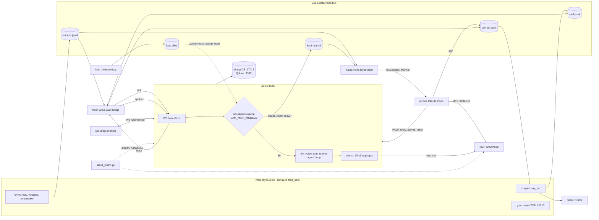
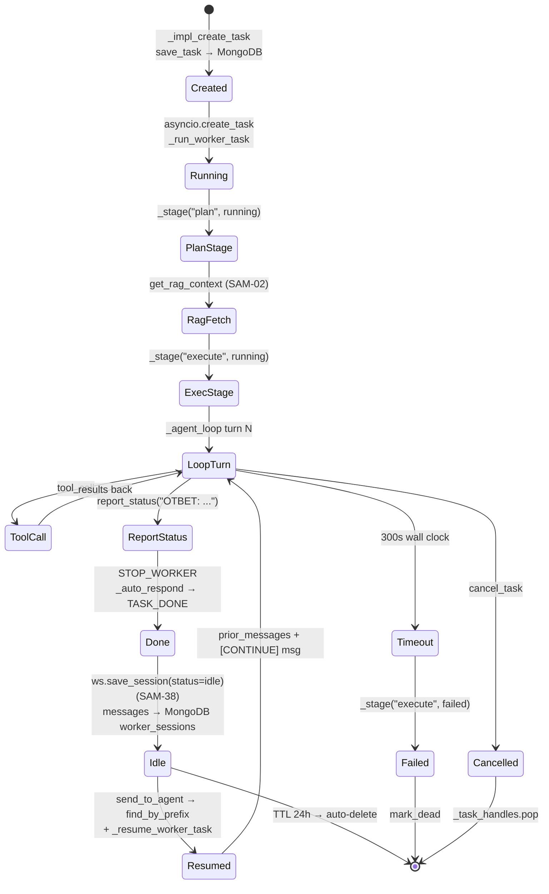
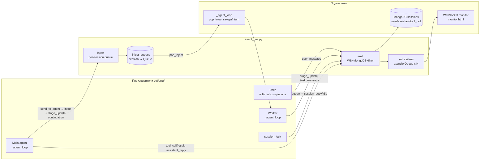
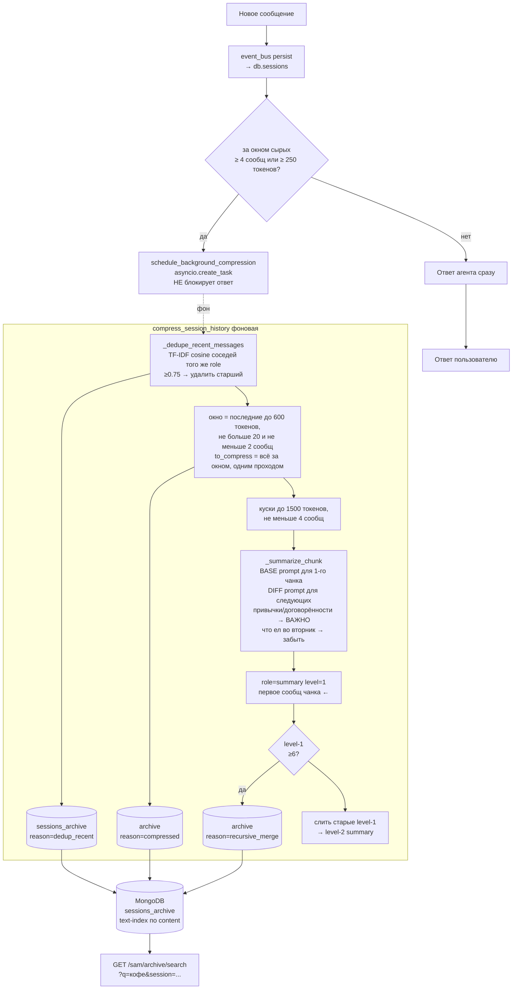
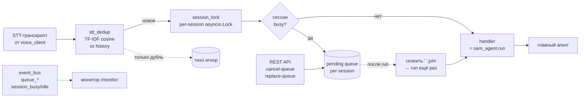
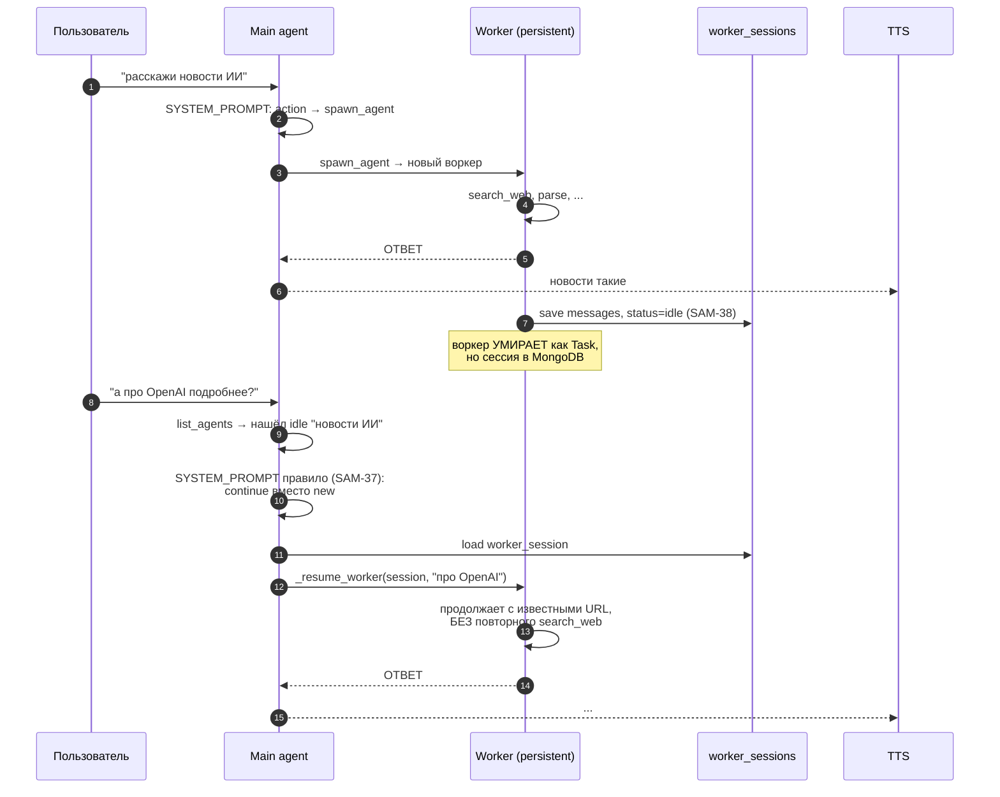

# SAM - архитектурные схемы

Схемы потоков, очередки и жизненный цикл со ссылками на код. Устройство каждого блока - `features/stand.md`;
решения и их причины - `docs/adr/`.

Ядро платформы - шлюз, голос, основная модель, агенты, память, песочница, рантайм приложений, MCP. Поверх ядра
живут приложения: радар, монитор, доска тренажёра. Приложения идут в своих контейнерах и обращаются к ядру только
через разрешённые интерфейсы (ADR-021, `features/apps.md`).

**Сверено с кодом** 25 ноября: точки входа `gateway/main.py`, `gateway/main_model.py`, `voice/layer/*.py`,
`start_sam.ps1`, `scripts/sam_lead.ps1`, `gateway/dream.py`, `gateway/rag.py`.

## 0. Стенд и основная модель

Кто кого вызывает и через что: HTTP, WebSocket, файлы шины, MongoDB.



`start_sam.ps1` поднимает Docker, Silero, MCP, client_agent, голос и шлюз вкладками с автоподъёмом, затем мост и
вкладку сессии (`scripts/sam_lead.ps1`, если `lead.alive` старше 5 с). Живость, тикер и надзор сессия поднимает
сама по SessionStart-брифу.

---

Схемы 1-6 - путь модели в шлюзе (`llm`). Схема 1 - текстовый путь `/v1/chat/completions` (`runner.run_turn`);
голосовой ход идёт через WebSocket `/voice/turn` одним вызовом LLM без guard, критика и повторов, только с
`spawn_agent` (README, «Голосовой ход»).

---

## 1. Текстовый путь /v1/chat/completions (основная модель llm)

```mermaid
sequenceDiagram
  autonumber
  participant U as Пользователь
  participant VC as клиент<br/>(chat.py, voice_client.py)
  participant GW as gateway/main.py<br/>FastAPI
  participant SL as session_lock.py<br/>(SAM-01)
  participant SD as stt_dedup.py<br/>(SAM-32)
  participant AG as SAMAgentRunner<br/>(главный агент)
  participant W as _run_worker<br/>(воркер таски)
  participant DB as MongoDB<br/>sessions / tasks
  participant Q as Qdrant RAG

  U->>VC: текст ("открой telegram")
  VC->>GW: POST /v1/chat/completions
  GW->>SD: deduplicate_stt(text, history)
  Note over SD: TF-IDF cosine vs последние 20<br/>user-сообщений сессии
  SD-->>GW: очищенный текст
  alt текст пустой после дедупа
    GW-->>VC: пустой ответ (тихо)
  else есть новое
    GW->>SL: acquire_and_run(session_id, text, handler)
    alt сессия занята
      SL->>SL: queue.append(text)
      SL-->>GW: "" (UI покажет в очереди)
    else свободна
      SL->>AG: run(text)
      AG->>DB: get_session_history(20)
      AG->>Q: get_rag_context(text)
      AG->>AG: _agent_loop (LLM + tools)
      alt action / поиск (правило из SYSTEM_PROMPT)
        AG->>W: spawn_agent → asyncio.create_task<br/>(_run_worker_task)
        W->>Q: RAG по описанию задачи (SAM-02)
        W->>W: _agent_loop с tools<br/>(search_web, mcp_call, ...)
        W-->>AG: report_status("ОТВЕТ: ...")
        AG->>AG: _auto_respond → перефраз<br/>в &lt;voice&gt;...&lt;/voice&gt;
      else разговорный ≤2 фразы (SAM-35)
        AG-->>AG: прямой &lt;voice&gt; БЕЗ spawn_agent<br/>1 LLM-вызов вместо 4
      else action-verb fallback (SAM-07 safety net)
        AG->>AG: модель забыла spawn_agent →<br/>второй turn форсит задачу,<br/>вступление озвучивается
      end
      AG-->>SL: voice-ответ
      SL->>SL: пока в queue что-то есть — склеить<br/>и обработать
      SL-->>GW: финальный voice
    end
    GW-->>VC: response
  end
```

---

## 2. Жизненный цикл таски / воркера (после SAM-38)



**После SAM-38:** воркер не «умирает» по содержанию — после `Done`
переходит в `Idle` со всем своим контекстом сохранённым в MongoDB.
`send_to_agent` для завершённой таски реанимирует её через
`_resume_worker_task` — старые URL'ы, parsed-данные, прогресс продолжают
работать, новый search_web не нужен. TTL 24h.

---

## 3. EventBus и inject-очереди



**После SAM-37:** `SYSTEM_PROMPT` явно учит главного агента
проверять `list_agents` перед `spawn_agent` и использовать
`send_to_agent` если есть подходящая running/recent таска (старые имена
`get_tasks`, `create_task`, `send_to_task` остались в `TOOL_IMPL` для совместимости). При
inject теперь эмитится `stage_update("continuation", running)` —
таска визуально оживает в мониторе.

**Гэп (SAM-38 planned):** переиспользуются только running таски,
завершённые `_task_handles.pop` улетают без сохранения. После
SAM-38 (persistent worker_sessions в MongoDB) — оживление idle
тасков из БД станет возможным.

---

## 4. Компрессия истории (после SAM-36)

Модель: **скользящее окно забывания с каскадной агрегацией.** Сырое
сообщение → архив навсегда → level-1 summary → level-2 → ... Активная
память (`db.sessions`) ограничена константами, но любое удалённое
сообщение можно найти и восстановить из архива.



**Принципы:**
- Ничего не удаляется без архивирования: `_archive_messages` - всегда первый шаг.
- Компрессия идёт в фоне (`asyncio.create_task`, флаг `_compress_in_progress`).
- Дедуп стоит до суммаризации, чтобы сводка не закрепила повторы.
- Промпт суммаризации различает вечные факты и эпизод.
- Слияние рекурсивное: даже многомесячная сессия не растёт линейно.
- Полнотекстовый поиск с русским text-index находит оригинал любого удалённого сообщения.

---

## 5. Текущие очереди (после SAM-01 и SAM-32)



---

## 6. Продолжение задачи воркером (SAM-35..38, сделано)



---

## Тесты

`tests/` - pytest с `tests/conftest.py`: mongomock вместо Mongo, подменённый sounddevice, закрытые порты стенда,
временные папки вместо `data/`. Маркеры в `pytest.ini`:

| Команда | Что идёт |
|---|---|
| `pytest -q` | всё, кроме интеграционных и LLM-as-judge: 3798 тестов, около 5 минут |
| `pytest -m integration` | с живой моделью и живым Docker |
| `pytest -m quality` | LLM-as-judge, дорого по токенам |
| `pytest -m hardware` | настоящая звуковая цепочка: такт и частота через soxr и pedalboard |

CI (`.github/workflows/ci.yml`) гоняет `pytest -q -m "not integration and not quality and not hardware"` на каждый
pull request; правка только документации тесты не запускает. Файл на каждый раздел: `tests/test_rag.py` к
`memory-search.md`, `tests/test_guard.py` к `guard.md` и так далее - список проверок есть в конце каждого раздела.

## Модель памяти SAM

MongoDB - источник правды, Qdrant - оглавление к фактам. Поиск, запись и обслуживание - `features/memory-search.md`;
коллекции целиком - `features/storage.md`.

```
MongoDB (`_memories`), один документ - один факт:
  text           полный текст, источник правды
  summary        короткое описание
  questions      вопросы, на которые факт отвечает (HyDE)
  tags           метки
  created_at, updated_at, last_used_at, last_access_at, access_count, author
  archived       мягкое удаление (find и поиск его пропускают)
  related_ids, merged_from, split_from   задел под слияние фактов, пока не заполняются

Qdrant (`context`), один факт - N векторов:
  summary        один вектор на общий поиск
  question       по вектору на вопрос: запрос «когда у Мурки день рождения» matчит вопрос, а не весь текст
  payload        mongo_id, facet_type, facet_text, summary, tags, source_session, created_at, access_count
```

### Поиск

```
1. embed запроса -> Qdrant: векторная ветка, порог 0,5
2. Mongo: лексическая ветка, BM25 по основам слов
3. слияние RRF (k=60); при равной сумме выше найденное по словам
4. дедуп по mongo_id: один факт не приходит дважды
5. текст всегда берётся из Mongo, а не из Qdrant
6. access_count и last_used_at растут у выданного факта
```

MMR (разнообразие выдачи) в `RAGStore.search` есть параметром `mmr`, по умолчанию выключен, и поиск шлюза его не
включает - это открытый дефект (`tests/test_rag.py`, xfail).

### Qdrant можно пересоздать

Qdrant - не база. `RAGStore.reindex_all()` собирает оглавление из Mongo заново; потеря оглавления не теряет фактов.
Отстать от Mongo оно может - ночное обслуживание подчищает.

### Dream-job: что сделано

`gateway/dream.py` раз в 10 минут проверяет ночное окно (`SAM_DREAM_FROM_H`-`SAM_DREAM_TO_H`, 3-6), интервал
(`SAM_DREAM_INTERVAL_H`, 20 ч) и ворота простоя; один прогон на все процессы - блокировка в Mongo (`_dream`).
Включается `SAM_DREAM=1`. Шаги:

| Шаг | Что делает |
|---|---|
| `maintenance_check` | отчёт: сколько фактов, сколько векторов, что устарело |
| `prune_index` (`SAM_DREAM_APPLY=1`) | удаляет из Qdrant векторы, по которым не нашли ни разу за 90 дней; Mongo не трогает |

Итог - событие `dream` в мониторе.

### Чего в dream-job нет

Слияние похожих фактов, разделение разросшихся, перенос содержимого, машина переписывания summary и вопросов -
план (SAM-45), не код. `access_count`, `related_ids`, `merged_from`, `split_from` в документе памяти заведены под
него, но ничего их пока не заполняет, кроме `access_count` при выдаче факта в поиске.

### Чего не делать

- Не делать авто-sync через MongoDB Change Streams: dream-job с этим справляется без подписки на каждый write.
- `update()` не переиндексирует: память - снимок, `reindex=True` только когда решение переписать принято явно.
- Не брать summary из Qdrant при чтении: текст всегда из Mongo.
- Не путать Qdrant с базой: это оглавление, его можно пересоздать.

