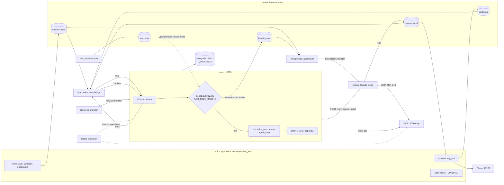
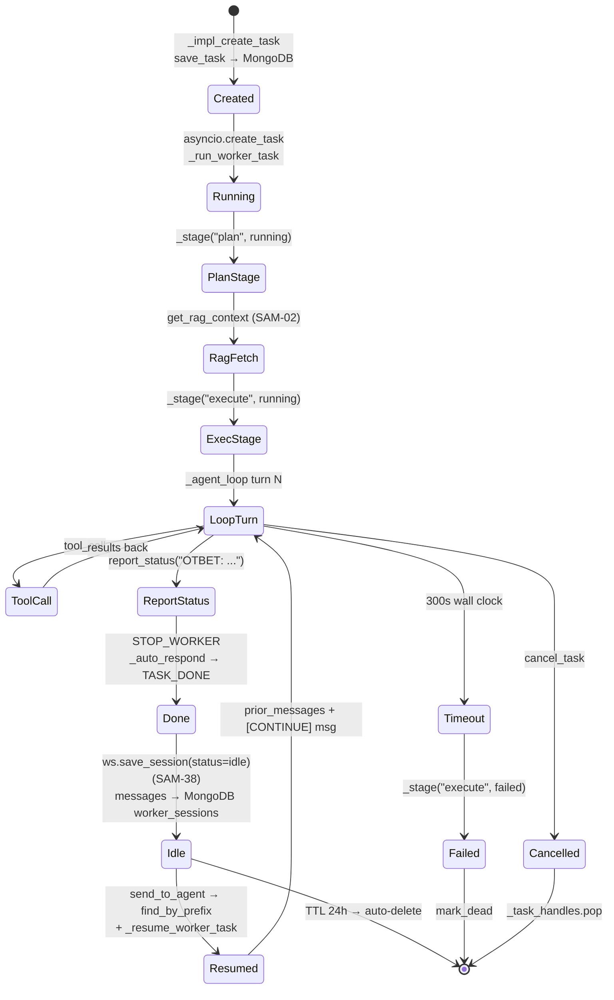
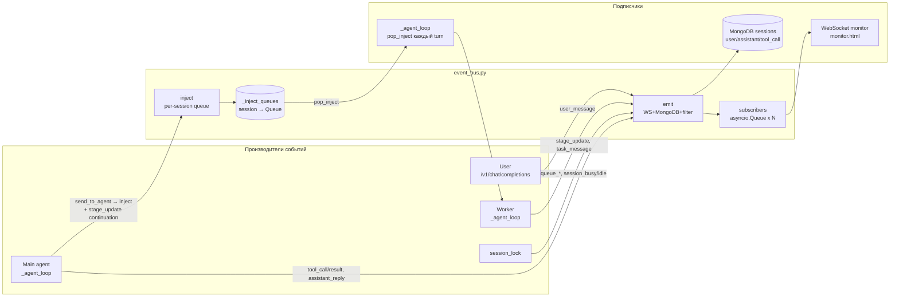
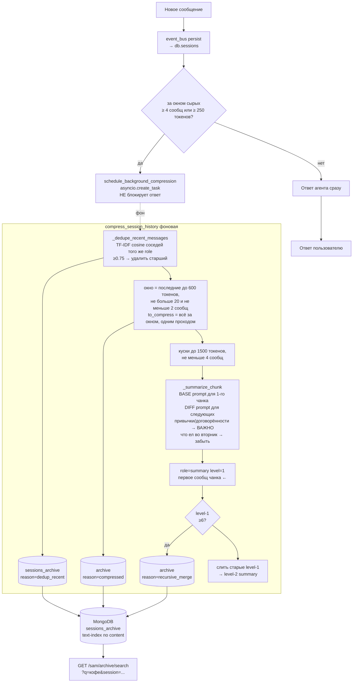
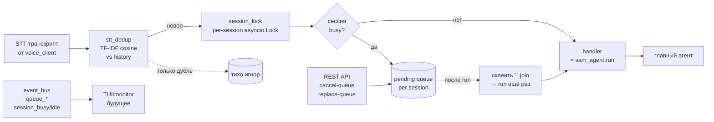
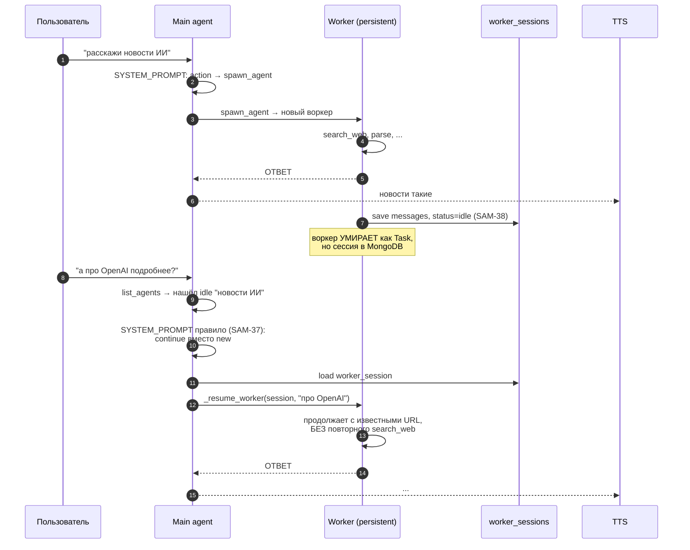

# SAM - архитектурные схемы

> Главный документ архитектуры - README.md (так в CLAUDE.md). Здесь схемы потоков, жизненного цикла и
> очередей со ссылками на код; решения и их причины - `docs/adr/`.

SAM - система мониторинга, реагирования и ассистирования (README, «Что такое SAM»); здесь - платформа, из которой
она сделана. Модели в ней - сменные носители, приложения - инструменты. Слоёв три. Ядро - шлюз, голос, основная модель, агенты,
память, песочница, рантайм приложений, MCP; схемы ниже описывают его. Поверх ядра - цели и приложения дома:
радар, монитор, доска тренажёра. Приложения на платформе живут в своих контейнерах и ходят к ядру только через
разрешённые интерфейсы (ADR-021, `docs/features/apps.md`). Монитор пока - страница шлюза, перенос в приложение -
план ADR-021.

**Последнее обновление:** 2026-10-10: стенд и основная модель (ADR-018, ADR-019, SAM-91) - раздел 0, сверен с
кодом `gateway/main.py`, `gateway/main_model.py`, `voice/layer/*.py`, `start_sam.ps1`, `scripts/sam_lead.ps1`.
Справка по блокам стенда - `docs/features/stand.md`. Референс устройства по зонам мозга - `docs/brain-map.md`.

---

## 0. Стенд и основная модель

Кто кого вызывает и через что: HTTP, WebSocket, файлы шины, MongoDB.



`start_sam.ps1` поднимает Docker, Silero, MCP, client_agent, голос и шлюз вкладками с автоподъёмом, затем мост и
вкладку сессии (`scripts/sam_lead.ps1`, если `lead.alive` старше 5 с). Живость, тикер и надзор сессия поднимает
сама по SessionStart-брифу.

---

Схемы 1-6 - путь модели в шлюзе (`llm`). Схема 1 - текстовый путь `/v1/chat/completions` (`runner.run_turn`);
голосовой ход идёт через WebSocket `/voice/turn` одним вызовом LLM без guard, критика и повторов, только с
`spawn_agent` (README, «Голосовой ход»).

---

## 1. Текстовый путь /v1/chat/completions (основная модель llm)

```mermaid
sequenceDiagram
  autonumber
  participant U as Пользователь
  participant VC as клиент<br/>(chat.py, voice_client.py)
  participant GW as gateway/main.py<br/>FastAPI
  participant SL as session_lock.py<br/>(SAM-01)
  participant SD as stt_dedup.py<br/>(SAM-32)
  participant AG as SAMAgentRunner<br/>(главный агент)
  participant W as _run_worker<br/>(воркер таски)
  participant DB as MongoDB<br/>sessions / tasks
  participant Q as Qdrant RAG

  U->>VC: текст ("открой telegram")
  VC->>GW: POST /v1/chat/completions
  GW->>SD: deduplicate_stt(text, history)
  Note over SD: TF-IDF cosine vs последние 20<br/>user-сообщений сессии
  SD-->>GW: очищенный текст
  alt текст пустой после дедупа
    GW-->>VC: пустой ответ (тихо)
  else есть новое
    GW->>SL: acquire_and_run(session_id, text, handler)
    alt сессия занята
      SL->>SL: queue.append(text)
      SL-->>GW: "" (UI покажет в очереди)
    else свободна
      SL->>AG: run(text)
      AG->>DB: get_session_history(20)
      AG->>Q: get_rag_context(text)
      AG->>AG: _agent_loop (LLM + tools)
      alt action / поиск (правило из SYSTEM_PROMPT)
        AG->>W: spawn_agent → asyncio.create_task<br/>(_run_worker_task)
        W->>Q: RAG по описанию задачи (SAM-02)
        W->>W: _agent_loop с tools<br/>(search_web, mcp_call, ...)
        W-->>AG: report_status("ОТВЕТ: ...")
        AG->>AG: _auto_respond → перефраз<br/>в &lt;voice&gt;...&lt;/voice&gt;
      else разговорный ≤2 фразы (SAM-35)
        AG-->>AG: прямой &lt;voice&gt; БЕЗ spawn_agent<br/>1 LLM-вызов вместо 4
      else action-verb fallback (SAM-07 safety net)
        AG->>AG: модель забыла spawn_agent →<br/>второй turn форсит задачу,<br/>вступление озвучивается
      end
      AG-->>SL: voice-ответ
      SL->>SL: пока в queue что-то есть — склеить<br/>и обработать
      SL-->>GW: финальный voice
    end
    GW-->>VC: response
  end
```

---

## 2. Жизненный цикл таски / воркера (после SAM-38)



**После SAM-38:** воркер не «умирает» по содержанию — после `Done`
переходит в `Idle` со всем своим контекстом сохранённым в MongoDB.
`send_to_agent` для завершённой таски реанимирует её через
`_resume_worker_task` — старые URL'ы, parsed-данные, прогресс продолжают
работать, новый search_web не нужен. TTL 24h.

---

## 3. EventBus и inject-очереди



**После SAM-37:** `SYSTEM_PROMPT` явно учит главного агента
проверять `list_agents` перед `spawn_agent` и использовать
`send_to_agent` если есть подходящая running/recent таска (старые имена
`get_tasks`, `create_task`, `send_to_task` остались в `TOOL_IMPL` для совместимости). При
inject теперь эмитится `stage_update("continuation", running)` —
таска визуально оживает в мониторе.

**Гэп (SAM-38 planned):** переиспользуются только running таски,
завершённые `_task_handles.pop` улетают без сохранения. После
SAM-38 (persistent worker_sessions в MongoDB) — оживление idle
тасков из БД станет возможным.

---

## 4. Компрессия истории (после SAM-36)

Модель: **скользящее окно забывания с каскадной агрегацией.** Сырое
сообщение → архив навсегда → level-1 summary → level-2 → ... Активная
память (`db.sessions`) ограничена константами, но любое удалённое
сообщение можно найти и восстановить из архива.



**Принципы:**
- ❗ Ничего не удаляется без архивирования (`_archive_messages` всегда первый шаг)
- ⚡ Компрессия в фоне (`asyncio.create_task`, флаг `_compress_in_progress`)
- 🧹 Дедуп ДО суммаризации, чтобы summary не закрепил повторы
- 🧠 Промпт суммаризации различает вечные факты vs эпизод
- 🔄 Recursive merge — даже многомесячная сессия не растёт линейно
- 🔍 Полнотекстовый поиск с русским text-index — найти оригинал любого
  удалённого сообщения

---

## 5. Текущие очереди (после SAM-01 и SAM-32)



---

## 6. Продолжение задачи воркером (SAM-35..38, сделано)



---

## Тесты (SAM-39)

```
tests/
├── conftest.py                     # mongomock, fake_llm_response, llm_config
├── fixtures/sample_dialogues.py    # фиксированные диалоги для compression тестов
├── test_stt_dedup.py               # 11 unit-кейсов
├── test_session_lock.py            # 5 async unit-кейсов
├── test_worker_session.py          # 6 unit-кейсов с mongomock
├── test_compression_helpers.py     # 11 unit-кейсов (SKIP marker + archive + dedupe)
├── integration/
│   └── test_compression_pipeline.py  # @integration @slow, реальный LLM — skip по умолч.
└── quality/
    └── test_compression_quality.py   # @quality, LLM-as-judge с rubric — skip по умолч.
```

Запуск:
```
pytest                                  # unit only (быстро)
pytest -m integration                   # с реальным LM Studio
pytest -m quality                       # LLM-as-judge
```

## Модель памяти SAM (актуально 2026-05-20, SAM-40 + SAM-45 каркас)

**Архитектурный принцип:** MongoDB = source of truth. Qdrant = семантическое
оглавление (TOC), кратковременная память. Никогда не путать.

```
MongoDB (`_memories`):
  каждый документ = один факт / страница знания
  _id            — ObjectId, стабильная ссылка
  text           — полный авторитетный текст
  summary        — короткое описание (optional)
  questions      — список вопросов которые этот факт закрывает (optional)
  tags           — метки
  created_at, updated_at, last_used_at, last_access_at
  author         — кто записал (session_id)
  access_count   — сколько раз doc был возвращён (для librarian)
  — SAM-45 каркас для эволюции через LLM-librarian —
  archived: bool         — soft delete
  archived_at            — когда soft-deleted
  related_ids: list[str] — cross-references на другие mongo_id
  merged_from: list[str] — audit когда merge сделан
  split_from: str        — audit когда split сделан

Qdrant (`context`):
  каждый Mongo doc → N vector-точек (multi-facet indexing):
  • 1 точка для summary (general lookup)
  • N точек для каждого question (HyDE: матчит реальные запросы)
  payload:
    mongo_id       — ссылка на источник в Mongo
    facet_type     — "summary" | "question"
    facet_text     — конкретный текст этого facet
    summary        — общий summary факта (для дисплея)
    tags           — для filter
    source_session, created_at
    access_count   — сколько раз этот facet был в результате
    last_used_at   — последнее использование
```

### Pipeline поиска

```
1. query → embed → Qdrant query (top-K*3 при MMR)
2. фильтр по tags (Qdrant native FieldCondition)
3. дедуп по mongo_id (best score per group) — иначе один факт N раз
4. опциональный MMR re-rank для diversity
5. memory_repo.get_by_id(mongo_id) → archived? пропустить
6. text всегда из Mongo (source of truth)
7. _increment_qdrant_access — какие facets полезны
8. _touch_used → last_used_at в Mongo
```

### Multi-facet — зачем

Один факт «Мурка — кот, родился 1 января, рыжий, любит молоко» в Mongo →
в Qdrant N vector-точек:
- summary: "Мурка — био кота"
- question: "когда у Мурки день рождения?"
- question: "какой Мурка по цвету?"
- question: "что Мурка любит?"

Юзер: «когда у Мурки ДР?» → embed запроса матчит embed заглушки-вопроса
→ находим mongo_id → возвращаем актуальный текст био из Mongo.

### Memory.md аналогия (с поправкой)

Qdrant ≈ memory.md / TOC. **НЕ источник правды.** Может быть пересоздан
полностью (`reindex_all`) — не страшно. Может отставать от Mongo —
dream-job (SAM-22) подправит.

### Эволюция через dream-job (SAM-22 + SAM-45)

LLM в dream-cycle → librarian. Конкретный алгоритм reorganization:

```
1. Получить дерево всех documents в Mongo (включая archived для контекста)
2. Выделить группы как они пересекаются:
   - embedding similarity между docs
   - shared tags
   - cross-references (related_ids)
   - co-occurrence в результатах поиска
3. Наложить счётчик: какие данные чаще вызывались (access_count, last_used_at)
4. Попарно брать documents и условно вызывать:
   - merge(a, b)        — если очень похожи и часто матчатся вместе
   - split(a, parts)    — если doc разросся, части матчат разные запросы
   - move(content, from, to)  — переместить кусок в более релевантный
   - copy(content, from, to)  — дублировать в более релевантный
5. Регенерировать summary + questions для merged/split документов
6. Обновить cross-references (related_ids) для связанных
7. prune_dead_facets — почистить vector-нотисы которые никогда не матчили
8. expand_facets — для популярных фактов сгенерить ещё ракурсов
9. Audit log в Mongo: что merged/split/moved и когда
```

Через месяцы работы knowledge base самоорганизуется под реальные паттерны
использования. См. SAM-45.

### Что НЕ трогать

- ❌ Не делай авто-sync через MongoDB Change Streams — dream-job лучше
- ❌ `update()` НЕ авто-reindex — snapshot память, reindex=True только
  когда LLM решит переписать
- ❌ Не доверяй summary из Qdrant при чтении — text всегда из Mongo
- ❌ Не путай Qdrant с базой — это TOC

