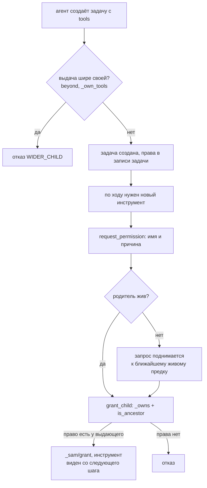

# Агентная система

Работу в SAM выполняют три разных исполнителя, и у каждого свой код, свои права и свой способ связи с создателем. Воркер
шлюза живёт в процессе шлюза и берёт задачу из `sam.tasks`; агент Cortex работает отдельным процессом за ACP (Agent
Client Protocol, JSON-RPC по stdio) и получает права от создателя; агент кода — внешний CLI (Claude Code, OpenCode),
которому воркер отдаёт правку файлов и git. Решение о границе ACP и причинах —
[ADR-022](../../adr/022-agent-system-behind-acp.md).

| Исполнитель | Код | Чем отличается |
|---|---|---|
| воркер шлюза | `gateway/worker.py`, `gateway/worker_session.py`, `gateway/worker_partial.py`, запуск — `gateway/agent.py` (`_impl_create_task`, `_run_worker_task`) | живёт в процессе шлюза, инструменты шлюза, пул шагов на дерево ([worker](worker.md)) |
| агент Cortex | `gateway/cortex_workers.py`, `cortex/acp/*` | отдельный процесс за ACP, инструменты MCP стенда по выдаче, каналы к создателю, свои ходы на задачу |
| агент кода | `gateway/tools/coding_agents.py` | внешний CLI с текстовым заданием, без истории SAM, без ключей в окружении ([coding-agent](coding-agent.md)) |

Кто ведёт главный ход — модель в шлюзе или сессия Claude Code, — решает
[main-model](../gateway/main-model.md); включение ACP-поставщика для хода описано там же. Создание агентов и ручки —
`gateway/tools/agents.py`.

## Выбор каркаса

Каркас задаёт параметр `framework` при создании (`POST /sam/agents` или `create_agent` MCP `sam`): `sam` — воркер шлюза,
`cortex` — сессия Cortex. Пустой параметр берёт значение `SAM_AGENT_FRAMEWORK`, а если и там пусто, создаётся воркер
шлюза. `spawn_agent` выдачу инструментов не передаёт, поэтому с каркасом `cortex` отказывает (`gateway/agent.py`,
`framework_error`, текст `CORTEX_NEEDS_GRANT`).

## Права агента

Выдача при создании задаёт список инструментов. У воркера шлюза пустой список значит все инструменты воркера, у Cortex
пустая выдача отклоняется: каналы связи и `tool_search` есть у сессии всегда, инструменты стенда выдаются явно. Ребёнку
выдача не может быть шире выдачи родителя: `beyond` в `cortex/acp/rights.py` сравнивает списки, а `_on_spawn` в
`gateway/cortex_workers.py` ещё раз сверяет пришедшее со своей записью задачи (`WIDER_CHILD`). Метку сложности `smart`,
`medium` (по умолчанию) или `weak` ставит создатель, и она берёт источник или пару `источник:модель` из
`SAM_AGENT_LLM_<МЕТКА>`, а пустое значение отдаёт выбор подборщику по задаче (`gateway/agent_levels.py`,
[llm-router](../llm/llm-router.md)).

Нужного инструмента в выдаче нет — агент зовёт `request_permission` с именем инструмента и причиной. Запрос уходит
родителю каналом `ask_creator`, а выдаёт право родитель вызовом `grant_child`; `_check` в `cortex/acp/channels.py`
проверяет, что право есть у самого выдающего (`_owns`), а `_on_grant_child` в `gateway/cortex_workers.py` — что
выдающий приходится предком по цепочке создателей (`is_ancestor` в `gateway/tools/agents.py` обходит поле `creator`
каждого звена). Если родитель уже кончился, запрос поднимается до ближайшего живого предка, и решает он. Выданное
право приходит расширением `_sam/grant` и видно со следующего шага; ответ на вопрос приходит в идущий ход инъекцией
`_sam/inject`.

Ключ команд агенту не выдаётся вообще. Привилегированные инструменты (`set_env`, `tune_self`, `forget`, `forget_topic`,
`claude_delegate`, `switch_main_model`, `soul_edit`, `soul_rollback`) выполняются только в ходе человека, где назван
`SAM_COMMAND_SECRET` (`gateway/command_auth.py`, `PRIVILEGED_TOOLS`). Агент идёт вне такого хода, поэтому на его просьбу
приходит `AGENT_REFUSED`: подготовить разбор, план и diff и вернуть создателю. Ключ привилегий
(`data/secrets/privilege.key`) агенту тоже не достаётся; вызов с путём ключа в аргументах запрещён политикой
`gateway/tool_policy.json`.

## Каналы

`report_status` пишет создателю статус или итог, `ask_creator` задаёт вопрос, `request_permission` просит инструмент,
`send_to_agent` пишет другому агенту. Писать можно только собеседникам из `peers` или тому, на кого выдано право
`agent:<id>`; при выдаче права родитель получает право писать ребёнку сам. Ответ создателя приходит в идущий ход
инъекцией `_sam/inject`.

## Дети

Глубина задаётся `depth` до `SAM_AGENT_MAX_DEPTH` (1), ширина — `SAM_AGENT_MAX_CHILDREN` (1). Уровень считается от
основной модели, у неё нулевой: её агент создаёт одного ребёнка, тот не создаёт ни одного. Создав ребёнка, агент теряет
`spawn_agent`. Шлюз перепроверяет число детей, глубину и выдачу по своей записи задачи, поэтому обойти пределы из сессии
Cortex нельзя. Выдача ребёнка не шире выдачи родителя. Запрос права ребёнка решает родитель.

## Жизнь агента Cortex

Агент живёт задачу, а не ход: пока идут его дети или он ждёт сообщения, следующий ход начинается по пришедшему
сообщению. Ходов на задачу `SAM_CORTEX_TASK_TURNS` (10); если сообщения нет за `SAM_CORTEX_WAIT_S` (600 с), задача
закрывается итогом последнего хода, и итог уходит создателю меткой `[TASK_DONE]`. Пул шагов задачи считает тот же учёт,
что у воркера шлюза (`gateway/agent_budget.py`, [worker](worker.md)), а сессию Cortex сверх этого ограничивают ходы на
задачу и шаги цикла на ход. Отменённая задача закрывается с итогом последнего хода, а не остаётся живой в маршрутах.

Агенты основной модели вне шлюза идут от сессии `SAM_AGENT_PARENT_SESSION` (по умолчанию `voice`).

## Cortex как сервер ACP

Cortex — сервер ACP на Python в `cortex/acp/`, шлюз запускает его подпроцессом. Протокол, инструменты и модель берутся
готовыми библиотеками: `agent-client-protocol` для протокола, SDK `mcp` для инструментов сессии, `llm_client` шлюза для
модели. Задачу роутера задаёт `SAM_CORTEX_LLM_TASK` (по умолчанию `default`), себя как поставщика `acp` Cortex не
выбирает.

Ход ведёт тот же `agent_loop`, что и в шлюзе ([agent-loop](../gateway/agent-loop.md)), и шагов цикла на один ход у него
`SAM_CORTEX_MAX_TURNS` (20). Контекст собирает шлюз и отдаёт текстом в новой сессии, поэтому своя история у Cortex не
копится. Текст уходит клиенту обновлением `agent_message_chunk`, ход и итог инструмента — `tool_call` и
`tool_call_update`, рассуждение — `agent_thought_chunk`; в ответ человеку идёт только текст.

Разрешения. Инструменты из `SAM_CORTEX_PERMISSION_TOOLS` (команды, запись и правка файлов, git на запись, код в
браузере) и помеченные в MCP как `destructiveHint` идут через `session/request_permission`, то есть через судью SAM.
Чтение, время и радар решаются без судьи. Разрешение выдаётся разово, `allow_once`, а политика `deny` из
`gateway/tool_policy.json` сильнее любого разрешения.

Поиск инструментов включается, когда в сессии больше `SAM_CORTEX_TOOL_SEARCH_MIN` (20) инструментов: модель видит
`load_skill` из `SAM_CORTEX_CORE_TOOLS` и мост `tool_search` со списком имён, а найденное поиском, названное по имени
или принесённое скиллом приходит полной схемой со следующего шага. Поиск идёт BM25 по основам слов (`rank-bm25`,
`snowballstemmer`), находок не больше `SAM_CORTEX_TOOL_SEARCH_LIMIT` (5). Замер 12 окт: описания 70 инструментов стенда
занимали 36 950 знаков на каждый вызов модели, с поиском — 1 900-4 160.

Реплика, пришедшая, пока модель пишет финальный ответ, продолжает ход не больше `SAM_CORTEX_LATE_INJECTS` (3) раз:
дальше начинается петля агентов, будящих друг друга внутри одного хода.

Агент Cortex поднимается со шлюзом (`SAM_CORTEX_WARM`, по умолчанию да): Cortex чинит стенд, поэтому ждать первого хода
агента незачем. Упавший процесс надзор поднимает через шлюз ([stand](../stand/stand.md)).

## Hermes

Внешний каркас для сравнения с Cortex. Прокси-режим держится конфигом `gateway/acp/hermes/config.yaml`: в нём пустой
`platform_toolsets.acp`, отключённые наборы, выключенные своя память и профиль. Конфиг копируется в домашнюю папку
агента через `SAM_ACP_HOME_TEMPLATE`, окружение подпроцесса задаётся именами из `SAM_ACP_ENV`, а свой MCP шлюз передаёт
адресом `SAM_ACP_MCP_URL` и именем `SAM_ACP_MCP_NAME`. Работает это на Hermes не старше 7 окт: в версии 24 июля пустой
список наборов становится полным набором.

Установка — venv клона с опциями `acp` и `mcp` (`uv sync --extra acp --extra mcp`, Python 3.14); без `mcp` сессия молча
остаётся без инструментов. Окно модели нужно от 64 тыс. токенов, иначе ACP отдаёт «Internal error», и локальная модель
грузится с `--context-length 65536`. Проба — `scripts/acp_probe.py`.

## Рабочее место и план

Инструмент `workspace` открывает git worktree в `data/worktrees/<имя>` с веткой `agent/<имя>` от `dev`
(`SAM_WORKSPACES_DIR`, `SAM_WORKSPACE_BASE`): основное дерево и dev остаются на месте; коммит идёт явными путями в свою
ветку. Инструмент `plan` ведёт план одним вызовом с действиями `where`, `check`, `take`, `done` и `add`; путь к
`plan.mjs` берётся из `SAM_PLAN_TOOL`, файл плана — `SAM_PLAN_FILE`, узел задачи в общем плане — `SAM_PLAN_WITHIN`. Оба
инструмента есть и у основной модели, и у воркера.

## Приём итога агента

Шлюз сверяет итог перед статусом `done` (`gateway/finish_contract.py`). Пустое «Готово.» и текст короче
`SAM_RESULT_MIN_CHARS` (15) знаков не принимаются. Задача кода, то есть с коммитом, рабочим местом или веткой `agent/` в
описании, обязана назвать хэш коммита, который действительно есть в репозитории (`git cat-file`). Не прошло — задача
получает статус `unverified`, итог начинается с `[НЕ ПОДТВЕРЖДЕНО]` и причины; создатель получает его обычным итогом и
может ответить агенту, что воскрешает его с прежней историей.

## Проверка

`tests/test_acp.py`, `tests/test_cortex_acp.py`, `tests/test_cortex_rights.py`, `tests/test_cortex_workers.py`,
`tests/test_agents_api.py`, `tests/test_tools_workspace.py`, `tests/test_tools_plan.py`,
`tests/test_finish_contract.py`, `tests/test_coding_agents.py`.
