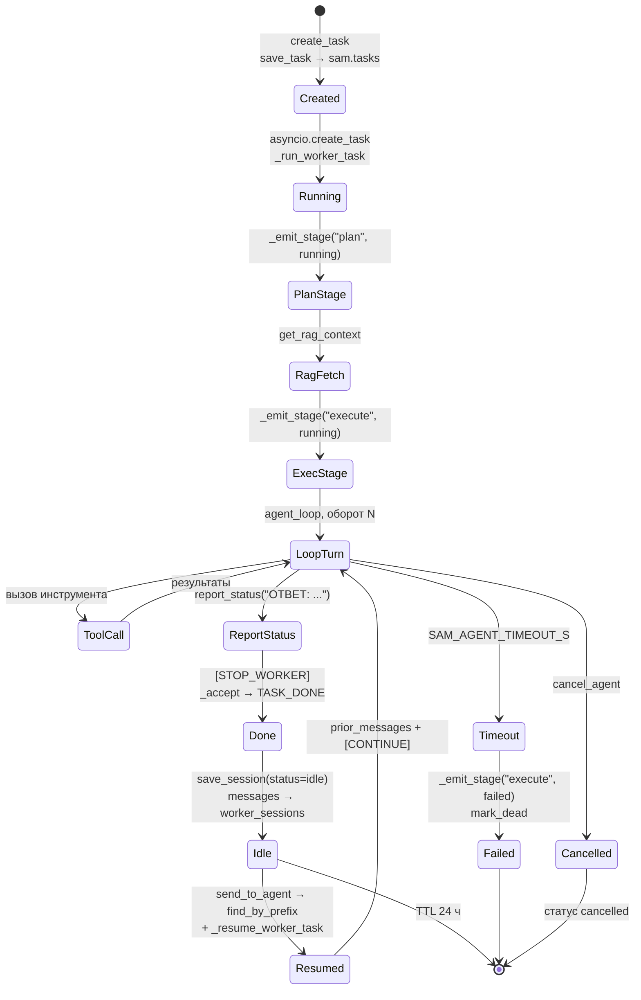
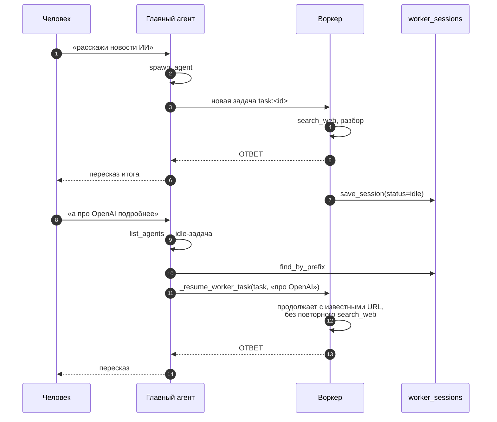

# Воркер шлюза

Воркер — фоновый исполнитель внутри процесса шлюза: он берёт задачу из `sam.tasks`, работает своим циклом со своими
инструментами и возвращает итог создателю, а главный агент пересказывает этот итог человеку. Разговор и работа идут
разными ходами и не ждут друг друга ([ADR-005](../../adr/005-orchestrator-and-background-workers.md)). Где воркеры живут
на стенде — [stand](../stand/stand.md), блок «Агенты»; агенты Cortex и агент кода — [README](README.md).

Код: `gateway/worker.py` держит `run_worker`, `run_worker_task`, `resume_worker_task` и `WorkerDeps`; `gateway/agent.py`
— `_impl_create_task`, `_run_worker_task`, `_resume_worker_task` и `_auto_respond`; учёт шагов —
`gateway/agent_budget.py`; частичный итог — `gateway/worker_partial.py`; сохранённый контекст задачи —
`gateway/worker_session.py`.

## Жизнь задачи

`spawn_agent` (он же `create_task`) пишет запись в `sam.tasks` и запускает воркер через `asyncio.create_task`, главный
ход при этом не ждёт. Одновременно идут не больше `SAM_MAX_WORKERS` (4) воркеров; запрос сверх этого получает ответ «все
воркеры заняты» без создания задачи. Тяжёлая задача при исчерпанном лимите встаёт в очередь
`_deferred_tasks` и запускается сама, когда лимит откроется (`gateway/deferred_tasks.py`, `SAM_DEV_*`). У задачи своя
сессия `task:<id>` со своей историей.

Порядок работы: этап `plan` подтягивает факты по теме задачи (`get_rag_context`), этап `execute` ведёт цикл агента до
итога, затем задача сохраняется.

В `plan`-этап входит и оценка: в первом ответе агент зовёт `estimate_steps` таблицей блоков, и от неё зависит пул
шагов.

Инструменты воркера перечислены в `WORKER_TOOL_NAMES` (`gateway/agent.py`): память и поиск (`list_memories`,
`search_web`), устройство и MCP (`mcp_call`), код и песочница (`claude_delegate`, `sandbox_run`, `sandbox_exec`),
приложения (`app_make`, `app_update`, `app_list`, `app_call`, `app_stop`), скиллы и возможности (`load_skill`,
`list_capabilities`), связь с создателем и шаги (`report_status`, `ask_creator`, `estimate_steps`, `request_steps`,
`grant_steps`), стенд и работа (`restart_component`, `workspace`, `plan`), агенты (`list_agents`, `set_agent_effort`,
`agent_info`). `spawn_agent` у воркера нет: глубина порождения — один уровень, дети заводятся только у агентов Cortex.

Работа кончается вызовом `report_status("ОТВЕТ: ...")`. Ответ «ОТВЕТ:» без единого настоящего вызова инструмента
отклоняется: сначала требуется действие, иначе воркер получает ответ `[REJECT]` (`gateway/agent.py`). Перед статусом
`done` итог проходит проверку артефакта ([README](README.md), «Приём итога агента»). Главный агент получает
`[TASK_DONE:<id>]` или `[TASK_FAILED]` и пересказывает итог своим ходом. Служебные метки (`[REJECT]`, `[STOP_WORKER]`,
ответ о лимите шагов) человеку не пересказываются: вместо них идёт короткое сообщение о сбое.

По часам задачу страхует `SAM_AGENT_TIMEOUT_S` (1800 с), по истечении приходит `[TASK_FAILED]` с причиной таймаута;
работу ограничивает пул шагов, а не время. Если воркер задал вопрос через `ask_creator`, он ждёт ответ до
`SAM_AGENT_ANSWER_WAIT_S` (90 с) и продолжает с ним не больше `SAM_AGENT_ANSWER_ROUNDS` (5) раз за прогон; поздний ответ
воскрешает агента.

Закончивший воркер остаётся idle-сессией в `worker_sessions` и продолжает по `send_to_agent`; сессию без активности
дольше 24 ч удаляет TTL-индекс `ttl_last_activity`. Запись задачи в `sam.tasks` живёт по своему TTL: выполненная — 24 ч,
упавшая — 2 ч, не запустившаяся — 15 мин (`gateway/tasks.py`).

Упавший воркер помечается через `mark_dead`, и его сессия больше не поднимается: `send_to_agent` такую задачу не
продолжит, нужна новая.

Отмена приходит через `cancel_agent` или `cancel_task`: задача получает статус `cancelled`, событие уходит в шину, и
ход воркера обрывается на ближайшем await.

## Шаги

Шаг — одно обращение агента к модели, а пул шагов считается на дерево агентов в `gateway/agent_budget.py`. Пул задачи —
меньшая из двух величин: прикидки создателя в `steps` у `spawn_agent` и оценки агента таблицей крупных блоков в первом
ответе через `estimate_steps`. Без обеих берётся `SAM_AGENT_STEPS` (30 шагов: правке кода нужно 20-30), а выдача
основной модели не превышает `SAM_AGENT_STEPS_CAP` (100).

`estimate_steps(plan)` принимает таблицу блоков с шагами на каждый, добавляет запас `SAM_ESTIMATE_RESERVE` (0,25) и
отклоняет таблицу больше `SAM_ESTIMATE_MAX_BLOCKS` (12) блоков; шаги, уже сделанные до текущего оборота, входят в пул
сами. Пул ребёнка выделяется из остатка родителя, и родитель узнаёт свой остаток; закрытая задача возвращает
неистраченное наверх.

На доле `SAM_AGENT_BUDGET_WARN` (0,8) агент получает подсказку закончить или попросить ещё: `request_steps` с причиной.
Создатель выдаёт шаги из своего остатка (`grant_steps`, вне шлюза — `grant_agent_steps` MCP `sam`), отказывает с
причиной или забирает работу себе. Просьба в пределах потолка задачи (`autogrant`) одобряется без разбора.

Пул кончился, а просьба о шагах ждёт ответа — агент ждёт его до `SAM_AGENT_ANSWER_WAIT_S`, и выдача продолжает работу.
Если ответа нет, создатель получает частичный итог из `gateway/worker_partial.py`: причину остановки, последний статус,
вызов, на котором агент встал, и `SAM_AGENT_PARTIAL_RESULTS` (3) свежих итогов инструментов.

Ход, в котором агент зовёт только каналы (`ask_creator`, `request_steps`, `estimate_steps`, `report_status`,
`send_to_agent`, `grant_steps`), шага не тратит; таких обращений на задачу не больше `SAM_AGENT_CHANNEL_CALLS` (10),
после чего `ask_creator` и `request_steps` отвечают «решай сам». Страховка самого цикла — `max_turns`, равный
`SAM_AGENT_STEPS_CAP`; если он кончился раньше пула, приходит служебный ответ «Превышен лимит шагов агента».

## Состояния задачи

Состояния в коде (`gateway/tasks.py`): `pending`, `running`, `done`, `unverified`, `failed`, `cancelled`; финальные —
`done`, `unverified`, `failed`, `cancelled`.

| Из | Событие | В | Кто ставит |
|---|---|---|---|
| — | `spawn_agent` | `pending` | `_impl_create_task` |
| `pending` | взят воркером | `running` | `mark_task_running` |
| `running` | `report_status("ОТВЕТ: ...")` | `done` | `_accept` |
| `running` | `SAM_AGENT_TIMEOUT_S` (1800 с) | `failed` | `mark_dead` |
| `running`, `pending` | `cancel_agent` | `cancelled` | `cancel_task` |
| `done` | контекст сохранён | idle в `worker_sessions` | `save_session` |
| idle | `send_to_agent` | `running` | `_resume_worker_task` |

После `Done` задача переходит в `Idle`, контекст остаётся в `worker_sessions`. `send_to_agent` продолжает её через
`_resume_worker_task`: прежние URL, разобранные данные и прогресс на месте, повторный `search_web` не нужен. Без
активности 24 ч запись удаляет TTL-индекс.

## Воскрешение воркера

`send_to_agent` поднимает idle-сессию с прежней историей. Сообщение, пришедшее между итогом и снятием задачи, тоже
поднимает агента: `hand_over_late_answers` забирает такие сообщения и зовёт `reanimate`, пока сессия сохранена.

## Граница с главным агентом

Список инструментов главного — `MAIN_TOOL_NAMES` (`gateway/agent.py`): память и её очистка, каталог устройств и людей,
управление агентами (`spawn_agent`, `list_agents`, `send_to_agent`, `cancel_agent`, `grant_steps`, `set_agent_effort`,
`agent_info`), настройка себя и переменных, душа, скиллы, смена основной модели, тихий режим, сжатие сессии,
`recall_history`, `restart_component`, `workspace`, `plan`, `app_list`, `app_call`, `sandbox_exec`. `mcp_call`,
`search_web` и `claude_delegate` у главного нет: это работа воркера.

`sandbox_exec` — единственное исполнение кода в самом ходе ([sandbox](../../features/execution/sandbox.md)). Вызов
вместе с ожиданием замка и стартом контейнера не длится дольше `SAM_FAST_SANDBOX_MAIN_TIMEOUT_S` (10 с), а просьба
дольше получает отказ «отдай воркеру».

## Проверка

`tests/test_worker.py`, `tests/test_worker_session.py`, `tests/test_worker_session_owner.py`.
