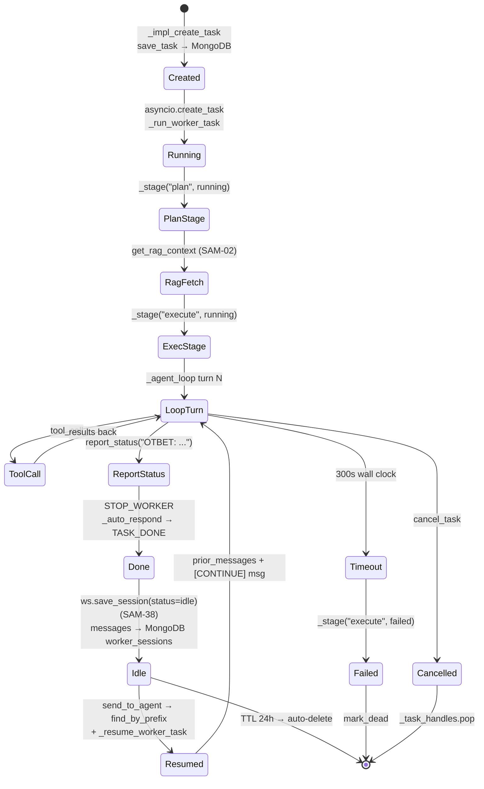
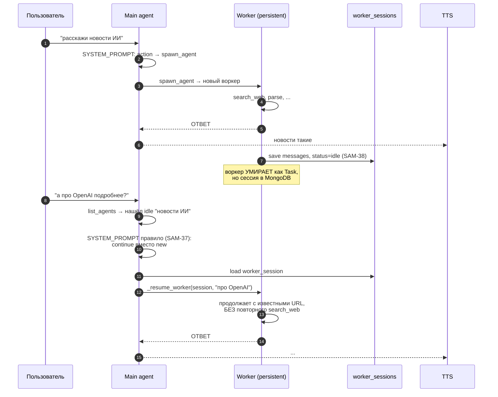

# Воркеры: задачи в фоне

Главный агент разговаривает и ставит задачи, действие на устройстве, поиск и код выполняет воркер в фоне, итог
пересказывает главный. Почему так - ADR-005; агенты в сессиях Cortex, права и каналы - [agents](architecture/agents/agents.md) и ADR-022; где что
на стенде - [stand](architecture/stand/stand.md), блок «Агенты».

`gateway/worker.py`, `gateway/agent.py` (`spawn_agent`, `_run_worker_task`, `_auto_respond`), учёт шагов -
`gateway/agent_budget.py`.

## Жизнь задачи

| Что | Как |
|---|---|
| создание | `spawn_agent` создаёт запись в `tasks` и запускает воркер через `asyncio.create_task`; главный ход не ждёт |
| сессия | своя сессия `task:<id>` со своей историей |
| инструменты | `WORKER_TOOL_NAMES`: `list_memories`, `search_web`, `mcp_call`, `claude_delegate`, `sandbox_run`, `sandbox_exec`, `app_make`, `app_update`, `app_list`, `app_stop`, `list_capabilities`, `load_skill`, `report_status`, `ask_creator`, `estimate_steps`, `request_steps`, `grant_steps` (`gateway/agent.py`) |
| итог | `report_status("ОТВЕТ: ...")` заканчивает работу; «ОТВЕТ:» без единого настоящего вызова tool отклоняется - сначала действие |
| пересказ | главный агент получает `[TASK_DONE]` или `[TASK_FAILED]` и пересказывает итог своим ходом; служебные метки (`[REJECT]`, `[STOP_WORKER]`, лимит шагов) человеку не пересказываются - вместо них короткое честное сообщение о сбое |
| срок | 300 с на задачу: по истечении `[TASK_FAILED]` с причиной «таймаут» |
| вопрос создателю | `ask_creator`: воркер ждёт ответ `SAM_AGENT_ANSWER_WAIT_S` (90 с), продолжает с ответом не больше `SAM_AGENT_ANSWER_ROUNDS` (5) раз за прогон; поздний ответ воскрешает агента |
| воскрешение | закончивший воркер остаётся idle-сессией в `worker_sessions` и продолжает с прежней историей по `send_to_agent` (SAM-38); сессия без активности дольше 24 ч удаляется TTL-индексом |
| запись задачи | TTL в `tasks`: выполненная - 24 ч, упавшая - 2 ч, не запустившаяся - 15 мин (`gateway/tasks.py`) |

## Шаги

Шаг - одно обращение агента к модели. Пул шагов - на дерево агентов (`gateway/agent_budget.py`):

- пул задачи - меньшая из прикидки создателя (`steps` у `spawn_agent`) и оценки агента в первом ответе
  (`estimate_steps`, без отдельного шага); оценка - сколько ещё нужно, считая текущий оборот, шаги до него (например,
  `load_skill`) прибавляются к ней сами (SAM-209); по умолчанию `SAM_AGENT_STEPS` (30: правке кода нужно 20-30 шагов),
  выдача основной модели не больше `SAM_AGENT_STEPS_CAP` (100);
- пул ребёнка выделяется из остатка родителя, родитель узнаёт свой остаток; закрытая задача возвращает неистраченное;
- на доле `SAM_AGENT_BUDGET_WARN` (0,8) агент получает подсказку закончить или попросить ещё (`request_steps` с
  причиной); создатель выдаёт из своего остатка (`grant_steps`, вне шлюза - `grant_agent_steps` MCP `sam`),
  отказывает или забирает работу; своего остатка мало - просит у своего создателя; создателю-модели в шлюзе
  (`spawn_agent` из хода) просьба приходит её ходом, текст хода уходит агенту ответом (SAM-212);
- пул кончился, а просьба о шагах ждёт ответа - агент ждёт его до `SAM_AGENT_ANSWER_WAIT_S`, выдача продолжает работу;
  иначе создатель получает частичный итог (`gateway/worker_partial.py`): причину, последний статус, вызов, на котором
  агент встал, и `SAM_AGENT_PARTIAL_RESULTS` (3) свежих итогов инструментов;
- ход, в котором агент зовёт только каналы (`ask_creator`, `request_steps`, `estimate_steps`, `report_status`,
  `send_to_agent`, `grant_steps`), шага не тратит; таких обращений на задачу `SAM_AGENT_CHANNEL_CALLS` (10), дальше
  `ask_creator` и `request_steps` отвечают «решай сам»;
- у цикла воркера страховка `max_turns`, равная потолку пула.

## Что главный делает сам

`MAIN_TOOL_NAMES` (`gateway/agent.py`): память, каталог устройств, управление агентами (`spawn_agent`,
`list_agents`, `send_to_agent`, `cancel_agent`, `grant_steps`), настройка себя и переменных, смена основной модели,
скиллы, тихий режим, сжатие сессии, `sandbox_exec`. `mcp_call`, `search_web` и
`claude_delegate` у главного нет. Исключение - `sandbox_exec`: проверка куска кода в тёплом контейнере
([sandbox](features/execution/sandbox.md)); весь вызов главного вместе с ожиданием замка и стартом контейнера не дольше
`SAM_FAST_SANDBOX_MAIN_TIMEOUT_S` (10 с), просьба дольше - отказ «отдай воркеру».

## Жизненный цикл задачи

От создания до idle и воскрешения; таймаут 300 с и TTL 24 ч.

После `Done` задача переходит в `Idle`, контекст остаётся в `worker_sessions`. `send_to_agent` продолжает её
через `_resume_worker_task`: прежние URL, разобранные данные и прогресс остаются, повторный `search_web` не
нужен. Без активности 24 ч запись удаляет TTL-индекс.

## Воскрешение воркера

Завершённый воркер хранит контекст в `worker_sessions`; `send_to_agent` продолжает с прежней историей.

## Проверка

`tests/test_worker.py`, `tests/test_worker_session.py`, `tests/test_worker_session_owner.py`.
