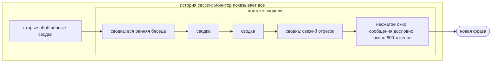
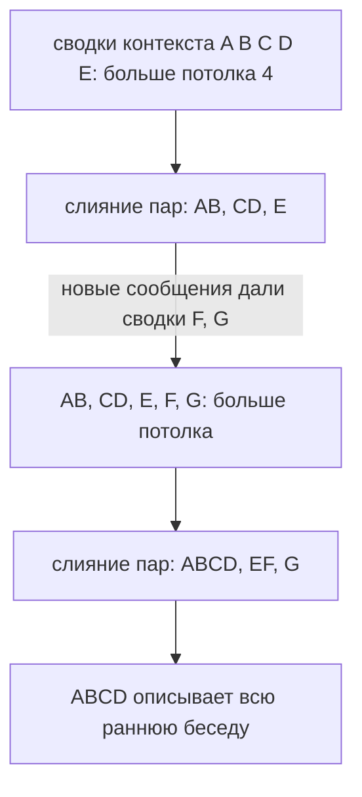
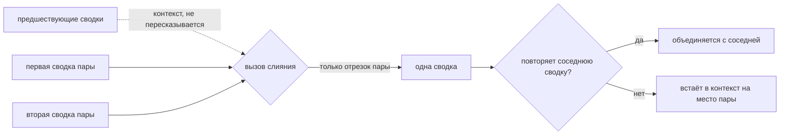
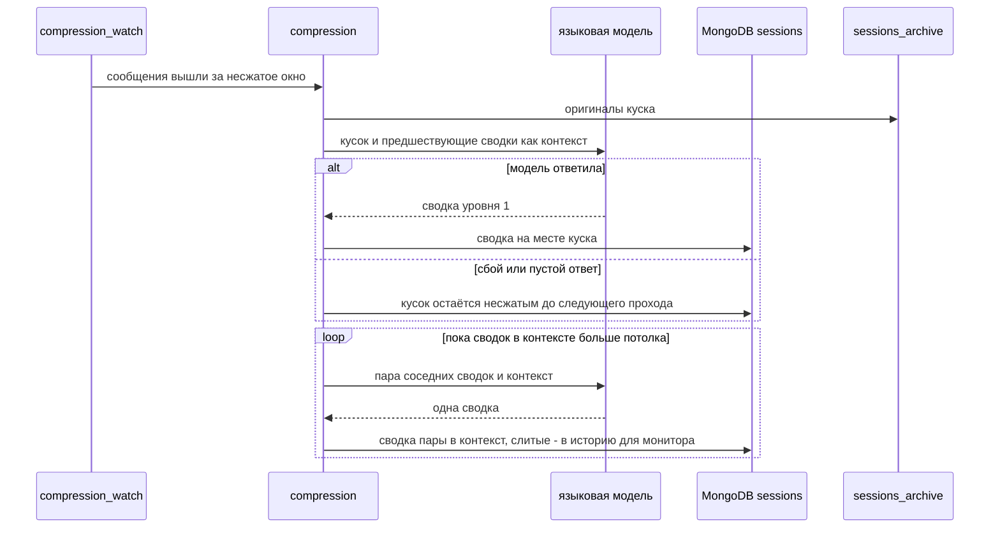
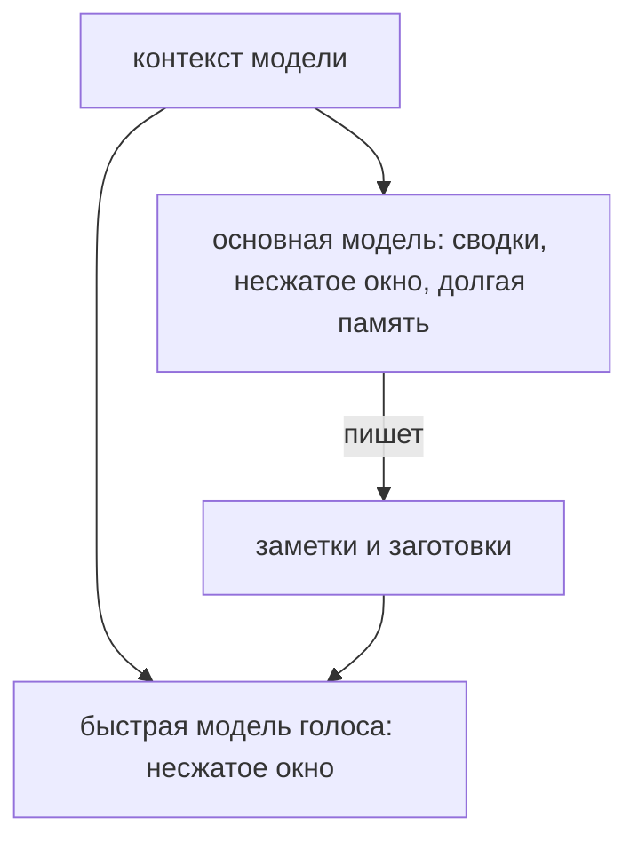

# Сжатие истории

Сессия SAM живёт неделями, а контекст модели ограничен: старые сообщения сессии сворачиваются в сводки
скользящим окном, всё удаляемое сначала уходит в архив. Почему так - ADR-008; когда сжатие запускается (ворота
простоя, потолок несжатого) и как из удаляемого извлекаются факты - ADR-015.

`gateway/compression.py`, запуск - `gateway/compression_watch.py`, промпты сводки - `gateway/prompts/summarize.py`.

## Дизайн (SAM-224)

Требования:

1. Сводки стоят в истории сессии на месте отрезков сообщений, которые они описывают.
2. Контекст модели в любой момент содержит не больше постоянного потолка сводок и несжатое окно, при любой длине
   беседы. История в MongoDB и в мониторе может содержать сколько угодно сводок: старые обобщённые сводки
   показываются в мониторе, но в контекст модели не попадают.
3. Когда сводок в контексте больше потолка, соседние сводки сливаются попарно, начиная с самых старых: из 4
   получается 2, из 6 - 3. Слияния повторяются каскадом, поэтому самая старая сводка контекста накапливает сжатое
   содержание всей ранней беседы: существенное остаётся, детали отбрасываются.
4. Соседние сводки не повторяют друг друга по содержанию.
5. Вызов слияния получает предшествующие сводки как контекст для точного обобщения пары и не включает их содержание в
   результат.

### Термины

- Сессия - один канал разговора с SAM: голос (`voice`), чат монитора с устройства (`homepc`), агент (`task:<id>`).
  У каждой сессии своя история в MongoDB, коллекция `sessions`.
- Сообщение - одна запись истории: фраза человека, ответ SAM или вызов инструмента.
- История сессии - все записи сессии в MongoDB: сообщения и сводки. Монитор показывает её целиком: что происходит
  сейчас и, по сводкам, что было раньше. Это инструмент наблюдения за историей, а не контекст модели.
  Нижняя часть истории в мониторе - сводки в пределах потолка и несжатое окно - и есть контекст модели; всё выше в
  контекст уже не входит. Монитор отмечает эту границу. Исходные сообщения сводки лежат в архиве; развернуть сводку в
  них в мониторе и показать границу контекста - SAM-225.
- Контекст модели - часть истории, которая уходит языковой модели в ход: сводки в пределах потолка и несжатое окно.
- Несжатое окно - последние сообщения сессии, которые хранятся и уходят в контекст дословно: около 600 токенов
  (`SAM_COMPRESS_KEEP_TOKENS`), последний обмен (фраза и ответ) всегда.
- Сводка - запись истории, которая заменяет отрезок старых сообщений их кратким обобщением и хранит отрезок времени,
  который описывает (`time_range`).
- Уровень сводки - сколько раз её содержимое обобщалось: уровень 1 - сводка сообщений, выше - сводка сводок.
- Потолок сводок - наибольшее число сводок в контексте модели (`SAM_COMPRESS_SUMMARY_CEILING`, по умолчанию 4).
- Слияние пары - замена двух соседних сводок в контексте одной, которая описывает оба их отрезка.
- Вызов слияния - запрос к языковой модели, который выполняет слияние пары.
- Архив - коллекция `sessions_archive`: оригиналы сжатых и удалённых сообщений, доступны поиском
  `GET /sam/archive/search`.
- Долгая память - факты о людях и договорённостях в Qdrant и MongoDB, их находит поиск по памяти (RAG).
- Основная модель - модель, которая ведёт разговор с памятью и инструментами (`LLM_SOURCE`).
- Быстрая модель голоса - локальная модель, которая первой отвечает на фразу голосом (`LLM_FAST_MODEL`, ADR-014).
- Заметки и заготовки - текст, который основная модель пишет для быстрой: тема, ход разговора, вероятные реплики
  собеседника и короткие ответы на них (workflow `dialogue-notes`).

### Контекст постоянного размера

Контекст модели состоит не более чем из потолка сводок и несжатого окна. Самая старая сводка контекста описывает всю
раннюю беседу, следующие - всё более свежие отрезки. Монитор показывает историю целиком, включая старые сводки,
которые в контекст уже не входят.

### Каскадное попарное слияние

Сообщения, вышедшие за несжатое окно, сворачиваются в сводку уровня 1. Когда сводок в контексте становится больше
потолка, соседние сводки сливаются попарно, начиная с самых старых. Слияние повторяется при каждом переполнении, и
самая старая сводка контекста постепенно вбирает всю раннюю беседу. Слитые сводки остаются в истории для монитора, в
контекст идёт результат слияния.

### Слияние пары

Вызов слияния получает пару сводок и предшествующие им сводки как контекст. Контекст нужен, чтобы понять, о чём пара в
общей линии беседы; пересказывать его запрещено, результат описывает только отрезок пары. Если результат по смыслу
повторяет соседнюю сводку, он объединяется с ней: второй сводки с тем же содержанием в контексте нет.

### Проход сжатия

### Какую историю получает каждая модель

Быстрая модель голоса сводок не получает. То, что было раньше в разговоре и нужно для ответа, основная модель
включает в заметки и заготовки для неё (ADR-027).

### Два канала: разговор и мысли (ADR-027)

- Разговор - что сказали люди, SAM вслух и её агенты. Мысли - неозвученные блоки ответа основной модели в любых парных
  тегах (ADR-003): замысел, решения, планы. Отдельного канала мыслей в коде нет, и отсюда баг 15 окт: служебные мысли и
  вызовы сжимались вместе с разговором в сводки «разговора не было» и вытесняли живую беседу.
- У каждого канала свой бюджет окна; разговор в приоритете: последние реплики людей остаются в окне дословно даже в
  долгой тишине, мысли сжимаются раньше и сильнее и места разговора не занимают.
- Сжатие ведёт каналы раздельно, каждый своей цепочкой с тем же каскадом. Смешанная сводка стирала бы разницу между
  сказанным и подуманным.
- Цепочка мыслей держит только решения, планы и перемены; ожидание и пустые состояния («жду реплику») выбрасываются.
  Длительность тишины модель знает по времени во входящих, а не из сводки.
- Сводки разговора сливаются только при переполнении от новых бесед: тишина и мысли их не трогают, последние беседы
  долго живут в сжатом виде.
- Сжатая беседа восстанавливается по запросу: исходные сообщения лежат в архиве, основная модель поднимает их
  инструментом «поднять историю» по теме или отрезку времени (для монитора - SAM-225); Поднятое не копируется в историю: в MongoDB пишется одна запись-ссылка «вернулись к прошлому разговору» с отрезками архива, журнал остаётся линейным без дублей. При сборке контекста шлюз вставляет поднятые отрезки из архива в окно по времени, между несмежными кусками - маркеры пропуска; расширение - окно в N сообщений сверх обычного (`SAM_RECALL_WINDOW`). Модель видит старую и текущую беседу в оригинале и может их связать. Сжатию всё равно, свои это сообщения или поднятые и сколько тем загружено: оно сжимает окно по обычным правилам и дописывает сводки в MongoDB одну за другой, расширение сходит на нет само.

### Свойства контекста

Контекст линеен. Сводки идут по времени, каждая покрывает непрерывный отрезок, отрезки не пересекаются: сливаются
только соседние сводки, порядок не меняется.

Контекст полон по охвату. Отрезки сводок контекста вместе покрывают всю сессию без пропусков. Дословно в нём только
несжатое окно; оригиналы сжатого лежат в архиве, устойчивые факты уходят в долгую память раньше, чем сообщение выходит
за окно .

Подробность падает с возрастом. Свежее идёт дословно, ближние сводки - подробно, дальние - кратко: самая старая сводка
пережила больше всего слияний и описывает самый длинный отрезок тем же объёмом текста. Объём контекста не растёт с
длиной беседы, растёт длина отрезка в старших сводках.

Важное остаётся, проходное уходит. Каждое слияние заново обобщает пару с учётом предшествующих сводок. Ожидаем, что
повторявшееся, то, к чему возвращались, и то, что имело последствия (договорённость, решение, факт о человеке),
переживёт много слияний, а разовые реплики выпадут при ближайшем. Чем старше отрезок, тем больше слияний он прошёл.

Повторов нет. Результат слияния, совпадающий по смыслу с соседней сводкой, объединяется с ней: одна мысль
не повторяется в нескольких сводках подряд.

Размер контекста постоянен. Каждый ход модель получает контекст одного объёма и устройства. Замер 15 окт: первый
токен быстрой модели растёт с размером промпта, 4,0 с на 10,6 тыс. токенов без кэша; растущий контекст увеличивает его
ход за ходом. Ожидаем и меньше уходов ответа в сторону, когда в контексте нет десятков старых сводок.

Подробности давнего поднимаются по запросу. Контекст держит общую линию беседы; когда речь снова заходит о старой
теме, её подробности должны приходить в ход рядом с фразой из долгой памяти и архива, не увеличивая контекст. Ход
основной модели полнотекстом ищет в архиве своей сессии и получает до `SAM_ARCHIVE_RAG_LIMIT` (3) реплик блоком «Из
прошлого разговора» рядом с памятью (SAM-228, `gateway/recall_history.py`).

### На что опираемся

Каскад похож на перенос разряда в счётчике: переполнение сливает соседние пары, и старшая сводка вбирает всё
более длинный отрезок, а контекст остаётся постоянного размера при любой длине беседы. Сливаются все пары прохода
(из 5 - 3), поэтому при потолке 4 число сводок ходит по кругу 3-4-5 и самая старая обобщается заново примерно на
каждой второй новой сводке.

Обобщение по уровням - известный способ сжимать длинный текст: его пересказывают частями, затем пересказы частей
(OpenAI, «Recursively Summarizing Books with Human Feedback», 2021; уровни памяти агента в MemGPT).

Недавнее модель видит дословно, давнее - в сводках, повторённое и значимое удерживается. Отдельного счётчика
важности нет: что удержать, решает повторное обобщение.

### Чем код отличается от дизайна

Каскад, фон слияния, поглощение повтора и сбой пустой сводки сделаны (SAM-224, SAM-226). Осталось:

- Повтор пары с соседней сводкой определяет модель слияния ответом `SKIP`; сравнения по смыслу без модели нет.
- Канал записи выводится из записи при чтении (`compression.channel_of`), отдельного поля у сообщения нет; у сводки
  канал мыслей - поле `summary_channel: thoughts`.
- Рядом лежит неподключённая `compress_context` (`gateway/agent.py`) со своим кэшем сводного резюме.
- Монитор не отмечает границу контекста и не разворачивает сводку в исходные сообщения (SAM-225).

## Окно

| Что | Значение | Где |
|---|---|---|
| сырое окно | последние сообщения в пределах `SAM_COMPRESS_KEEP_TOKENS` (600 токенов), не больше 20 и не меньше 2 (последний обмен дословно при любой длине) | `KEEP_TOKENS`, `COMPRESS_KEEP`, `KEEP_MIN` |
| токены | по символам, `SAM_CHARS_PER_TOKEN` (3,3, замер 9 окт на 5881 реплике): `usage` поставщика приходит на вызов, а не на сообщение | `CHARS_PER_TOKEN` |
| порог сжатия | за окном 4 сообщения или `SAM_COMPRESS_CHUNK_TOKENS` (250) токенов | `COMPRESS_CHUNK`, `CHUNK_TOKENS` |
| после прохода | `SAM_COMPRESS_MIN_GAP_S` (60 с) новая запись ниже потолка проход не ставит: сообщения за окном копятся до куска | `compression_watch.MIN_GAP_S` |
| контекст хода | сводки контекста (до потолка) отдельно от лимита сообщений хода (30): поток реплик их не вытесняет | `session_repo.get_recent(summaries=)` |
| каналы (SAM-227) | разговор - фраза человека и ответ SAM с произнесённым текстом; мысли - ответ из одних неозвученных блоков, вызов инструмента, тело скилла. Окно мыслей - `SAM_COMPRESS_THOUGHT_KEEP_TOKENS` (150) от конца, отдельно от окна разговора: поток мыслей реплики людей не вытесняет | `channel_of`, `THOUGHT_KEEP_TOKENS` |
| одна на сессию | второй проход той же сессии не стартует, пока идёт первый; та же история второй раз не сжимается (хэш id, пишется после успеха) | `_compress_in_progress`, `_compress_hashes` |

Окно 600 токенов - около 10 сообщений по 90-му процентилю длины (около 56 токенов на сообщение).

## Проход

1. Почти-дубли: соседние сообщения одной роли (кроме сводок и вызовов tools) длиной от 15 знаков со сходством
   TF-IDF от 0,75 - старшее уходит в архив (`dedup_recent`) и удаляется. Без scikit-learn шаг пропускается.
2. Снимок всего, что старше окна; записи, пришедшие во время прохода, ждут следующего.
3. Факты из снимка - в долгую память (`SAM_MEMORY_AUTOWRITE`).
4. Снимок пишется в `sessions_archive` с причиной `compressed`, потом режется на куски до
   `SAM_COMPRESS_CHUNK_MAX_TOKENS` (1500 токенов, не меньше 4 сообщений).
5. Кусок - вызов сводки уровня 1: первый - промпт `BASE`, следующие - `DIFF` с тремя прошлыми сводками, только
   новое. Сводка встаёт на место первого сообщения куска с отрезком времени, остальные удаляются. Ответ `SKIP` -
   нового нет, кусок удаляется целиком без сводки.
5а. Куски мыслей сводит свой промпт «мои решения и планы» (`SUMMARIZE_THOUGHTS_PROMPT`): ожидание и пустые состояния
   выбрасываются, сводка помечена `summary_channel: thoughts`.
6. Каскад по каналам: у разговора потолок `SAM_COMPRESS_SUMMARY_CEILING` (4), у мыслей - `SAM_COMPRESS_THOUGHT_CEILING`
   (2); сводки разговора сливаются только от своего переполнения. Сводок в контексте больше `SAM_COMPRESS_SUMMARY_CEILING` (4) - соседние пары от старых сливаются
   (`fold_summaries`), проход за проходом, пока не станет не больше потолка; идёт и тогда, когда сообщений сжимать
   нечего. Вызов слияния получает фоном `SAM_COMPRESS_MERGE_BACKGROUND` (3) предшествующих сводок и не пересказывает
   их. Сводка пары встаёт на место первой с уровнем на 1 выше, слитые скрываются полем `ignore` («слита в сводку
   ...»): в истории и мониторе они есть, в контексте нет. Ответ `SKIP` - пара повторяет фон, её отрезок поглощает
   предыдущая сводка («повторяет сводку ...»). Сбой слияния оставляет пару в контексте до следующего прохода.
7. Кэш сводной сводки (`meta_repo`) сбрасывается; монитор видит одну строку хода сжатия
   (`compression_progress`, закрывается `context_compressed`).

Сводку пишет служебная модель при любой основной модели SAM: локальная qwen без рассуждения, если она загружена в
LM Studio (`SAM_SERVICE_LLM_SOURCE`, `SAM_SERVICE_LLM_MODEL`), иначе основная модель роутера с минимальным рассуждением
(SAM-226). Пустая сводка - сбой сжатия: сырой кусок вместо сводки не пишется, кусок ждёт следующего прохода. Промпт
сводки отделяет устойчивые факты (привычки, договорённости) от эпизодов.

## Архив

Запись-ссылка (SAM-228): инструмент основной модели `recall_history` по теме находит реплики архива сессии и пишет
в историю одну запись `role: recall` с их id (`recall_ids`). Контекст хода (`agent.get_session_history`) разворачивает
её в эти реплики по времени, не больше `SAM_RECALL_WINDOW` (20), с пометкой пропуска между кусками дальше
`SAM_RECALL_GAP_S` (300 с). В MongoDB реплики не копируются; ссылка - мысль для сжатия и уходит из окна сама. Быстрая
поднятого и блока архива не видит: в архиве до пометки секретов (SAM-229) секреты не помечены.

Любое сжатое или удалённое сообщение находится поиском `GET /sam/archive/search?q=...`; причина удаления -
поле записи (`dedup_recent`, `compressed`; `recursive_merge` - у записей до SAM-224).

## Когда идёт работа

Ворота простоя (`gateway/idle_gate.py`): хода нет `SAM_IDLE_S` (30 с). Сжатие ждёт паузы не дольше
`SAM_COMPRESS_IDLE_MAX_S` (300 с), потом идёт без неё. Потолок несжатого (`SAM_COMPRESS_CEILING`, 28 сообщений,
или `SAM_COMPRESS_CEILING_TOKENS`, 2100) сжимает сразу (ADR-015).

Перед удалением куска истории LLM извлекает факты: только добавление, с источником, повтор отсекается по
`SAM_MEMORY_DUP_SCORE` (0,85), включается `SAM_MEMORY_AUTOWRITE=1` (SAM-63).

Ночью (`gateway/dream.py`, `SAM_DREAM=1`, окно `SAM_DREAM_FROM_H`-`SAM_DREAM_TO_H`, раз в `SAM_DREAM_INTERVAL_H`,
20 ч) - отчёт о фактах и векторах и удаление векторов без попаданий за 90 дней при `SAM_DREAM_APPLY=1` (SAM-22).
Слияние повторов и забывание - следующий шаг.

## Проверка

`tests/test_compression_module.py`, `tests/test_compression_watch.py`.

## Не закрыто

- Отмена начатого сжатия новой фразой и состояние сжатия в Mongo: флаг и хэш - в памяти процесса (ADR-015).
- Сбой каскада после удачного сжатия сообщений - сбой всего прохода: сессия ждёт `SAM_COMPRESS_FAIL_RETRY_S`.
