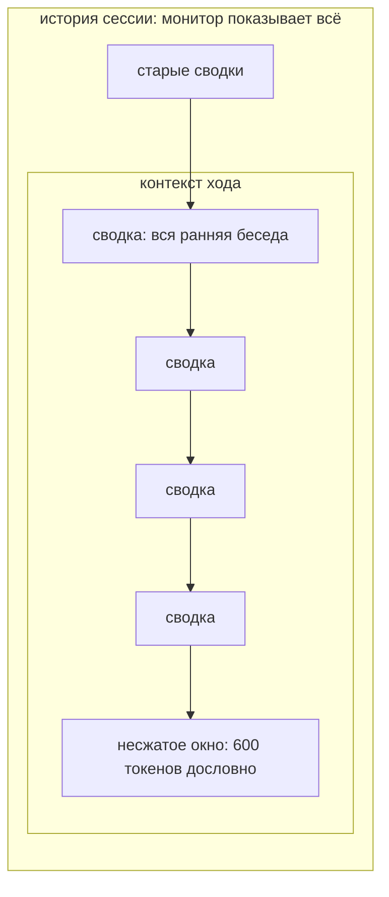
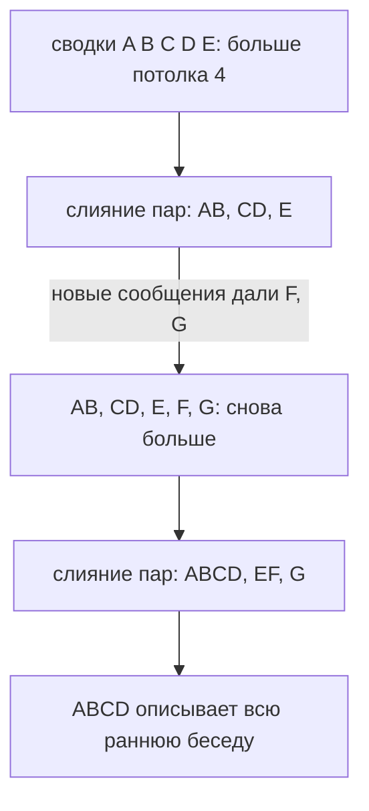
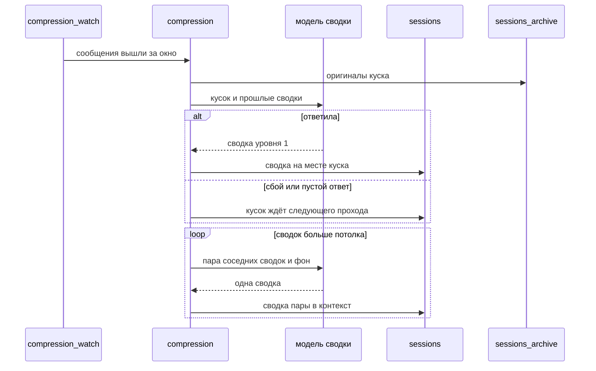

# Сжатие истории

Контекст модели не растёт с длиной беседы. Старые сообщения сессии сворачиваются в сводки скользящим окном,
оригиналы уходят в архив и остаются доступны поиском. Решение — [ADR-008](../adr/008-history-compression-window-archive.md),
время запуска — [ADR-015](../adr/015-memory-work-in-pauses-auto-write.md).

`gateway/compression.py` - проход и каскад, `gateway/compression_watch.py` - когда запускать,
`gateway/prompts/summarize.py` - промпты сводки и слияния.

## Устройство контекста

Контекст хода — это сводки в пределах потолка плюс несжатое окно. Всё, что старше окна, уже в сводках. Всё, что
старше потолка, в контекст не идёт, но остаётся в истории: монитор показывает сессию целиком.

| Слово | Что значит |
|---|---|
| сессия | один канал разговора: `voice`, `homepc`, `task:<id>`. У каждой своя история в `sessions` |
| несжатое окно | последние сообщения, которые уходят в контекст дословно: около 600 токенов, последний обмен всегда |
| сводка | запись вместо отрезка старых сообщений; хранит время отрезка в `time_range` |
| уровень сводки | сколько раз её обобщали: 1 — сводка сообщений, выше — сводка сводок |
| потолок сводок | сколько сводок помещается в контекст: `SAM_COMPRESS_SUMMARY_CEILING`, 4 |
| архив | `sessions_archive`, оригиналы сжатого и удалённого, поиск `GET /sam/archive/search` |

## Каскад

Сообщения за окном сворачиваются в сводку уровня 1. Когда сводок в контексте больше потолка, соседние сливаются
попарно, начиная со старых. Слияние повторяется при каждом переполнении, поэтому самая старая сводка постепенно
вбирает всю раннюю беседу, а контекст остаётся одного размера при любой длине сессии.

Сливаются все пары прохода: из пяти сводок получается три. При потолке 4 число сводок ходит по кругу 3-4-5, и
самая старая обобщается заново примерно на каждой второй новой сводке.

Слияние получает пару и несколько предшествующих сводок фоном (`SAM_COMPRESS_MERGE_BACKGROUND`, 3), чтобы понять
место пары в линии беседы. Пересказывать фон запрещено: результат описывает только отрезок пары. Если результат
повторяет соседнюю сводку, модель отвечает `SKIP`, и отрезок пары поглощает предыдущая сводка. Слитые сводки
остаются в истории с полем `ignore` («слита в сводку ...»): в мониторе они есть, в контекст не идут.

## Два канала

Разговор и мысли сжимаются раздельно, каждый своим потолком.

| Канал | Что в нём | Потолок |
|---|---|---|
| разговор | фразы людей и ответы SAM с произнесённым текстом | `SAM_COMPRESS_SUMMARY_CEILING`, 4 |
| мысли | ответ из одних неозвученных блоков, вызов инструмента, тело скилла | `SAM_COMPRESS_THOUGHT_CEILING`, 2 |

Разделение появилось после случая 15 октября: служебные мысли и вызовы сжимались вместе с разговором в сводки
«разговора не было» и вытесняли живую беседу. Сейчас у мыслей своё окно (`SAM_COMPRESS_THOUGHT_KEEP_TOKENS`, 150
токенов от конца), и поток мыслей реплики людей не вытесняет. Сводки разговора сливаются только от собственного
переполнения: тишина и мысли их не трогают.

Канал записи выводится при чтении (`compression.channel_of`): отдельного поля у сообщения нет. У сводки мыслей
есть `summary_channel: thoughts`.

## Свойства контекста

Контекст линеен: сводки идут по времени, каждая покрывает непрерывный отрезок, отрезки не пересекаются.

Отрезки покрывают всю сессию без пропусков. Дословно в контексте только несжатое окно, оригиналы сжатого лежат в
архиве, устойчивые факты уходят в память раньше, чем сообщение выйдет за окно.

Подробность падает с возрастом: свежее идёт дословно, ближние сводки подробны, дальние кратки. Самая старая сводка
прошла больше всех слияний и описывает самый длинный отрезок тем же объёмом текста.

Что удержать, решает повторное обобщение: повторявшееся, то, к чему возвращались, и то, что имело последствия
(договорённость, решение, факт о человеке), переживает много слияний, разовые реплики выпадают на ближайшем.
Отдельного счётчика важности нет.

## Окно

| Параметр | Значение | Где |
|---|---|---|
| сырое окно | `SAM_COMPRESS_KEEP_TOKENS` (600 токенов), не больше 20 сообщений и не меньше 2: последний обмен остаётся дословно при любой длине | `KEEP_TOKENS`, `COMPRESS_KEEP`, `KEEP_MIN` |
| токены | считаются по символам, `SAM_CHARS_PER_TOKEN` (3,3, замер на 5881 реплике): `usage` поставщика приходит на вызов, а не на сообщение | `CHARS_PER_TOKEN` |
| порог сжатия | за окном 4 сообщения или `SAM_COMPRESS_CHUNK_TOKENS` (250) токенов | `COMPRESS_CHUNK`, `CHUNK_TOKENS` |
| после прохода | `SAM_COMPRESS_MIN_GAP_S` (60 с) новая запись ниже потолка проход не ставит: сообщения копятся до куска | `compression_watch.MIN_GAP_S` |
| контекст хода | сводки (до потолка) отдельно от лимита сообщений хода (30): поток реплик их не вытесняет | `session_repo.get_recent(summaries=)` |
| одна на сессию | второй проход той же сессии не стартует, пока идёт первый; та же история дважды не сжимается | `_compress_in_progress`, `_compress_hashes` |

Окно в 600 токенов — около 10 сообщений по 90-му процентилю длины (около 56 токенов на сообщение).

## Проход

1. Почти-дубли: соседние сообщения одной роли (кроме сводок и вызовов инструментов) длиной от 15 знаков со
  сходством TF-IDF от 0,75. Старшее уходит в архив с причиной `dedup_recent` и удаляется. Без scikit-learn шаг
  пропускается.
2. Снимок всего, что старше окна. Записи, пришедшие во время прохода, ждут следующего.
3. Факты из снимка - в долгую память, если включено `SAM_MEMORY_AUTOWRITE`.
4. Снимок пишется в `sessions_archive` с причиной `compressed`, затем режется на куски до
  `SAM_COMPRESS_CHUNK_MAX_TOKENS` (1500 токенов, не меньше 4 сообщений).
5. Кусок - вызов сводки уровня 1: первый идёт с промптом `BASE`, следующие - с `DIFF` и тремя прошлыми сводками,
  только новое. Сводка встаёт на место первого сообщения куска, остальные удаляются. Ответ `SKIP` - нового нет,
  кусок удаляется без сводки.
6. Каскад слияния по каналам, пока сводок не станет не больше потолка. Идёт и тогда, когда сообщений сжимать
  нечего.
7. Кэш сводной сводки (`meta_repo`) сбрасывается. В мониторе видна одна строка хода сжатия (`compression_progress`,
  закрывается `context_compressed`).

Сводку пишет служебная модель при любой основной: локальная qwen без рассуждения, если загружена в LM Studio
(`SAM_SERVICE_LLM_SOURCE`), иначе модель роутера с минимальным рассуждением. Пустая сводка считается сбоем: сырой
кусок вместо сводки не пишется, кусок ждёт следующего прохода. Промпт отделяет устойчивые факты (привычки,
договорённости) от эпизодов.

## Архив

Любое сжатое или удалённое сообщение находится поиском `GET /sam/archive/search?q=...`. Причина удаления лежит в
поле записи: `dedup_recent`, `compressed` или `recursive_merge`.

Инструмент основной модели `recall_history` ищет по теме реплики архива своей сессии и пишет в историю одну запись
`role: recall` с их id. Контекст хода разворачивает запись в эти реплики по времени, не больше
`SAM_RECALL_WINDOW` (20), с пометкой пропуска между кусками дальше `SAM_RECALL_GAP_S` (300 с). Сами реплики в
MongoDB не копируются: ссылка уходит из окна как обычная мысль. Быстрая модель поднятого не видит.

## Запуск в паузах

Ворота простоя (`gateway/idle_gate.py`): хода нет `SAM_IDLE_S` (30 с). Сжатие ждёт паузы не дольше
`SAM_COMPRESS_IDLE_MAX_S` (300 с), потом идёт без неё. На потолке несжатого (`SAM_COMPRESS_CEILING`, 28 сообщений,
или `SAM_COMPRESS_CEILING_TOKENS`, 2100) сжимает сразу.

Перед удалением куска LLM извлекает факты: только добавление, с источником, повтор отсекается по
`SAM_MEMORY_DUP_SCORE` (0,85), включается `SAM_MEMORY_AUTOWRITE=1`.

Ночью (`gateway/dream.py`, `SAM_DREAM=1`, окно `SAM_DREAM_FROM_H`-`SAM_DREAM_TO_H`, раз в `SAM_DREAM_INTERVAL_H`,
20 ч) идёт отчёт о фактах и векторах и удаление векторов без попаданий за 90 дней при `SAM_DREAM_APPLY=1`.
Слияние повторов и забывание — следующий шаг.

## Не закрыто

- Отмена начатого сжатия новой фразой и состояние сжатия в Mongo: флаг и хэш живут в памяти процесса.
- Сбой каскада после удачного сжатия сообщений считается сбоем всего прохода: сессия ждёт `SAM_COMPRESS_FAIL_RETRY_S`.
- Повтор пары с соседней сводкой определяет только модель ответом `SKIP`; сравнения по смыслу без модели нет.
- Монитор не отмечает границу контекста и не разворачивает сводку в исходные сообщения.
- Рядом лежит неподключённая `compress_context` в `gateway/agent.py` со своим кэшем сводного резюме.

## Проверка

`tests/test_compression_module.py`, `tests/test_compression_watch.py`.
