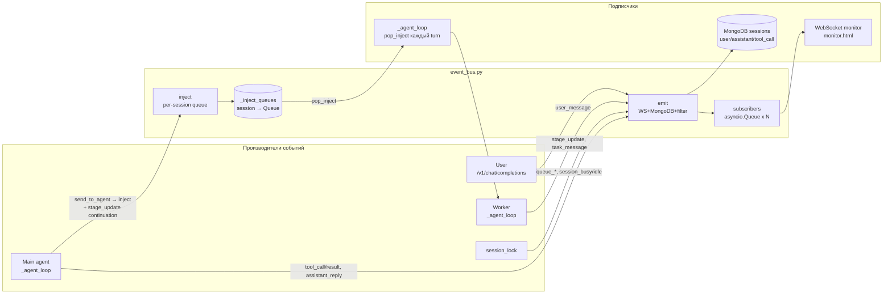
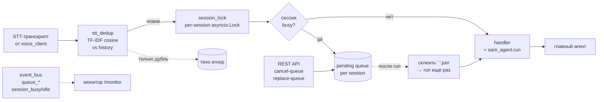

# Цикл агента и вызовы tools

Главный агент, воркер и агент Cortex крутятся в одном цикле: модель — вызовы tools — результаты — модель, пока не
будет ответа. Вызовы приходят нативно или текстом, их разбирает один слой.

`gateway/agent_loop.py` (`run_agent_loop`, зависимости — `AgentLoopDeps`), адаптеры — `gateway/llm_client.py`,
схемы и сообщения под поставщика — `gateway/provider_transform.py`, разбор текста — `gateway/tool_text_parse.py`.

## Адаптеры

`LLM_ADAPTER` в `.env` или `POST /sam/llm/switch` (`python -m gateway.cli llm switch <адаптер>`):

| Адаптер | Что делает |
|---|---|
| `openai` (по умолчанию) | прямой AsyncOpenAI с нативными tools: у всех поставщиков SAM OpenAI-совместимый адрес; формату `harmony` (gpt-oss) нативные tools не передаются |
| `custom` | тот же AsyncOpenAI и проверка синтаксиса вызовов из текста (мета-формат, `LLM_TEXT_TOOLS`) |
| `litellm` | через litellm, для поставщика без OpenAI-совместимого адреса |
| `auto` | `openai`; после `LLM_PARSE_FAIL_THRESHOLD` (3) провалов разбора подряд на локальной модели — `custom` |

Разбор вызовов из текста идёт на любом адаптере: Qwen через litellm писал вызов текстом там, где ждали нативный.
Форматы — Harmony, `<tool_call>`, `[tool_call: ...]`, голые Python-вызовы, GLM-4, Gemma 4; каждый — разбор с тестом.
`provider_transform` чистит схемы tools под поставщика (Gemini отвечал 400 на часть JSON Schema) и сообщения
(особенности Claude, Mistral, Gemini).

## Защита цикла

| Действие | Исполнение |
|---|---|
| тот же tool 3 раза подряд (у шлюзов `mcp_call` — тот же вызов целиком: имя и аргументы) | подсказка «Ты вызываешь X 3-й раз подряд; результаты выше — используй их или ответь», событие `loop_guard` |
| тот же tool 5 раз подряд | следующий вызов модели с `tool_choice="none"`: только ответ |
| опрос без прогресса | тот же вызов с тем же результатом `SAM_NO_PROGRESS_LIMIT` (3) раза, и вперемешку с другими — системная строка «ответь тем, что известно», событие `no_progress`, дальше `tool_choice="none"` |
| повтор вызова | вызов с теми же именем и аргументами за один прогон не исполняется повторно, кроме `READONLY_TOOLS` (`tools/list`, `screenshot`, `get_windows`, `get_audio_state`, `list_allowed_directories`, `read_file`, `search_web`) |
| невыданный tool | инструмент, которого модели не показали, не исполняется: ответ «Инструмента X нет» |
| лимит шагов | `max_turns` и пул шагов задачи ([worker](../agents/worker.md)); кончились — ответ «Превышен лимит шагов агента» |
| `[STOP_WORKER]` | tool вернул маркер — цикл заканчивается последним ответом воркера |
| инъекции | на каждом шаге цикл забирает сообщения сессии из шины (`pop_inject`, ADR-004) и добавляет их с меткой `[INJECT]` |
| обрезанный вызов | ответ упёрся в предел (`finish_reason=length`), а вызов не разобрался: нативный — с битыми аргументами, текстом — не нашёлся. Вызов не исполняется; модель получает причину с пределом и советом «раздели аргументы на несколько вызовов или пиши короче», у `app_make` и `app_update` — «раздели файл — app_make с частью, остальное app_update или несколько файлов» (`split_hints`, `gateway/tools/apps.py`). В ходе только с ответом обрезанный текст уходит как есть |

## Предел ответа модели

| Переменная | По умолчанию | Ход |
|---|---|---|
| `SAM_LOOP_MAX_TOKENS` | 8192 | модель может вызвать инструмент (`tool_choice="auto"`) |
| `SAM_LOOP_MAX_TOKENS_TEXT` | 2048 | только ответ (`tool_choice="none"`): после 5 одинаковых вызовов подряд или опроса без прогресса |

Вызов `app_make` со страницей 5 КБ (код с кириллицей) занимает 1,6-1,9 тыс. токенов аргументов, страница 8 КБ —
около 3 тыс.; GLM с рассуждением (zai) тратит тот же предел и на него. При прежних 2048 такой вызов обрезался в 12
из 14 попыток живого прогона 14 окт. Залипание на повторе гасят штрафы повторов
(`provider_transform.sampling_for_provider`, кроме Gemini), предел ограничивает цену такого сбоя. Выше 8192
предел не поднимать без проверки поставщика: у gemini-2.0-flash потолок вывода 8192, больший `max_tokens` — ответ
400. Пределы читаются при старте шлюза.

## Регистрация tool

Класс `BaseTool` с `@register_tool` (из qwen_agent берутся только они), имя в `MAIN_TOOL_NAMES` или
`WORKER_TOOL_NAMES`, функция в `TOOL_IMPL` (`gateway/agent.py`). Сама функция — `*_impl(params, deps)` в
`gateway/tools/` с зависимостями параметрами.

## Очередь фраз сессии

В сессии идёт один ход; фразы, пришедшие во время хода, копятся и уходят следующим ходом одним сообщением (ADR-007).
`gateway/session_lock.py`.

| Вызов | Что делает |
|---|---|
| `acquire_and_run(session_id, text, handler)` | берёт замок сессии; первая фраза идёт в ход сразу |
| очередь | фразы во время хода копятся, после хода склеиваются через пробел и уходят одним ходом |
| `cancel_current_turn`, `cancel_all_turns`, `clear_queue`, `pop_last_queued`, `replace_queue` | управление; у монитора ручки `/sam/session/{id}/...` и `/sam/cancel-all` |
| `exclusive(session_id)` | ход не от человека (шаг workflow, ответ основной после паузы быстрой): ждёт замок, сессию занятой не помечает (ADR-023, шаг 1) |
| `background(session_id)` | пачки очереди push одной сессии идут одновременно под одним захватом замка (ADR-020, п. 12, [workflows](../../features/automation/workflows.md)) |

События `queue_*`, `session_busy`, `session_idle` идут через шину.

## Проверка

`tests/test_agent_loop.py`, `tests/test_llm_client.py`, `tests/test_provider_transform.py`, `tests/test_session_lock.py`.

## Не закрыто

- Новая модель с новым форматом вызова: вызов не разобран, текст уходит ответом, пока не добавлен разбор.
- Разбор текста может принять вызов в обычном ответе текстовой модели за настоящий.

## Шина и инъекции

`emit` рассылает событие подписчикам, пишет запись в `sessions` и зовёт слушателей; `inject` кладёт сообщение в
очередь сессии, её забирает `pop_inject` на шаге цикла.

Промпт учит главного агента проверять `list_agents` перед `spawn_agent` и брать `send_to_agent`, если есть
подходящая задача; старые имена `get_tasks`, `create_task`, `send_to_task` остались в `TOOL_IMPL` для совместимости.
Инъекция в задачу шлёт `stage_update("continuation", running)`, и задача оживает в мониторе.

## Очередь сессии

