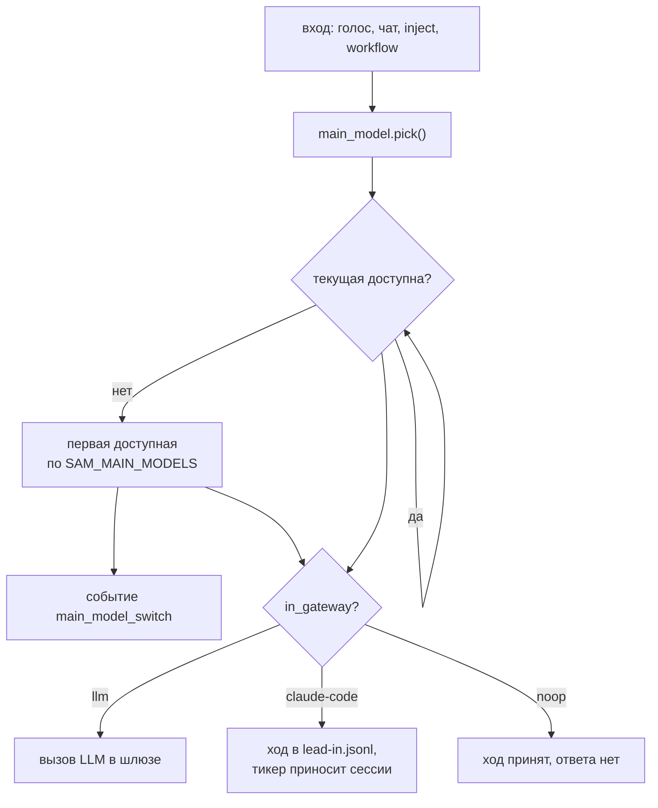

# Основная модель

Шлюз отдаёт каждый вход — голос, чат монитора, inject — основной модели и не знает, кто за ней. Роль основного
играет модель внутри шлюза (`llm`), сессия Claude Code (`claude-code`) или `noop`: по умолчанию
`SAM_MAIN_MODELS=claude-code,llm`, где Claude Code один из вариантов основной модели рядом с `llm`.
Решение — [ADR-018](../adr/018-main-model-concrete-models.md).



`gateway/main_model.py`, сборка — `gateway/agent.py` (`main_models`):

- Список конкретных моделей по приоритету — `SAM_MAIN_MODELS`, по умолчанию `claude-code,llm`. Неизвестное имя
  или пустой список — ошибка на старте шлюза одной строкой.
- Контракт конкретной модели: имя, проверка доступности `available`, признак `in_gateway` (ответ рождается вызовом
  LLM в шлюзе), доставка `deliver` входа не из голоса и `commands` — её команды для подсказки монитора по `/`
  (у `claude-code` — `SAM_CLAUDE_CODE_COMMANDS`, у остальных пусто).
- Инертность: текущая модель остаётся, пока доступна; недоступна — берётся первая доступная по приоритету,
  событие `main_model_switch` уходит в монитор; никто не доступен — ход идёт текущей.
- Смена без рестарта: `POST /sam/main-model` с `main: claude-code|llm` (инструмент `switch_main_model`
  MCP-сервера `sam`) делает модель текущей и первой, порядок пишется в `SAM_MAIN_MODELS` в `.env`; недоступного
  ведущего не ставит. Маршрут требует ключа привилегий ([stand](../stand/stand.md), блок «Агенты»).
- Ярлык «ведёт» в мониторе и поле `main_model` в `/health` — текущая модель; событие `main_model_turn` — ход,
  отданный модели вне шлюза.

| Модель | in_gateway | Доступна | Как получает вход |
|---|---|---|---|
| `llm` | да | всегда | голосовой ход `/voice/turn` и чат — вызов модели роутера (`LLM_SOURCE`, быстрая — `LLM_FAST_*`) |
| `claude-code` | нет | `lead.alive` в шине моложе `SAM_LEAD_ALIVE_S` (5 с) | голос — тиком из `voice-in.jsonl`; чат монитора и inject — строкой в `lead-in.jsonl`, тикер приносит её тиком `chat` |
| `noop` | нет | всегда | никак: ход принят, ответа нет |

Шаг workflow стенда приходит тем же путём с источником `workflow:<имя>/<шаг>`: `claude-code` — строкой в
`lead-in.jsonl`, `llm` — ходом шлюза ([workflows](../../features/automation/workflows.md)). Реплику по расписанию
(поздний час) делает основная модель.

При `claude-code` голосовой ход шлюза основную модель не зовёт (`gateway/voice_turn.py`). Быстрый голос при
ведущем (`SAM_FAST_WITH_LEAD`, по умолчанию 1): быстрая модель роутера отвечает сразу или берёт паузу, ведущий
получает фразу тиком и ответ быстрой входом с источником `fast_reply` и делает по существу или поправляет
`say --fix`; workflow проверки быстрой (`fast-review`, `fast-action`, `fast-handoff`) при ведущем не идут
(`where: {main: llm}`). Быстрая не отвечает (холодная сессия или откат по `fast-voice.yml`,
`SAM_FAST_WITH_LEAD=0`) — модель шлюза не зовётся, отвечает сессия. Поиск по памяти идёт на входе до развилки при
любой основной модели (`gateway/recall.py`): сессия получает факты полем `facts` в тике `chat` или тиком `rag` к
фразе ([stand](../stand/stand.md), блок «Память»). История сжимается при любой основной модели: сжатие ставит
запись реплики в историю, сводку пишет модель роутера ([stand](../stand/stand.md), блок «Память»).

## Ведущий главного хода

Кроме `llm` и `claude-code` главный ход может вести агент за ACP (Agent Client Protocol, JSON-RPC по stdio).
Выбирает `SAM_AGENT_BACKEND`: `sam` (по умолчанию) оставляет ход своему циклу в шлюзе, `acp` отдаёт его агенту.
В роутере агент за ACP — поставщик `acp` для задач `turn` и `fast` (`gateway/llm_router.py`, `_agent_turn_llm`);
без `SAM_ACP_COMMAND` агента нет и ход идёт как раньше.

| Переменная | Что задаёт | По умолчанию |
|---|---|---|
| `SAM_ACP_COMMAND` | исполняемый файл агента | нет: без неё агента нет |
| `SAM_ACP_ARGS` | аргументы строкой, как в shell; для Cortex — `python` в `SAM_ACP_COMMAND` и `-m cortex.acp` здесь | пусто |
| `SAM_ACP_CWD` | рабочая папка сессии агента | `data/acp` |
| `SAM_ACP_NAME` | ярлык модели в мониторе и учёте токенов | `acp-agent` |
| `SAM_ACP_MCP_URL` | MCP стенда, который агент получает в сессии | `http://localhost:3000/mcp` |
| `SAM_ACP_MCP_NAME` | имя этого MCP для агента | `sam` |
| `SAM_ACP_ENV` | имена переменных окружения, которые агент получает сверх минимума SDK, через запятую | пусто |
| `SAM_ACP_HOME_TEMPLATE` | папка шаблона, копируется в домашнюю папку агента перед запуском | пусто: своей папки нет |
| `SAM_ACP_HOME` | куда копировать шаблон; состояние агента остаётся здесь | `data/acp/home` |
| `SAM_ACP_HOME_VAR` | имя переменной, по которой агент находит свою папку (у Hermes `HERMES_HOME`) | пусто |
| `SAM_ACP_START_TIMEOUT_S` | предел старта подпроцесса | 60 |

Окружение подпроцесса SDK ограничивает безопасным минимумом, поэтому ключ модели, адреса и домашняя папка
передаются по именам из `SAM_ACP_ENV`. Контекст хода собирает шлюз и отдаёт агенту целиком текстом в новой сессии.
Агент упал — ход кончается `AcpError`, поставщик получает 503, `llm_client` ставит его в паузу и берёт следующего
по роутеру. Механика сессий — `gateway/acp/`, свой агент — `cortex/acp/` ([agents](../agents/README.md)).

## Claude Code как основная модель

Когда основная модель — сессия Claude Code, она разговаривает с человеком, история хода лежит в шлюзе, а не в
сессии: после `/clear` переписка самой сессии пропадает, история SAM остаётся.

Что сессия получает о себе — SessionStart-хук `.claude/hooks/lead_brief.py`: роль про среду (блоки среды по
строке, указатель на `docs/`), промпт SAM `gateway/prompts/lead.py` — те же разделы, что у модели шлюза, импортом,
в роде голоса из `GET /sam/config` (шлюз лежит — род по умолчанию и строка о причине), шаги старта, раздел
«После /clear» из `current.md` и голос из шины за 30 минут (`SAM_LEAD_BRIEF_MINUTES`), между ними — выжимка
памяти о доме из `GET /sam/memory/search`. Хук срабатывает, если сессию открыл `start_sam.ps1`
(`SAM_LEAD_SESSION=1`) или тикер писал в шину последние 10 минут.

Живость — `scripts/lead_heartbeat.py`: фоновый процесс сессии трогает `lead.alive` раз в секунду, хук SessionEnd
удаляет файл. Ответ — `python -m voice.layer.say "текст"`: строка в `say-out.jsonl` и
`POST /sam/session/{id}/reply` — в монитор и историю. `--fix` — поправка, `--from haiku` — быстрый голос. Текст
без звука (схема псевдографикой, список) — `--text-only "текст"` или `--text-only -` с текстом в stdin:
`POST /sam/session/{id}/note`, в монитор моноширинно как есть и в историю с полем `channel: text`; модель видит
его в истории с пометкой `[текстом в монитор, не голосом]` (`gateway/runner.py`).

Дела SAM сессия делает инструментами MCP-сервера `sam` (`mcp/sam_server.py` поверх REST шлюза, строка в
локальном `.mcp.json`, в агрегатор стенда не входит):

| Инструмент | Что делает |
|---|---|
| `memory_search`, `remember` | поиск и запись факта долгой памяти |
| `create_agent` | агент SAM под задачу, как `spawn_agent` |
| `answer_agent` | ответ или вводная агенту в сессию `task:<id>` |
| `grant_agent_tool`, `grant_agent_steps` | инструмент и шаги агенту по его просьбе |
| `push_ack` | подтверждение сообщений очереди push |
| `switch_main_model` | смена основной модели или поставщика без рестарта |
| `sandbox_exec` | кусок кода в тёплом контейнере песочницы |
| `restart_component` | перезапуск компонента стенда |

## Модели

Opus — агентам кода (`SAM_CLAUDE_CODING_MODEL`, по умолчанию `opus`, `gateway/tools/coding_agents.py`); служебные
вызовы поставщика `claude_code` — `SAM_CLAUDE_LEAD_MODEL` (по умолчанию `sonnet`); модель сессии — `SAM_LEAD_ARGS`
(например, `--model sonnet`) в `scripts/sam_lead.ps1`.

## Источник реплики

При `llm` шлюз до первой дельты хода шлёт мосту `{"type": "source", "source": "fast"|"main"}`, мост пишет строку
say-out с `from=haiku` за быструю модель и `from=gateway` за основную; поправка (`fix`) отзывает только `haiku`.
Озвучка переносит `from` в `said.jsonl`, тикер подписывает `unheard` полем `speaker` (`SAM · быстрая`,
`SAM · основная`, `SAM · ведущий`; `voice/layer/turns.py` `speaker_label`).

## Не сделано

- Приоритет реального времени по статистике сбоев, отказа от tools и бреда рядом с личным приоритетом человека.
- Составная проверка доступности, где таймаут хода перекрывает «зелёный» сигнал.
- Канал WebSocket к сессии вместо файла `lead.alive`.
- История по способностям модели: модели со своей памятью — только при подключении, слабой — окно и резюме;
  запрос содержимого истории сессии у шлюза.
- Проверка правил слуха и времени прогоном по записанным ослышкам: правила в промптах шлюза и в брифе есть,
  поведение моделей на записях не замерено.
- Раздел `NO_LIES` и правила tools в промпт ведущего не входят: они написаны через `spawn_agent` шлюза
  (`gateway/prompts/lead.py`).
- Запись важного в память по триггеру (просьба «запомни», заметное событие); раз в полчаса — workflow
  `memory-review` ([workflows](../../features/automation/workflows.md)).

## Текстовый ход

Путь `/v1/chat/completions` через очередь сессии, дедуп STT, память и цикл агента.

```mermaid
sequenceDiagram
  autonumber
  participant U as Пользователь
  participant VC as клиент<br/>(chat.py, voice_client.py)
  participant GW as gateway/main.py<br/>FastAPI
  participant SL as session_lock.py<br/>
  participant SD as stt_dedup.py<br/>
  participant AG as SAMAgentRunner<br/>(главный агент)
  participant W as _run_worker<br/>(воркер таски)
  participant DB as MongoDB<br/>sessions / tasks
  participant Q as Qdrant RAG

  U->>VC: текст ("открой telegram")
  VC->>GW: POST /v1/chat/completions
  GW->>SD: deduplicate_stt(text, history)
  Note over SD: TF-IDF cosine vs последние 20<br/>user-сообщений сессии
  SD-->>GW: очищенный текст
  alt текст пустой после дедупа
    GW-->>VC: пустой ответ (тихо)
  else есть новое
    GW->>SL: acquire_and_run(session_id, text, handler)
    alt сессия занята
      SL->>SL: queue.append(text)
      SL-->>GW: "" (UI покажет в очереди)
    else свободна
      SL->>AG: run(text)
      AG->>DB: get_session_history(20)
      AG->>Q: get_rag_context(text)
      AG->>AG: _agent_loop (LLM + tools)
      alt action / поиск (правило из SYSTEM_PROMPT)
        AG->>W: spawn_agent → asyncio.create_task<br/>(_run_worker_task)
        W->>Q: RAG по описанию задачи
        W->>W: _agent_loop с tools<br/>(search_web, mcp_call, ...)
        W-->>AG: report_status("ОТВЕТ: ...")
        AG->>AG: _auto_respond → перефраз<br/>в &lt;voice&gt;...&lt;/voice&gt;
      else разговорный ≤2 фразы
        AG-->>AG: прямой &lt;voice&gt; БЕЗ spawn_agent<br/>1 LLM-вызов вместо 4
      else action-verb fallback (safety net)
        AG->>AG: модель забыла spawn_agent →<br/>второй turn форсит задачу,<br/>вступление озвучивается
      end
      AG-->>SL: voice-ответ
      SL->>SL: пока в queue что-то есть - склеить<br/>и обработать
      SL-->>GW: финальный voice
    end
    GW-->>VC: response
  end
```
