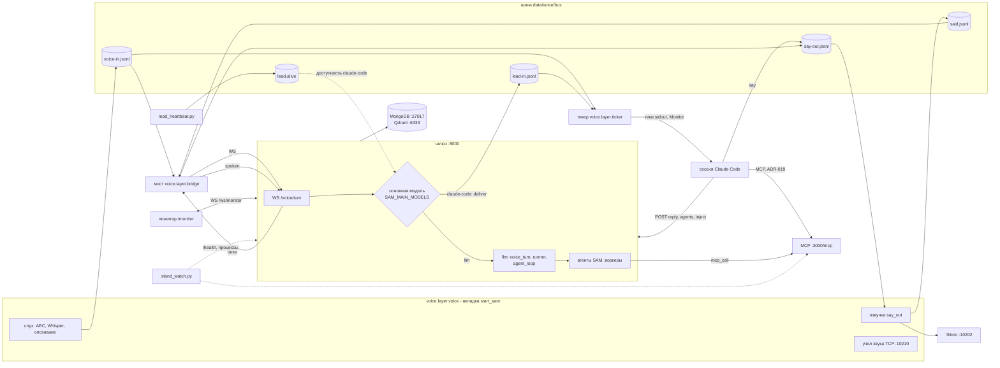

# Стенд SAM

Из чего состоит запущенная SAM: у каждого блока - где он, зачем, что в нём есть и чем получить то же, если он
упал. Кому отдаётся вход - `main-model.md`. Почему блоки общаются файлами шины - ADR о голосовом слое и шине.

## Кто что поднимает

`start_sam.ps1` по порядку: Docker (MongoDB, Qdrant, n8n), Silero и эмбеддер, MCP, затем одной группой вкладок
client_agent, голос и шлюз (страница приложений `/apps` - его же, SAM-204), затем мост и вкладку сессии Claude Code (`scripts/sam_lead.ps1`, без неё - `-NoLead`).
Каждая вкладка (`scripts/sam_process.ps1`) поднимает свой компонент заново через 3 с после падения, пока нет
флага `.sam_stop`. client_agent поднимает ещё свой `mcp_aggregator` дочерним процессом.

`-Stop` и рестарт кладут флаг, гасят вкладки этого репозитория (их скрипт ждёт его `.sam_stop`), потом по командной
строке процессы шлюза, MCP, client_agent, слуха, Silero, CosyVoice, эмбеддера и моста, потом контейнеры
и надзор (`Select-SamTargets` в `scripts/sam_process.ps1`). Тикер, живость, `voice.layer.vmic` и сессию Claude Code
не трогают. Одиночный ключ (`-Voice`, `-Gateway`, `-Mcp`, `-Client`, `-Cosy`) сначала гасит вкладку и процесс
своего компонента. Через 5 с после старта скрипт пишет красную строку, если компонент запущен дважды: две вкладки
или два процесса, дочерний процесс компонента не считается.

Надзор (SAM-195, холодный старт) поднимают все: полный старт `start_sam.ps1` и каждый долгоживущий модуль - шлюз,
слух, мост, агрегатор MCP, радар. Модуль раз в `SAM_STAND_WATCH_KEEP_S` (30 с, 0 - выключено) смотрит файл живости
надзора `stand_watch.health` в шине; файла нет или он старше `SAM_STAND_WATCH_HEALTH_STALE_S` (10 с) - запускает
надзор (`gateway/stand_watch_keeper.py`): скрытым процессом, отвязанным от модуля, лог `logs/stand_watch.log`. Пока
лежит `.sam_stop`, надзор не поднимается. Надзор в одном экземпляре: замок `stand_watch.lock` в шине, второй
экземпляр выходит одной строкой. Надзор поднимает лежащий шлюз; Cortex шлюз поднимает при своём старте
(`SAM_CORTEX_WARM`, по умолчанию да), а умерший Cortex надзор просит шлюз поднять. Остальное Cortex чинит по событию
надзора (блок «Надзор»). `-Stop` гасит надзор вместе с компонентами.

Сессия Claude Code сама поднимает живость и тикер - шаги старта в её SessionStart-брифе; строки надзора читает из
его лога.

## Слух и узел звука

- где: `python -m voice.layer.voice`, вкладка «SAM: Voice»; виртуальные входы - TCP `127.0.0.1:10210`
  (`SAM_VOICE_HUB_PORT`, `voice/layer/vmic.py`);
- зачем: один процесс держит микрофон и колонки, эхоподавление и опознание голоса считаются один раз (ADR-017);
- что есть: фраза по паузе -> Whisper -> строка с `who` в `voice-in.jsonl`; озвучка `say-out.jsonl` -> синтез ->
  колонки, судьба реплики в `said.jsonl`; подписчикам - очищенный звук;
- если упал: вкладка поднимает сама; пропажу микрофона видно тиком `mic` и в `mic.jsonl`.

## Синтез

- где: Silero `tcp://127.0.0.1:10202` (Wyoming), вкладка «SAM: Silero»; CosyVoice `:10203` по `-Cosy`;
- зачем: голос SAM;
- что есть: голоса из реестра `data/voice/voices/registry.json`, движок по голосу (`voice/layer/tts_client.py`);
- если упал: вкладка поднимает сама; основной движок не ответил - говорит `SAM_TTS_FALLBACK` (silero).

## Шина голоса

- где: папка `data/voice/bus` (`SAM_VOICE_BUS_DIR`), имена файлов - `voice/layer/bus.py`;
- зачем: слух, озвучка, мост, тикер и сессия общаются файлами и не зависят от шлюза;
- что есть: `voice-in.jsonl` (фразы людей), `say-out.jsonl` (реплики SAM), `said.jsonl` (судьба реплик),
  `lead-in.jsonl` (вход основной модели не из голоса), `ticks.jsonl` (копия тиков), `mic.jsonl`, флаги
  `speaking`, `hearing`, `barge`, отметка `lead.alive`;
- если упал шлюз или монитор: разговор читается из этих файлов.

## Мост

- где: `python -u -m voice.layer.bridge`, лог `logs/bridge.log`; поднимает `start_sam.ps1`, и при `-NoLead` тоже;
- зачем: несёт фразу из `voice-in.jsonl` в WebSocket `/voice/turn`, ответ шлюза - предложениями в
  `say-out.jsonl`; отчитывается шлюзу, что прозвучало (ADR-013); передаёт свои реплики SAM (`say`);
- что есть: шлюз недоступен - переподключение раз в 2 с (`SAM_BRIDGE_RECONNECT_S`);
- если упал: голос до шлюза не доходит, при основной модели `claude-code` сессия слышит его тикером; поднять -
  `python -u -m voice.layer.bridge >> logs/bridge.log 2>&1` или следующий `start_sam.ps1`.

## Шлюз

- где: `uvicorn gateway.main:app`, `:8000`, вкладка «SAM: Gateway»;
- зачем: точка входа SAM - основная модель, история, агенты, память, монитор;
- что есть: `/health` (`main_model`, `components`: mongo, qdrant, mcp, cortex, `compression` - сжатие истории по сессиям,
  `stand_watch` - последняя отбивка надзора),
  `/voice/turn`, `/v1/chat/completions`, `/ws/monitor`; остальное - раздел README «REST API»;
- если упал: вкладка поднимает через 3 с, нет вкладки - надзор через 90 с (блок «Надзор»); слух, озвучка, тикер и сессия работают на шине; `say` пишет реплику в
  шину и одной строкой сообщает, что в монитор и историю она не попала.

## Монитор

- где: `http://localhost:8000/monitor`, поток `/ws/monitor`;
- зачем: видеть разговор, ходы, агентов и писать SAM;
- что есть: при подключении - последние 300 сообщений всех сессий из MongoDB, потом события шлюза; ярлык
  «ведёт»; строка сжатия в шапке из `/health` (несжатых, сколько минут назад сжато, ждёт паузы, ошибка - красным,
  текст ошибки в подсказке); строки «сжатие ждёт паузы» и «сжатие не удалось»; чат и inject; текст основной
  модели без озвучки (`say --text-only`, `POST /sam/session/{id}/note`) - строкой «SAM · текст» моноширинно, и после F5;
  фразы, решённые как фон или «не мне», - скрытые строки с решением адресата («фон - обрывок вне беседы; голос не
  узнан»), видны по кнопке «скрытые», модели не идут (SAM-98); по `/` - подсказка команд из `GET /sam/commands`
  (скиллы стенда и команды основной модели), выбранная уходит основной модели командой (SAM-99); селектор сессий
  группами «Люди», «Агенты», «Проверки» по `GET /sam/sessions` (вид сессии - `gateway/session_kinds.py`),
  устаревшие проверки свёрнуты в один пункт; кнопка «удалить» снимает сессию после ввода её id
  (`DELETE /sam/sessions/{id}`), канал голоса и устройство этой машины не удаляются;
- сессии проверок: живой прогон и интеграционный тест пишут в сессию `test-do-not-use-<имя>`, а не в канал
  человека, и удаляют её за собой (`DELETE /sam/sessions/{id}`); забытые шлюз снимает сам через
  `SAM_CHECK_SESSION_TTL_H` (72) ч молчания. Сессию агента `task:<id>` шлюз снимает раз в `SAM_SESSION_SWEEP_S`
  (3600) с, когда агент не идёт в памяти шлюза, задачи в `sam.tasks` (в любом статусе) и контекста в `worker_sessions`
  уже нет (их чистит TTL Mongo) и с последней записи прошло `SAM_DEAD_AGENT_GRACE_H` (24) ч - упавший агент держит
  историю столько же, сколько успешный. Удаление не идёт посреди хода, сжатия и пока агент работает (409);
- если упал: история - MongoDB `sam.sessions` (`docker exec -it sam-mongo mongosh sam`), список сессий -
  `GET /sam/sessions`, сжатое - `GET /sam/archive/search?q=...`, голос - файлы шины, вывод шлюза - его вкладка.

## Сессия Claude Code

- где: вкладка «SAM: Claude Code» (`scripts/sam_lead.ps1`, команда `SAM_LEAD_COMMAND`, по умолчанию `claude`),
  открывается, если `lead.alive` старше 5 с;
- зачем: основная модель `claude-code` (`main-model.md`);
- что есть: живость `python -u scripts/lead_heartbeat.py` (фоном), тикер `python -u -m voice.layer.ticker` под
  Monitor (события `voice`, `chat`, `rag`, `unheard`, `mic`), строки надзора - `tail -F logs/stand_watch.log`, ответ
  `python -m voice.layer.say`; инструменты SAM - MCP-сервер `sam` (`mcp/sam_server.py`, SAM-175) строкой в
  локальном `.mcp.json`, только у сессии, не в агрегаторе стенда;
- если упала: через 5 с шлюз переключается на `llm`; новая сессия - `claude` в папке SAM, хук узнает основную
  модель по свежему `ticks.jsonl`.

## Агенты

- где: воркеры в процессе шлюза (`gateway/worker.py`) или сессии Cortex (`gateway/cortex_workers.py`,
  `framework=cortex` или `SAM_AGENT_FRAMEWORK`, ADR-022), задачи в MongoDB `tasks`;
- зачем: действие на устройстве, поиск, код - в фоне, пока SAM разговаривает (ADR-005);
- что есть: у модели в шлюзе - `spawn_agent`, `list_agents`, `send_to_agent`, `cancel_agent`, итог `[TASK_DONE]`;
  у основной модели вне шлюза - `create_agent` и `answer_agent` MCP-сервера `sam` (поверх `POST /sam/agents` и
  `POST /sam/inject`), вопрос агента и итог приходят тиком `chat` с `session: task:<id>`
  ([REST API](../api/rest.md), «Агент от основной модели вне шлюза»);
- шаги: шаг - одно обращение агента к модели; пул на дерево агентов - меньшая из прикидки создателя (`steps`) и
  оценки агента в первом ответе (`estimate_steps`), по умолчанию `SAM_AGENT_STEPS` (30), потолок
  `SAM_AGENT_STEPS_CAP` (100); пул ребёнка вычитается из пула родителя, не хватило - `request_steps`, создатель
  выдаёт `grant_steps` (`gateway/agent_budget.py`, ADR-022 «Шаги - пул на дерево»). Ход только с вызовами каналов
  (`ask_creator`, `request_steps`, `estimate_steps`, `report_status`, `send_to_agent`, `grant_steps`) шага не
  тратит; таких вызовов на задачу не больше `SAM_AGENT_CHANNEL_CALLS` (10), дальше `ask_creator` и
  `request_steps` отвечают «решай сам»;
- ключ привилегий (SAM-177): `POST /sam/agents`, `/sam/agents/{id}/grant`, `/sam/main-model` и `/sam/llm/switch`
  требуют заголовок `X-SAM-Privilege` и с этой машины; ключ лежит только в файле
  `data/secrets/privilege.key` (`SAM_PRIVILEGE_FILE`, создаётся при первом обращении, `gateway/privilege_key.py`);
  его шлёт MCP-сервер `sam`, агентам он не выдаётся;
- если упал шлюз: работающие воркеры гибнут с ним, задачи остаются в MongoDB.

## Память

- где: MongoDB `:27017` (контейнер `sam-mongo`: `_memories`, `sessions`, архив), Qdrant `:6333`;
- зачем: факты о доме и история разговоров (ADR-009);
- что есть: `remember`, `list_memories`, `update_memory`, `forget` у модели в шлюзе; у Claude Code -
  `memory_search` и `remember` MCP-сервера `sam` (SAM-175, поверх `GET /sam/memory/search?q=&limit=` и
  `POST /sam/memory`);
- поиск гибридный (SAM-102, README «Поиск по памяти»): слова (BM25 по фактам в Mongo, падежи сводятся к основе) и
  вектор (Qdrant), слияние RRF; запрос-имя («Шарик», «партнёр») находит свой факт первым по словам, вектор
  дополняет. Эмбеддер - отдельный процесс `python -m gateway.embedder_service` (вкладка «SAM: Embedder», `:10204`,
  `SAM_EMBEDDER_URL`, SAM-172): модель грузится раз, рестарт шлюза её не трогает. Процесс не ответил - шлюз
  грузит модель у себя, пока грузится - поиск по словам; поиск идёт в потоке, `/health` в это время отвечает.
  Выключить слова - `SAM_RAG_LEXICAL=0`;
- поиск на входе (SAM-101, `gateway/recall.py`): голос, чат монитора и inject ищут в памяти до развилки основной
  модели, срок `VOICE_RAG_TIMEOUT_S` (1,5 с). Модель в шлюзе получает успевшие факты в контекст хода; Claude Code -
  полем `facts` в тике `chat`, а к голосовой фразе и опоздавшие - тиком `rag` с `at` (время входа, как `at` у
  тиков `voice` и `chat`) и `phrase`. Бриф сессии берёт выжимку о доме: люди, питомцы, правила, до
  `SAM_LEAD_BRIEF_MEMORY_CHARS` (1500) знаков; шлюз недоступен - строка о причине;
- сжатие истории (SAM-97): ставит шина шлюза после записи реплики в `sessions`, при любой основной модели
  (`gateway/compression_watch.py`), сводку пишет основная модель роутера; ждёт паузы в разговоре
  (`SAM_IDLE_S`, 30 с), но не дольше `SAM_COMPRESS_IDLE_MAX_S` (300 с); несжатого в базе от `SAM_COMPRESS_CEILING`
  (28) сообщений или `SAM_COMPRESS_CEILING_TOKENS` (2100: окно 600 и кусок 1500) токенов - сразу. Видно: `/health` → `compression.sessions`
  (`pending_msgs`, `pending_tokens`, `above_ceiling`, `last_ok`, `waiting_s`, `running_s`, `last_error`), шапка
  монитора, строка надзора `compress:<сессия> stalled`;
- если упала: `/health` покажет `mongo` или `qdrant` down; поднять - `docker compose -f
  docker/docker-compose.dev.yml up -d`.

## MCP стенда

- где: агрегатор `mcp/mcp_aggregator.py`, `POST http://localhost:3000/mcp` (Streamable HTTP), вкладка «SAM: MCP»;
  серверы - `mcp/configs/local.json`;
- зачем: действия на этом ПК - команды, окна, браузер, файлы (ADR-001);
- что есть: `/health`, `tools/list` (10 окт - 62 инструмента устройств); шлюз зовёт его `mcp_call` воркера по
  `mcp_url` устройства из каталога, устройство регистрирует `mcp/client_agent.py`; инструментов SAM здесь нет:
  сервер `sam` подключён только сессии Claude Code, иначе смену модели и запись в память получили бы агенты через
  `mcp_call`;
- если упал: вкладка поднимает сама; `/health` шлюза покажет `mcp` down.

Подключить MCP стенда к модели из shell - настройка один раз, start_sam её не делает:

```bash
claude mcp add --scope project --transport http sam-stand http://localhost:3000/mcp   # .mcp.json, в .gitignore
```

## Надзор

- где: `python -u scripts/stand_watch.py`, скрытый процесс, лог `logs/stand_watch.log`; поднимают его модули стенда
  (блок «Кто что поднимает»); файл живости `stand_watch.health` в шине (часть `loop` - не повис ли цикл опроса,
  `SAM_STAND_WATCH_LOOP_STALE_S`, 120 с); проверки компонентов - `gateway/stand_checks.py`, общие с перезапуском;
- зачем: основная модель узнаёт о поломке стенда без человека;
- что есть: раз в 15 с (`SAM_STAND_WATCH_POLL_S`) - health check компонентов под теми же именами, что у
  `restart_component`: `/health` шлюза, MCP, эмбеддера (`SAM_EMBEDDER_URL`), радара (`SAM_RADAR_URL`); файлы
  живости слуха и моста в шине (`voice.health`, `bridge.health`, `voice/layer/health.py`: процесс пишет раз в 2 с,
  старше `SAM_VOICE_HEALTH_STALE_S` (10 с) или не ok - лежит; файла нет - судит счёт процессов: процесс при старте
  удаляет свой старый файл, и слух, который грузит модель (около 20 с), не сойдёт за упавший; слух ok, когда живы
  поток озвучки и приём узла звука, мост - когда его цикл событий отзывается (сам ставит метку раз в 2 с), связь со
  шлюзом - поле `gateway`; слух и мост, запущенные с папкой шины аргументом, а не `SAM_VOICE_BUS_DIR`, пишут файл
  туда, где надзор его не увидит); `cortex` - строка `components` в `/health` шлюза
  (процесс Cortex поднимался и вышел - down, ещё не поднятый - ok); число процессов шлюза, слуха, моста и Silero
  (у синтеза других проверок нет). Компонент, которого на машине нет (радар не запущен), выключает
  `SAM_STAND_WATCH_OFF` через запятую. Печатает только смену состояния, `x2` - два процесса одного компонента; `compress:<сессия> stalled` -
  несжатого сверх потолка, а последнее сжатие старше `SAM_STAND_WATCH_COMPRESS_STALE_S` (600 с) и свежего не идёт;
- шлюз лежит дольше `SAM_STAND_WATCH_GATEWAY_DOWN_S` (90 с) - надзор поднимает его сам: `SAM_RESTART_CMD_GATEWAY`, на
  Windows по умолчанию `start_sam.ps1 -Gateway`, вывод - `logs/restart-gateway.log`; при `.sam_stop` не поднимает;
- Cortex лежит при живом шлюзе дольше `SAM_STAND_WATCH_CORTEX_DOWN_S` (30 с) - надзор зовёт `POST /sam/stand/restart
  cortex` без `force`: шлюз сам проверяет Cortex и поднимает только не живые процессы, живые и их ходы не трогает;
- подъём не помог - срок до следующей попытки удваивается, но не дольше `SAM_STAND_WATCH_BACKOFF_MAX` (8) сроков:
  шлюз 90 с -> 12 мин, Cortex 30 с -> 4 мин; компонент встал - срок снова исходный;
- шлюзу (SAM-195): `POST /sam/stand/watch` с состоянием всех компонентов раз в 30 с (`SAM_STAND_WATCH_BEAT_S`) и
  сразу, когда оно отличается от последнего принятого шлюзом. Шлюз недоступен - надзор работает дальше, строка в
  stderr раз в минуту, отчёт повторяется следующим опросом;
- в шлюзе (`gateway/stand_report.py`): смену считает шлюз - от состояний последней отбивки; повтор того же отчёта
  смены не даёт, компонент, пропавший из отчёта (сессия ушла из `compression` в `/health`), считается поднявшимся,
  если `/health` шлюза ответил; не ответил (лежит или не успел под нагрузкой) - надзор держит сжатие из прошлого
  снимка, как и `cortex`.
  Время и состояния последней отбивки - в памяти и в файле `data/stand_watch_beat.json`
  (`SAM_STAND_WATCH_BEAT_FILE`); файл переживает рестарт шлюза и читается без Mongo. При старте шлюз берёт прошлую
  отбивку из файла, поэтому его собственное падение и смены его сжатия за время простоя в событие не попадают: шлюз
  поднимает вкладка, а умерший надзор ловит workflow `stand-silence` (ниже). Смена уходит в шину событием
  `stand_change` (`changes`, `down`, `up`), на него срабатывает workflow `stand-health`: основная модель перезапускает
  упавшее сама (`restart_component`, блок «Перезапуск компонента») и говорит, что упало и что сделала; поднявшееся
  само - молчит, если о падении не говорили;
- молчание надзора: `/health` шлюза → `stand_watch` (время последней отбивки и её возраст, `age_s`). Workflow
  `stand-silence` раз в минуту запускает ворота `python -m gateway.stand_silence`: отбивок нет дольше
  `SAM_STAND_WATCH_SILENT_S` (90 с, три отбивки) - тревога. Молчание считается не раньше старта шлюза
  (`SAM_GATEWAY_STARTED_AT`, шлюз ставит себе сам): поднявшийся шлюз ждёт отчёта надзора, а не тревожит по старой
  отбивке. Одно молчание - один повод: основная модель проверяет `/health` шлюза, MCP, эмбеддера и радара и говорит
  Человеку, что надзор молчит и что лежит; упавший модуль перезапускает сама.

## Перезапуск компонента

- где: инструмент `restart_component` у основной модели и воркеров, у ведущего - `restart_component` MCP-сервера
  `sam` (`POST /sam/stand/restart`); решение и исполнение - `gateway/restart.py` (SAM-195);
- зачем: SAM поднимает упавший или зависший модуль и модуль после своей правки сама, без вопроса;
- что есть: имена `gateway`, `mcp`, `voice`, `bridge`, `tts` (Silero), `embedder`, `client`, `cosy`, `radar`,
  `cortex` (страница приложений - часть шлюза, SAM-204). Перед перезапуском - health check компонента теми же проверками, что у надзора (`gateway/stand_checks.py`;
  Cortex - по процессам этого шлюза): уже поднялся (вкладка поднимает упавшее за 3 с) - ответ «уже поднялся», без
  действия; `force` - без проверки, после правки кода компонента или по прямой просьбе; у `client` и `cosy` проверки
  нет, они перезапускаются всегда. Команда компонента - `SAM_RESTART_CMD_<ИМЯ>`, по умолчанию на Windows - ключ `start_sam.ps1`
  (`-Mcp`, `-Voice`, `-Bridge`, `-Tts`, `-Embedder`, `-Client`, `-Cosy`), радар - `start_radar.ps1`; вывод команды -
  `logs/restart-<имя>.log`, ход ждёт её не дольше `SAM_RESTART_WAIT_S` (60 с). На другой ОС без переменной - строка
  «перезапуск X здесь не настроен: SAM_RESTART_CMD_X». Шлюз перезапускает себя сам: ждёт конца идущих ходов (не
  дольше `SAM_RESTART_SELF_MAX_WAIT_S`, 120 с), ещё `SAM_RESTART_SELF_GRACE_S` (2 с), затем выходит, вкладка
  поднимает его через 3 с; с `SAM_RESTART_CMD_GATEWAY` вместо выхода идёт эта команда (служба ОС; `start_sam.ps1
  -Gateway` не годится - он гасит шлюз вместе с собой). `cortex` без `force` сразу поднимает заново только не живые
  процессы Cortex, живые и их ходы не трогает; с `force` (после правки кода Cortex) ждёт конца идущих ходов агентов
  Cortex (и хода основной модели при `LLM_SOURCE=acp`) не дольше `SAM_RESTART_CORTEX_MAX_WAIT_S` (120 с), затем
  закрывает процессы Cortex в шлюзе (поставщик `acp` и агенты в сессиях Cortex) и сразу поднимает их; ход, не
  кончившийся за предел, рвётся, и создатель видит неудачу. Агент Cortex, который между ходами ждёт детей или ответа создателя,
  хода не ведёт и перезапуск не задерживает: его процесс закрывается посреди задачи. Один компонент перезапускается один раз за раз: второй вызов, пока
  идёт первый, получает «перезапуск уже идёт»;
- чем платит перезапуск шлюза: голосовой ответ «перезапускаю» звучит, но в историю не ложится (историю пишет отчёт
  моста о прозвучавшем, а шлюза уже нет); удержанные пункты очереди push и работающие воркеры гибнут вместе с
  процессом, задачи остаются в MongoDB; шлюз, запущенный руками без вкладки, сам не поднимется;
- событие `stand_change` несёт поле `restart` - имена для `restart_component`, у надзора те же имена; встало сжатие
  (`compress:*`) и дубль шлюза (`gateway x2`) перезапуском не лечатся и в `restart` не попадают.

## Workflow стенда

- где: файлы `workflows/*.yml` (`SAM_WORKFLOWS_DIR`), планировщик в процессе шлюза, состояние - MongoDB `_workflows`;
- зачем: расписание стенда для любой основной модели - поздний час, память раз в полчаса (`workflows.md`);
- что есть: тик раз в 2 с (`SAM_WORKFLOW_TICK_S`), ворота без LLM, шаг основной модели входом с источником `workflow:<имя>/<шаг>`,
  событие `workflow` в мониторе, `/health` → `workflows`;
- если упал шлюз: расписание стоит; после подъёма опоздавший до половины периода запуск идёт один раз.

## n8n

- где: `:5678`, контейнер dev-compose;
- зачем: большие сценарии;
- лёгкие workflow по файлу, как GitHub Actions, идут в шлюзе (блок «Workflow стенда»).

## Потоки

Кто кого вызывает и через что: HTTP, WebSocket, файлы шины, MongoDB. Пунктир - проверка состояния.



`start_sam.ps1` поднимает Docker, Silero, MCP, client_agent, голос и шлюз вкладками с автоподъёмом, затем мост и
вкладку сессии (`scripts/sam_lead.ps1`, если `lead.alive` старше 5 с). Живость, тикер и надзор сессия поднимает
сама по SessionStart-брифу.

Схемы 1-6 - путь модели в шлюзе (`llm`). Схема 1 - текстовый путь `/v1/chat/completions` (`runner.run_turn`);
голосовой ход идёт через WebSocket `/voice/turn` одним вызовом LLM без guard, критика и повторов, только с
`spawn_agent` ([speech.md](../features/speech.md)).
