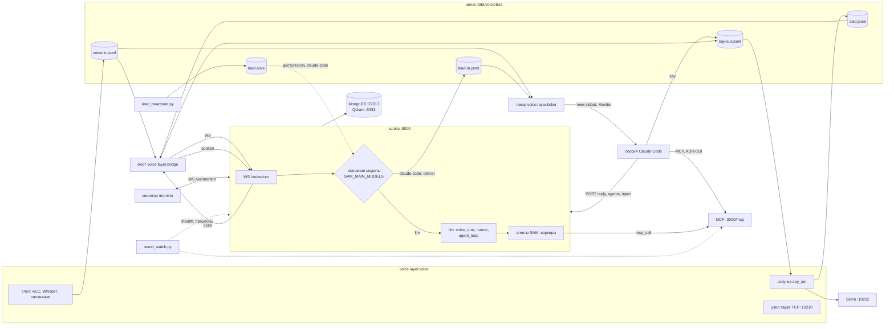

# Стенд SAM

Стенд SAM — набор процессов, которые общаются HTTP, WebSocket, файлами шины и MongoDB; шлюз в этом наборе такой же
компонент, как остальные. Файл описывает блоки, их подъём после падения и точки проверки. Кому шлюз отдаёт ход —
[main-model](../gateway/main-model.md), почему голосовой слой говорит файлами — [ADR-011](../../adr/011-voice-layer.md)
и [ADR-012](../../adr/012-voice-bus-and-leads.md).

## Запуск компонентов

`start_sam.ps1` идёт по порядку: Docker (`docker/docker-compose.dev.yml`: `sam-mongo`, `sam-qdrant`, `sam-n8n`), синтез
Silero и эмбеддер, агрегатор MCP, затем одной группой client_agent, слух и шлюз, затем мост и вкладка сессии Claude Code
(`scripts/sam_lead.ps1`, ключ `-NoLead` её не открывает).

Компоненты работают скрытыми процессами, вывод каждого идёт в `logs/<компонент>.log`; переменная `SAM_COMPONENT_TABS=1`
возвращает вкладки wt, а имя окна задаёт `SAM_WT_WINDOW`. Лог больше `SAM_COMPONENT_LOG_MAX_MB` (20 МБ) при старте
уходит в `.1`, бесконечно не растёт. Обёртка компонента — `scripts/sam_process.ps1`: упавший процесс поднимается через 3
с, пока нет
флага `.sam_stop`. client_agent поднимает `mcp/mcp_aggregator.py` дочерним процессом, поэтому тот дублем не считается.
Через 5 с после старта скрипт печатает красную строку на компонент, запущенный дважды.

Одиночный ключ (`-Gateway`, `-Mcp`, `-Voice`, `-Client`, `-Tts`, `-Embedder`, `-Bridge`, `-Cosy`) гасит вкладку и
процесс своего компонента, затем поднимает новый. Чужой процесс на порту 8000 или 3000 останавливает запуск: скрипт
называет его и выходит, ничего не гася.

`-Stop` ставит `.sam_stop`, гасит вкладки репозитория (их скрипт ждёт флаг), затем процессы компонентов по командной
строке, контейнеры и надзор — это `Select-SamTargets` и `Stop-SamComponents` в `scripts/sam_process.ps1`. Тикер,
живость, `voice.layer.vmic` и сессию Claude Code остановка не трогает.

## Слух и узел звука

Слух и озвучка живут одним процессом `python -m voice.layer.voice`: эхоподавлению нужны сигнал колонок и сигнал
микрофона в одном месте ([ADR-017](../../adr/017-audio-hub-virtual-mics.md)). Законченная фраза по паузе уходит в
Whisper и строкой с `who` в `voice-in.jsonl`; озвучка читает `say-out.jsonl`, синтезирует и пишет судьбу реплики в
`said.jsonl`. Подписчикам узел звука отдаёт очищенный микрофон по TCP `127.0.0.1:10210` (`SAM_VOICE_HUB_PORT`,
`voice/layer/vmic.py`). Упавший процесс поднимает обёртка, а пропажу микрофона видно тиком `mic` и в `mic.jsonl`.

## Синтез речи

Silero слушает Wyoming на `tcp://127.0.0.1:10202` (`SILERO_PORT`) и поднимается всегда. CosyVoice слушает `:10203`
(`COSY_PORT`), включается ключом `-Cosy` и только при живом venv лаборатории `COSY_PYTHON`; без него голос идёт через
Silero. Голоса и их движки лежат в реестре `data/voice/voices/registry.json` (`SAM_VOICE_REGISTRY`), движок по голосу
выбирает `voice/layer/tts_client.py`. Если основной движок не ответил, говорит `SAM_TTS_FALLBACK` (silero) голосом
`SAM_TTS_FALLBACK_VOICE` (xenia).

## Шина голоса

Шина — папка `data/voice/bus` (`SAM_VOICE_BUS_DIR`), имена файлов заданы в `voice/layer/bus.py`. Файлами общаются слух,
озвучка, мост, тикер и сессия Claude Code, поэтому разговор переживает падение шлюза и монитора. В папке лежат
`voice-in.jsonl` с фразами людей, `say-out.jsonl` с репликами SAM, `said.jsonl` с судьбой каждой реплики (played, cut,
dropped, stale), `lead-in.jsonl` со входом основной модели не из голоса, `ticks.jsonl` с копией тиков и `mic.jsonl`.
Рядом лежат флаги `speaking`, `mute`, `hearing`, `barge`, `hold`, `reply.to`, отметка `lead.alive` и файлы живости
`voice.health`, `bridge.health`, `stand_watch.health`.

## Мост

Мост `python -u -m voice.layer.bridge` (лог `logs/bridge.log`) несёт фразу из `voice-in.jsonl` в WebSocket
`/voice/turn`, а ответ шлюза отдаёт предложениями в `say-out.jsonl`. Прозвучавшее он отчитывает шлюзу сообщением
`spoken`, и в историю попадает только прозвучавшее ([ADR-013](../../adr/013-history-only-spoken.md)); свои реплики SAM
из `say` идут своей очередью. Когда шлюз недоступен, мост переподключается раз в `SAM_BRIDGE_RECONNECT_S` (2 с), и голос
в это время до шлюза не доходит; при основной модели `claude-code` сессия слышит фразу тикером. Поднять заново —
`start_sam.ps1 -Bridge`.

## Шлюз

`uvicorn gateway.main:app` на `:8000` держит основную модель, историю, агентов, память, монитор и страницу приложений
`/apps`. Ручка `/health` отдаёт `status`, `main_model`, `llm`, `model`, `devices_online`, `components` (mongo, qdrant,
mcp, cortex), `compression` со сжатием по сессиям, `stand_watch` с полями `last_beat` и `age_s`, `workflows`,
`workflow_tick`, `quiet` и `fast_backoff`. Входы хода — `/voice/turn`, `/v1/chat/completions` и `/ws/monitor`; остальные
ручки перечислены в [REST API](../../api/rest.md).

Если шлюз лёг, вкладка поднимает его через 3 с, а без вкладки это делает надзор через 90 с. Слух, озвучка, тикер и
сессия в это время работают на шине; `say` пишет реплику в `say-out.jsonl` и одной строкой сообщает, что в монитор и
историю она не попала.

## Монитор

Страница `/monitor` и поток `/ws/monitor` показывают разговор, ходы и агентов и дают писать SAM. При подключении монитор
получает первую порцию истории (`SAM_MONITOR_FIRST_PAGE`, 60 записей всех сессий), а остальное подгружает прокруткой
вверх через `GET /sam/monitor/history` (`SAM_MONITOR_PAGE_LIMIT`, 100). В шапке стоят ярлык «ведёт» и строка сжатия из
`/health`. Записи с пометкой `ignore` скрыты, видны по флажку «показывать скрытые» и в контекст модели не идут: там
фразы, решённые как фон или «не мне», с причиной решения вроде «обрывок вне беседы» или «голос не узнан»
(`gateway/addressee.py`).

Селектор сессий делит их на «Люди», «Агенты» и «Проверки» по виду из `gateway/session_kinds.py`, а устаревшие проверки
свёрнуты в один пункт «показать». Ввод `/` открывает подсказку из `GET /sam/commands`, и выбранная команда уходит
основной модели командой. Кнопка удаления снимает сессию через `DELETE /sam/sessions/{id}` после ввода её id
(`gateway/session_purge.py`); канал голоса, устройство этой машины, агент за работой и сессия посреди хода получают 403
или 409.

Сессии проверок пишутся в `test-do-not-use-<имя>` отдельно от канала человека и удаляются за собой; забытые шлюз снимает
через `SAM_CHECK_SESSION_TTL_H` (72 ч) молчания. Сессию `task:<id>` уборка снимает раз в `SAM_SESSION_SWEEP_S` (3600 с),
когда агента нет в памяти шлюза, задачи в `sam.tasks` и контекста в `worker_sessions` нет, а с последней записи прошло
`SAM_DEAD_AGENT_GRACE_H` (24 ч).

История сессий лежит в MongoDB `sam.sessions` (`docker exec -it sam-mongo mongosh sam`), сжатое — в `sessions_archive`
(`GET /sam/archive/search?q=...`), голос — в файлах шины.

## Сессия Claude Code

Вкладка «SAM: Claude Code» (`scripts/sam_lead.ps1`) открывает в терминале `SAM_LEAD_TERMINAL` (по умолчанию `wt`)
команду `SAM_LEAD_COMMAND` (по умолчанию `claude`) с аргументами `SAM_LEAD_ARGS` и первым сообщением `SAM_LEAD_PROMPT`
в корне репозитория. `start_sam.ps1` открывает её, только если первая основная модель — `claude-code`
(`SAM_MAIN_MODELS`) и
`lead.alive` старше 5 с, то есть живой сессии нет. Закрытую сессию вкладка не перезапускает, это решение человека.

Сессия сама поднимает живость `scripts/lead_heartbeat.py` фоном, тикер `python -u -m voice.layer.ticker` под Monitor с
тиками `voice`, `chat`, `rag`, `unheard` и `mic`, и читает строки надзора из `logs/stand_watch.log`. Говорит она через
`python -m voice.layer.say`, а текст без озвучки отдаёт ключом `--text-only`. Инструменты SAM приходят MCP-сервером
`sam` (`mcp/sam_server.py`), он прописан строкой в локальном `.mcp.json` (файл в `.gitignore`) и в агрегатор стенда не
входит.

Если сессия упала, шлюз через 5 с (`SAM_LEAD_ALIVE_S`) отдаёт ход модели `llm`. Новая сессия поднимается командой
`claude` в папке SAM, а что она основная, хук `SessionStart` узнаёт по свежему `ticks.jsonl`. Бриф сессии берёт
выжимку о доме из памяти не длиннее `SAM_LEAD_BRIEF_MEMORY_CHARS` (1500) знаков.

## Агенты

Агент SAM для задачи — либо воркер в процессе шлюза (`gateway/worker.py`), либо сессия Cortex
(`gateway/cortex_workers.py`, каркас `cortex` или `SAM_AGENT_FRAMEWORK`,
[ADR-022](../../adr/022-agent-system-behind-acp.md)); задача живёт в MongoDB `sam.tasks`. У модели в шлюзе есть
`spawn_agent`, `list_agents`, `send_to_agent` и `cancel_agent`, итог приходит меткой `[TASK_DONE]`. У основной модели
вне шлюза те же действия дают `create_agent` и `answer_agent` MCP `sam` поверх `POST /sam/agents` и `POST /sam/inject`,
а вопрос и итог агента приходят тиком `chat` с `session: task:<id>`.

Ручки `POST /sam/agents`, `/sam/agents/{id}/grant`, `/sam/agents/{id}/steps`, `/sam/agents/{id}/effort`,
`/sam/main-model`, `/sam/llm/switch` и `/sam/sandbox/exec` требуют заголовок `X-SAM-Privilege` даже с этой машины
(`gateway/privilege_key.py`, кортеж `ROUTES`). Ключ лежит в `data/secrets/privilege.key` (`SAM_PRIVILEGE_FILE`) и
создаётся при первом обращении; читает его только MCP `sam` ведущего, агентам он не выдаётся; вызов с путём ключа в
аргументах запрещён `gateway/tool_policy.json`. Шаги агента считаются пулом на дерево (`gateway/agent_budget.py`): пул
задачи — меньшая из прикидки создателя `steps` и оценки агента в первом ответе `estimate_steps`, по умолчанию
`SAM_AGENT_STEPS` (30), выдача основной модели не больше `SAM_AGENT_STEPS_CAP` (100). Пул ребёнка вычитается из пула
родителя, а не хватило — агент зовёт `request_steps`, и создатель выдаёт `grant_steps`. Ход, в котором агент зовёт
только каналы (`ask_creator`, `request_steps`, `estimate_steps`, `report_status`, `send_to_agent`, `grant_steps`), шага
не тратит, но таких обращений на задачу не больше `SAM_AGENT_CHANNEL_CALLS` (10), дальше `ask_creator` и `request_steps`
отвечают «решай сам». Воркер шлюза описан в [worker](../agents/worker.md), три исполнителя и цепочка прав — в
[overview](../agents/README.md).

Если шлюз упал, работающие воркеры гибнут вместе с ним, а задачи и их контекст остаются в MongoDB.

## Память

Факты и история разговоров лежат в MongoDB `:27017` (контейнер `sam-mongo`: коллекции `_memories`, `sessions`,
`sessions_archive`) и в Qdrant `:6333` ([ADR-009](../../adr/009-memory-mongo-truth-qdrant-index.md)). У модели в шлюзе
есть `remember`, `list_memories`, `update_memory` и `forget`; у Claude Code — `memory_search` и `remember` MCP `sam`
поверх `GET /sam/memory/search` и `POST /sam/memory`.

Поиск гибридный (`gateway/rag.py`, [memory-search.md](../../features/memory/memory-search.md)): BM25 по фактам в Mongo и
вектор Qdrant, слияние RRF. Слова ищутся по основам, поэтому падежи сводятся к одной форме; запрос из одного имени
(«Шарик», «партнёр») находит свой факт первым по словам, а вектор только дополняет выдачу. Словесную ветку выключает
`SAM_RAG_LEXICAL=0`, тогда остаётся один вектор. Эмбеддер вынесен в процесс `python -m gateway.embedder_service`
(`:10204`, `SAM_EMBEDDER_URL`), поэтому модель грузится раз и рестарт шлюза её не трогает. Если процесс не ответил,
`gateway/embedder_client.py` отдаёт запрос локальной модели, и пока она грузится, поиск идёт по словам. Поиск на входе
(`gateway/recall.py`) укладывается в `VOICE_RAG_TIMEOUT_S` (1,5 с): модели в шлюзе факты идут в контекст хода, а сессии
Claude Code — полем `facts` в тике `chat` или тиком `rag` с временем входа.

Сжатие истории ставит шина шлюза после записи реплики (`gateway/compression_watch.py`,
[ADR-008](../../adr/008-history-compression-window-archive.md)). Оно ждёт паузы в разговоре `SAM_IDLE_S` (30 с) и не
дольше `SAM_COMPRESS_IDLE_MAX_S` (300 с), а на потолке несжатого (`SAM_COMPRESS_CEILING`, 28 сообщений, или
`SAM_COMPRESS_CEILING_TOKENS`, 2100) идёт сразу; окно, каскад и архив описаны в
[compression](../context/compression.md). Видно его в `/health` → `compression.sessions`, где по каждой сессии лежат
`pending_msgs`, `pending_tokens`, `above_ceiling`, `last_ok`, `waiting_s`, `running_s` и `last_error`; те же числа
показывает шапка монитора, а вставшее сжатие называет строка надзора `compress:<сессия> stalled`.

Если база упала, `/health` покажет `mongo` или `qdrant` в состоянии down; поднять — `docker compose -f
docker/docker-compose.dev.yml up -d`.

## MCP стенда

Агрегатор `mcp/mcp_aggregator.py` слушает `POST http://localhost:3000/mcp` по протоколу Streamable HTTP и собирает
серверы из `mcp/configs/local.json`: скиллы, радар (при `SAM_RADAR=1`), fetch и time. Это инструменты устройств —
команды, окна, браузер, файлы ([ADR-001](../../adr/001-mcp-aggregator-per-device.md)). Шлюз зовёт их через `mcp_call`
воркера по `mcp_url` устройства из каталога, а устройство регистрирует `mcp/client_agent.py`. `/health` и `tools/list`
показывают состав; на 10 окт в списке было 62 инструмента устройств. Инструментов SAM здесь нет: сервер `sam` подключён
только сессии Claude Code, иначе агенты получили бы смену модели и запись в память через `mcp_call`.

Если агрегатор упал, вкладка поднимает его сама, а `/health` шлюза покажет `mcp` в состоянии down.

Подключить MCP стенда к модели из shell — настройка на один раз, `start_sam.ps1` этого не делает:

```bash
claude mcp add --scope project --transport http sam-stand http://localhost:3000/mcp  # .mcp.json, в .gitignore
```

## Надзор

Надзор — процесс `python -u scripts/stand_watch.py` с логом `logs/stand_watch.log`; поднимает его
`gateway/stand_watch_keeper.py` от имени любого долгоживущего модуля. Раз в `SAM_STAND_WATCH_KEEP_S` (30 с) шлюз, слух,
мост, агрегатор MCP и радар смотрят файл `stand_watch.health` в шине: если файла нет или он старше
`SAM_STAND_WATCH_HEALTH_STALE_S` (10 с), надзор запускается скрытым процессом, отвязанным от модуля. Пока лежит
`.sam_stop`, он не поднимается. Экземпляр один: замок `stand_watch.lock` в шине, и второй запуск выходит одной строкой.

Проверки собраны в `gateway/stand_checks.py`, те же самые у перезапуска: `/health` шлюза, MCP, эмбеддера
(`SAM_EMBEDDER_URL`) и радара (`SAM_RADAR_URL`); файлы живости слуха и моста (`voice/layer/health.py`, запись раз в 2 с,
старше `SAM_VOICE_HEALTH_STALE_S` (10 с) — компонент лежит; файла нет — судит счёт процессов, потому что процесс при
старте удаляет свой старый файл и слух, грузящий модель около 20 с, не сойдёт за упавший); ровно один процесс шлюза,
слуха, моста и Silero; строка `cortex` в `components` шлюза, где вышедший процесс даёт down, а ещё не поднятый — ok.
Компонент, которого на машине нет, выключается переменной `SAM_STAND_WATCH_OFF` через запятую; выключенный радар
(`gateway/radar_switch.py`) не проверяется и без неё.

Опрос идёт раз в `SAM_STAND_WATCH_POLL_S` (15 с), и печатается только смена состояния: `bridge up -> down`, `gateway
x2`, `compress:<сессия> stalled`. Сжатие считается вставшим, когда несжатого выше потолка, последнее сжатие старше
`SAM_STAND_WATCH_COMPRESS_STALE_S` (600 с), нового не идёт и паузы оно не ждёт.

Надзор поднимает упавшее сам. Если шлюз лежит дольше `SAM_STAND_WATCH_GATEWAY_DOWN_S` (90 с), идёт команда холодного
старта `SAM_RESTART_CMD_GATEWAY`, на Windows по умолчанию `start_sam.ps1 -Gateway`, и её вывод пишется в
`logs/restart-gateway.log`. Cortex шлюз поднимает при своём старте (`SAM_CORTEX_WARM`, по умолчанию да), а если его
процесс умер, надзор просит шлюз поднять его заново. Если Cortex лежит при живом шлюзе дольше
`SAM_STAND_WATCH_CORTEX_DOWN_S` (30 с), надзор зовёт `POST /sam/stand/restart cortex` без `force`, и шлюз поднимает
только не живые процессы, не трогая идущие ходы. Остальное Cortex чинит сам по событию надзора. Когда подъём не помог,
срок до следующей попытки удваивается, но не больше `SAM_STAND_WATCH_BACKOFF_MAX` (8) сроков: шлюз от 90 с до 12 мин,
Cortex от 30 с до 4 мин. Компонент встал — срок снова исходный.

Отчёт шлюзу уходит через `POST /sam/stand/watch` раз в `SAM_STAND_WATCH_BEAT_S` (30 с) и сразу при смене состояния. Шлюз
(`gateway/stand_report.py`) сам считает смену, пишет отбивку в `data/stand_watch_beat.json`
(`SAM_STAND_WATCH_BEAT_FILE`, файл переживает рестарт) и отдаёт её событием `stand_change` с полями `changes`, `down`,
`up` и `restart`; на событие подписан workflow `stand-health`. Если шлюз недоступен, надзор работает дальше, пишет
строку в stderr не чаще раза в минуту и повторяет отчёт следующим опросом.

Молчание надзора видно по `/health` → `stand_watch` с полями `last_beat` и `age_s`. Workflow `stand-silence` раз в
минуту зовёт условие вызова модели `python -m gateway.stand_silence`: если отбивок нет дольше `SAM_STAND_WATCH_SILENT_S`
(90 с) от последней отбивки или от старта шлюза (`SAM_GATEWAY_STARTED_AT`), условие печатает причину, и модель
проверяет `/health`
шлюза, MCP, эмбеддера и радара, поднимает упавшее и говорит человеку, что надзор молчит. Один и тот же вывод второй раз
модель не будит.

## Перезапуск компонента

Инструмент `restart_component` есть у основной модели и у воркеров, у ведущего — одноимённый инструмент MCP `sam` поверх
`POST /sam/stand/restart`. Решение и исполнение лежат в `gateway/restart.py`, а имена общие с надзором: `gateway`,
`mcp`, `voice`, `bridge`, `tts` (Silero), `embedder`, `client`, `cosy`, `radar`, `cortex`.

Перед перезапуском идёт health check теми же проверками, что у надзора: поднявшийся компонент получает ответ «уже
поднялся» без действия, ведь вкладка поднимает упавшее за 3 с. Ключ `force` проверку пропускает — после правки кода
компонента или по прямой просьбе. У `client` и `cosy` проверки нет, они перезапускаются всегда.

Команду компонента задаёт `SAM_RESTART_CMD_<ИМЯ>`; на Windows по умолчанию это ключ `start_sam.ps1` (`-Mcp`, `-Voice`,
`-Bridge`, `-Tts`, `-Embedder`, `-Client`, `-Cosy`), а у радара — `start_radar.ps1`. Вывод идёт в
`logs/restart-<имя>.log`, и ход ждёт команду не дольше `SAM_RESTART_WAIT_S` (60 с). На другой ОС без переменной приходит
строка «перезапуск X здесь не настроен: SAM_RESTART_CMD_X».

Шлюз перезапускает себя сам: ждёт конца идущих ходов не дольше `SAM_RESTART_SELF_MAX_WAIT_S` (120 с), выдерживает
`SAM_RESTART_SELF_GRACE_S` (2 с) и выходит, после чего вкладка поднимает его через 3 с. Если задан
`SAM_RESTART_CMD_GATEWAY`, вместо выхода идёт эта команда: годится служба ОС, а `start_sam.ps1 -Gateway` нет, он погасит
шлюз вместе со своим деревом.

`cortex` без `force` сразу поднимает заново только не живые процессы, оставляя живые и их ходы. С `force` (после правки
кода Cortex) он ждёт конца ходов агентов Cortex и хода основной модели при `LLM_SOURCE=acp` не дольше
`SAM_RESTART_CORTEX_MAX_WAIT_S` (120 с), затем закрывает процессы поставщика `acp` и агентов в сессиях Cortex и
поднимает их. Ход, не кончившийся за предел, рвётся, и создатель видит неудачу. Агент Cortex, ждущий между ходами детей
или ответа создателя, хода не ведёт и перезапуск не задерживает: его процесс закрывается посреди задачи.

Перезапуск шлюза стоит дорого, и это видно в поведении: голосовой ответ «перезапускаю» звучит, но в историю не ложится,
потому что историю пишет отчёт моста о прозвучавшем, а шлюза к тому времени уже нет; удержанные пункты очереди push и
работающие воркеры гибнут вместе с процессом, а задачи остаются в MongoDB; шлюз, запущенный руками без вкладки, сам не
поднимется.

Один компонент перезапускается один раз за раз: второй вызов получает «перезапуск уже идёт». В событии `stand_change`
поле `restart` несёт имена для перезапуска, а сжатие (`compress:*`) и дубль шлюза (`gateway x2`) в него не попадают и
перезапуском не лечатся.

## Workflow стенда

Workflow лежат файлами `workflows/*.yml` (`SAM_WORKFLOWS_DIR`), планировщик работает в процессе шлюза, состояние
хранится в `_workflows`. Расписание и условие вызова без LLM описаны в [workflows](../../features/automation/workflows.md); шаг
основной модели приходит входом с источником `workflow:<имя>/<шаг>`. Тик идёт раз в `SAM_WORKFLOW_TICK_S` (2 с), каждый
шаг виден событием `workflow`, а состояние — в `/health` → `workflows`. Если шлюз упал, расписание стоит; после подъёма
опоздавший запуск идёт один раз, когда опоздание уложилось в половину периода и не меньше 120 с.

## n8n

Контейнер `sam-n8n` на `:5678` из dev-compose держит большие сценарии с ручной сборкой в интерфейсе. Лёгкие workflow по
файлу, как GitHub Actions, идут в шлюзе.

## Потоки

Кто кого зовёт и через что: HTTP, WebSocket, файлы шины, MongoDB. Пунктир — проверка состояния.



Текстовый ход `POST /v1/chat/completions` идёт через `runner.run_turn` с guard, критиком ответа и повторами. Голосовой
ход `/voice/turn` — один вызов LLM без guard и критики, а действие уходит воркеру через `spawn_agent`
([speech.md](../../features/voice/speech.md), [ADR-010](../../adr/010-voice-turn-one-llm-call.md)).

## Настройки и пороги

| Параметр | Значение | Где |
|---|---|---|
| пауза перед подъёмом упавшего | 3 с | `$RESTART_PAUSE`, `scripts/sam_process.ps1` |
| проверка дублей после старта | 5 с | `$DUP_CHECK_S`, `start_sam.ps1` |
| проверка надзора модулем | `SAM_STAND_WATCH_KEEP_S`, 30 с | `gateway/stand_watch_keeper.py` |
| свежесть живости надзора | `SAM_STAND_WATCH_HEALTH_STALE_S`, 10 с | там же |
| опрос компонентов | `SAM_STAND_WATCH_POLL_S`, 15 с | `scripts/stand_watch.py` |
| отбивка шлюзу | `SAM_STAND_WATCH_BEAT_S`, 30 с | там же |
| шлюз лежит до подъёма | `SAM_STAND_WATCH_GATEWAY_DOWN_S`, 90 с | там же |
| Cortex лежит до подъёма | `SAM_STAND_WATCH_CORTEX_DOWN_S`, 30 с | там же |
| предел удвоения срока | `SAM_STAND_WATCH_BACKOFF_MAX`, 8 сроков | там же |
| молчание надзора | `SAM_STAND_WATCH_SILENT_S`, 90 с | `gateway/stand_silence.py` |
| вставшее сжатие | `SAM_STAND_WATCH_COMPRESS_STALE_S`, 600 с | `scripts/stand_watch.py` |
| ожидание команды перезапуска | `SAM_RESTART_WAIT_S`, 60 с | `gateway/restart.py` |
| ожидание ходов при перезапуске шлюза | `SAM_RESTART_SELF_MAX_WAIT_S`, 120 с | там же |
| ожидание ходов Cortex | `SAM_RESTART_CORTEX_MAX_WAIT_S`, 120 с | там же |
| порция истории монитора | `SAM_MONITOR_FIRST_PAGE`, 60 | `gateway/main.py` |
| срок сессии проверки | `SAM_CHECK_SESSION_TTL_H`, 72 ч | там же |
| уборка сессий агентов | `SAM_SESSION_SWEEP_S` 3600 с, `SAM_DEAD_AGENT_GRACE_H` 24 ч | там же |

## Проверка

`tests/test_stand_health_checks.py`, `tests/test_stand_watch.py`, `tests/test_stand_watch_keeper.py`,
`tests/test_stand_report.py`, `tests/test_stand_silence.py`, `tests/test_restart.py`.
