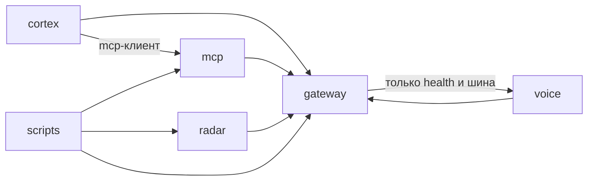

# Структура кода

Что где лежит и кто от кого зависит. Сверено с репозиторием.

## Крупные блоки

| Блок | Что это | Как запускается | Файлов |
|---|---|---|---|
| `gateway/` | шлюз: входы, ход, агенты, память, песочница, приложения, workflow | процесс `uvicorn gateway.main:app`, порт 8000 | 252 |
| `voice/` | голосовой слой: слух, синтез, шина, мост, тикер | процессы `voice.layer.voice`, `.bridge`, `.ticker` | 39 |
| `cortex/` | свой агент за ACP | подпроцесс шлюза, `python -m cortex.acp` | 12 |
| `mcp/` | MCP-серверы и агрегатор | процесс `mcp/mcp_aggregator.py`, порт 3000; остальные - его дочерние | 12 |
| `radar/` | радар присутствия, отдельное приложение | процесс `python -m radar.presence_service`, порт 8010 | 89 |
| `scripts/` | служебные скрипты стенда и разовые инструменты | по вызову | 37 |
| `tests/` | тесты | `pytest` | 286 |

Вне Python: `workflows/` (12 файлов - сценарии стенда), `docs/`, `docker/` (Dockerfile шлюза, песочницы, файрвола),
`n8n-workflows/`, `data/` (вне git).

## Средние блоки

### gateway

| Подпапка или группа | Что внутри |
|---|---|
| `main.py` | FastAPI-роутер: только маршруты, логики нет |
| `agent.py` | регистрация инструментов, их обёртки, сборка зависимостей |
| `agent_loop.py`, `runner.py`, `worker.py`, `worker_session.py`, `worker_partial.py` | цикл агента и жизнь задачи: ход, воркер, воскрешение, частичный итог |
| `agent_budget.py`, `agent_levels.py`, `task_class.py`, `model_choice.py`, `model_picker.py`, `model_catalog.py`, `model_profiles.py`, `model_stats.py`, `model_learning.py`, `model_report.py` | модель под задачу: шаги, метка, подбор по цене и вероятности успеха |
| `tools/` | реализации инструментов: `*_impl(params, deps)` на каждый инструмент модели |
| `repos/` | доступ к Mongo: сессии, память, архив, души, токены, запуски задач |
| `prompts/` | сборка системных промптов: душа, инструкции, личный слой, голос, ведущий |
| `acp/` | клиент ACP: внешний агент за протоколом |
| `cortex_workers.py` | агенты SAM в сессиях Cortex |
| `apps.py`, `apps_api.py`, `apps_edge.py`, `app_view.py`, `app_tools.py`, `builtin_apps.py`, `builtin_proxy.py` | живые приложения и страницы шлюза |
| `sandbox*.py` | песочница: запуск, пакеты, сеть, клонирование, выгрузка |
| `llm_client.py`, `llm_router.py`, `llm_gate.py`, `llm_monitor.py`, `provider_transform.py` | вызов модели: адаптеры, выбор, очередь мест, форматы |
| `compression.py`, `compression_watch.py`, `memory_extract.py`, `dream.py` | контекст: сжатие, извлечение фактов, ночное обслуживание |
| `rag.py`, `lexical.py`, `recall.py`, `recall_history.py`, `embed_model.py`, `embedder_client.py`, `embedder_service.py` | память: поиск, слова, эмбеддер |
| `guard.py`, `guard_scope.py`, `tool_policy.py`, `readonly_command.py`, `turn_taint.py`, `command_auth.py`, `secret_mask.py`, `privilege_key.py`, `access.py`, `core_paths.py` | допуск и защита: политика, судья, ключи, маска секретов |
| `workflows.py`, `workflow_spec.py`, `workflow_gates.py`, `workflow_ask.py`, `push_queue.py`, `push_dispatch.py` | проактивность: планировщик, файл, ворота, очередь к модели |
| `event_bus.py`, `session_lock.py`, `main_model.py`, `voice_turn.py`, `voice_socket.py`, `addressee.py`, `fast_voice_gate.py`, `fast_backoff.py`, `phrase_class.py`, `reply_class.py`, `spoken_history.py`, `speech_meta.py`, `stt_dedup.py` | ход и речь: шина, замок сессии, основная модель, голосовой ход, кому сказана фраза |
| `stand_checks.py`, `stand_report.py`, `stand_watch_keeper.py`, `stand_silence.py`, `health.py`, `restart.py` | стенд: проверки, отчёты, надзор, перезапуск |
| `static/` | монитор, каркас страниц, страница приложений |

### voice

| Файл | Что |
|---|---|
| `voice.py` | слух и озвучка одним процессом |
| `hearing.py`, `audio_core.py`, `mic_watch.py`, `speakers.py` | микрофон, эхоподавление, фраза, опознание голоса |
| `say_out.py`, `tts_client.py`, `audio_stream.py`, `turns.py`, `speech_text.py` | синтез, очередь реплик, судьба реплик, нарезка |
| `bus.py`, `config.py` | имена файлов шины и пути из окружения |
| `bridge.py`, `ticker.py`, `say.py` | мост к шлюзу, тикер для сессии, ответ ведущего |
| `vmic.py` | виртуальные входы узла звука |

### cortex

`agent.py` - серверная сторона ACP, `mcp_tools.py` - инструменты сессии, `rights.py` - права от создателя,
`channels.py` - каналы к создателю, `tool_search.py` - поиск инструментов, `updates.py` - события клиенту,
`stdio.py` - потоки протокола, `prompt.py` - сборка подсказки, `config.py` - настройка из окружения.

### mcp

`mcp_aggregator.py` - агрегатор нескольких серверов в один порт, `windows_control_server.py` - управление
компьютером, `sam_server.py` и `sam_http.py` - инструменты SAM для ведущего, `skills_server.py` - скиллы,
`radar_server.py` - переходник к радару, `agent_channel_server.py` - канал агента кода к создателю,
`client_agent.py` - регистрация и heartbeat клиентского ПК.

### radar

`presence_service.py` - сервис, `presence_api.py` - маршруты, `presence_sam_api.py` - ручки для SAM,
`presence_answers.py` - ответы словами, остальные `presence_*.py` - части расчёта: устройства, привычки, карта
радиоуровня, покрытие, ходьба, поток положения.

## Зависимости

По импортам в коде: кто кого тянет.



| Откуда → куда | Сколько импортов | Что именно |
|---|---|---|
| `voice` → `gateway` | 26 | `access`, `env`, `secret_mask`, `speech_meta`, `quiet_mode`, `stand_watch_keeper` |
| `cortex` → `gateway` | 10 | `llm_client`, `agent_loop`, `llm_router`, `tool_policy`, `readonly_command`, `text_utils` |
| `mcp` → `gateway` | 12 | `access`, `env` и подобное |
| `radar` → `gateway` | 8 | `env`, `access` |
| `gateway` → `voice` | 4 | только `voice.layer.health` и `voice.layer.config` в `stand_checks` и `stand_watch_keeper` |

Правило, которое из этого следует: `gateway` не импортирует модули радара, а говорит с ним по REST
(`gateway/radar_client.py`). `voice` и `gateway` знают друг о друге только через шину и два модуля состояния,
поэтому голос работает, когда шлюз лежит.

## Дерево папок

```
gateway/            шлюз и всё, что он делает
  tools/            инструменты модели
  repos/            доступ к Mongo
  prompts/          сборка промптов
  acp/              клиент ACP
  static/           монитор, каркас, страницы
voice/layer/        голосовой слой
  data/voice/bus/   файловая шина (вне git)
cortex/acp/         свой агент за ACP
mcp/                MCP-серверы и агрегатор
radar/              радар присутствия
  static/           страница радара
scripts/            скрипты стенда и разовые инструменты
tests/              тесты
workflows/          сценарии стенда, файлом
docker/             образы шлюза, песочницы, файрвола
docs/               документация
data/               данные стенда, вне git
```

Новое кладётся по тому же правилу: логика, которая решает, отдельно от того, что трогает внешний мир; доступ к
базе - в `repos/`, инструмент модели - в `tools/`, тест - в `tests/` рядом с именем модуля.
