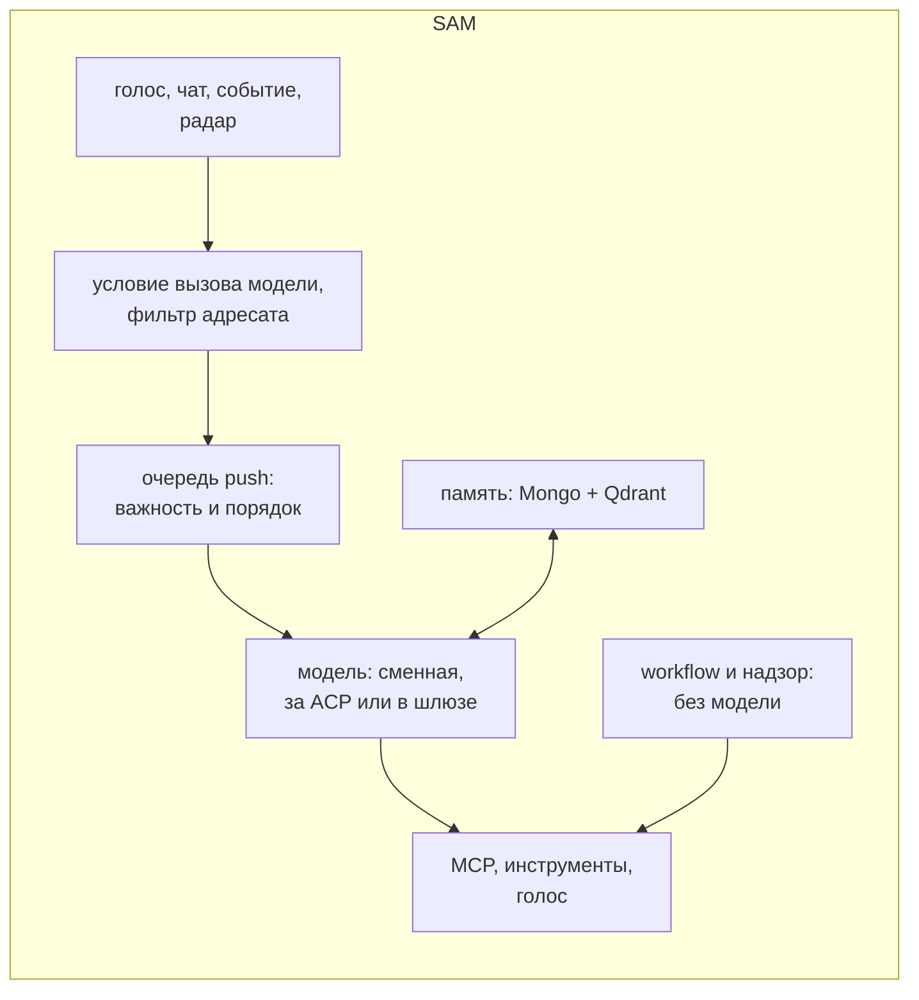

# Зоны мозга

Разбирая, как устроен мозг, я увидел неплохую организацию: у каждой функции своё место и свои связи с другими.
Часть этих идей я заимствую из природы для раскладки модулей SAM и их зависимостей.

`senses` — органы чувств, `voice` — слух и речь, `cortex` — рассуждение, `memory` и `dream` — память и работа в
паузах.

- модель приходит в ход без своей истории, контекст собирает SAM ([ADR-022](adr/022-agent-system-behind-acp.md), п. 5);
- условие вызова, важность и очередь решают, что дойдёт до модели ([ADR-020](adr/020-light-stand-workflows.md));
- проверка, перезапуск и расписание обходятся без вызова модели;
- тяжёлая работа с памятью идёт в паузах ([ADR-015](adr/015-memory-work-in-pauses-auto-write.md)).

Устройство — [structure](architecture/structure.md), решения — [ADR](adr/README.md).
